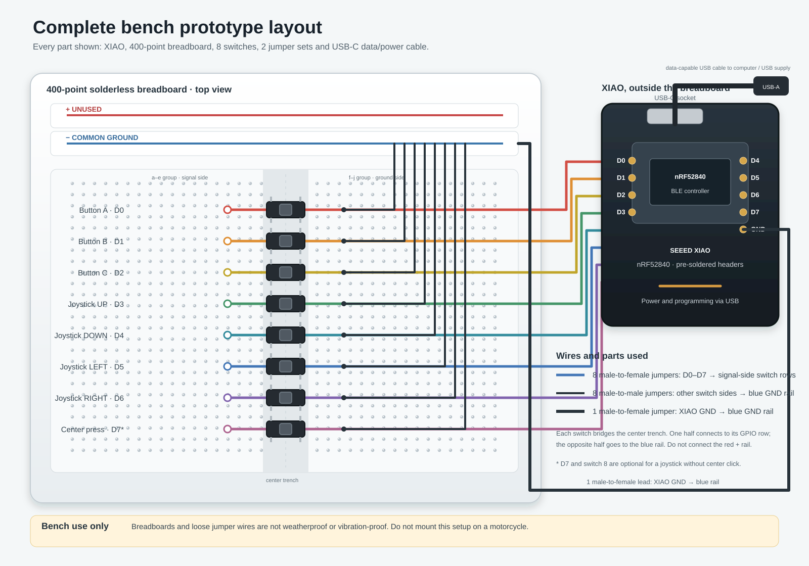

# Montaje en protoboard de la XIAO nRF52840

> Traducción al castellano de [breadboard-assembly.md](breadboard-assembly.md). La versión en inglés es la de referencia; si las dos difieren, vale la inglesa.

**Estado:** instrucciones del prototipo de banco. Este montaje provisional de interruptores es para experimentos de firmware y BLE; no es un mando listo para rodar.

Esta guía usa una Seeed XIAO nRF52840 y siete pulsadores para representar los tres botones y un joystick de cuatro direcciones; la pulsación central son tres direcciones pulsadas a la vez, como en el mando. La XIAO queda fuera de la protoboard y se conecta con cables Dupont. La alimentación y la programación llegan por el conector USB-C de la XIAO.

## Piezas

Las piezas, con tiendas españolas de ejemplo y los precios comprobados el 07-10-2026, están en la [lista de materiales](bom.md#bench-prototype).

## Herramientas

- Soldador y estaño, solo si usas la alternativa de placa sin pines.
- Unos alicates de corte pequeños para cortar tiras de pines, solo con esa alternativa.
- Un cable USB de datos y un ordenador para programar.
- Opcional: un multímetro para identificar qué dos patas de cada interruptor forman cada lado eléctrico.

## Asignación de pines

El firmware debe configurar estos GPIO como entradas con pull-up interno. Cada interruptor une su GPIO a masa al pulsarlo, así que suelto se lee HIGH y pulsado se lee LOW.

| Pin de la XIAO | Interruptor de la protoboard | Función |
|---|---|---|
| D0 | SW1 | Botón A |
| D1 | SW2 | Botón B |
| D2 | SW3 | Botón C |
| D3 | SW4 | Joystick arriba |
| D4 | SW5 | Joystick abajo |
| D5 | SW6 | Joystick izquierda |
| D6 | SW7 | Joystick derecha |
| GND | Raíl azul/negativo | Masa común de los interruptores |

El joystick no tiene interruptor central; el firmware interpreta tres o más direcciones cerradas a la vez como el centro. En la protoboard, pulsa tres o cuatro interruptores de dirección a la vez con un objeto plano, como una regla, o con tres dedos, para hacer ese acorde; así se prueba la misma lógica que en el mando. D7 no se lee. (Hasta el firmware 0.11.0 un octavo interruptor en D7 podía hacer de centro; la 0.11.1 quitó esa opción.) Este circuito de interruptores no necesita conectar ningún raíl de 3,3 V ni de 5 V.

Los pines de la XIAO, vistos desde la cara de componentes con el conector USB-C arriba (según el pinout de Seeed):

```text
            [ USB-C ]
  D0  o                 o  5V
  D1  o                 o  GND
  D2  o                 o  3V3
  D3  o     XIAO        o  D10
  D4  o   nRF52840      o  D9
  D5  o                 o  D8
  D6  o                 o  D7
```

## Esquema de conexiones en la protoboard

Deja la XIAO al lado de la protoboard en vez de forzar la placa pequeña dentro de ella. Cada interruptor queda a caballo sobre el canal central de la protoboard. Un lado eléctrico va a la fila de su GPIO; el otro, al raíl azul de masa. En una protoboard normal, los cinco agujeros de cada lado de una fila numerada están unidos, pero los dos grupos a cada lado del canal central están separados.



```text
XIAO nRF52840 (al lado de la protoboard)
  D0 ───────────────────────────────────────────────────────┐
  D1 ────────────────────────────────────────────────────┐  │
  D2 ─────────────────────────────────────────────────┐  │  │
  D3 ──────────────────────────────────────────────┐  │  │  │
  D4 ───────────────────────────────────────────┐  │  │  │  │
  D5 ────────────────────────────────────────┐  │  │  │  │  │
  D6 ─────────────────────────────────────┐  │  │  │  │  │  │
GND ──────────────────────────────────────┼──┼──┼──┼──┼──┼──┼──── raíl azul (−)

Filas de la protoboard (los interruptores cruzan el canal central):
                       a b c d e  ║  f g h i j
 Botón A / fila D0:    GPIO ──────║───o/ o─────── GND ─── azul (−)
 Botón B / fila D1:    GPIO ──────║───o/ o─────── GND ─── azul (−)
 Botón C / fila D2:    GPIO ──────║───o/ o─────── GND ─── azul (−)
 Joystick ARRIBA / D3: GPIO ──────║───o/ o─────── GND ─── azul (−)
 Joystick ABAJO / D4:  GPIO ──────║───o/ o─────── GND ─── azul (−)
 Joystick IZQ. / D5:   GPIO ──────║───o/ o─────── GND ─── azul (−)
 Joystick DCHA. / D6:  GPIO ──────║───o/ o─────── GND ─── azul (−)
                                     interruptor

USB-C de la XIAO ── cable de datos ── ordenador / alimentación USB
```

El SVG es un esquema de conexiones, no un dibujo a escala del recorrido real de los cables; su octavo interruptor, en D7, ya no se usa. Coloca los siete interruptores en filas numeradas distintas y conecta el lado opuesto de cada interruptor al raíl de masa. Los dos grupos de cinco agujeros de cada fila (a–e y f–j) no están unidos a través del canal central. La disposición de las patas puede variar, así que mira el plano del interruptor o usa el modo de continuidad para identificar las parejas unidas por dentro antes de cablear. Sin multímetro, conecta los cables del GPIO y de masa a patas opuestas en diagonal: nunca están unidas por dentro, gires como gires el interruptor. En los interruptores de 6×6×5 mm usados aquí, las dos patas que se miran a través del canal, en la misma fila numerada, están unidas por dentro; un cable de GPIO y uno de masa en esa misma fila se leen como pulsados todo el tiempo.

### Pasos de cableado

1. **Pon los pines.** Suelda una tira macho de 1×7 en cada borde largo de la XIAO, con los pines hacia abajo. Evita puentes de estaño entre pads vecinos. Si usas una placa con los pines ya soldados, sáltate este paso.
2. **Coloca los interruptores.** Mete los pulsadores cruzando el canal central de la protoboard. Cada interruptor ocupa dos filas numeradas; deja una fila libre entre interruptores. Etiquétalos A, B, C, ARRIBA, ABAJO, IZQUIERDA y DERECHA. Pon los cuatro interruptores de dirección uno al lado del otro, para que un objeto plano pueda pulsar tres o cuatro a la vez.
3. **Conecta la masa.** Usa un cable desde un pin GND de la XIAO hasta el raíl azul/negativo de la protoboard. Si el raíl está partido a la mitad de su longitud, une los dos tramos con otro cable.
4. **Conecta los cables de los GPIO.** Usa siete cables macho-hembra para conectar de D0 a D6 a un lado eléctrico del interruptor correspondiente. Sigue el mapa de pines de arriba.
5. **Lleva a masa el otro lado de cada interruptor.** Usa siete cables macho-macho para conectar el lado eléctrico opuesto de cada interruptor al raíl azul de masa. Conecta el pin GND de la XIAO a ese raíl con otro cable macho-hembra.
6. **Revisa antes de alimentar.** Comprueba que ninguna fila de GPIO está unida por error al raíl rojo. Comprueba que las patas de los interruptores cruzan el canal y que el cable del GPIO y el de masa de cada uno llegan a lados eléctricos opuestos.
7. **Alimenta por USB.** Conecta el puerto USB-C de la XIAO a un ordenador o a una fuente USB con un cable que tenga datos cuando vayas a programar. No metas 5 V en un GPIO, y no conectes una segunda alimentación a la protoboard mientras haya USB.

## Alcance y limitaciones

Este montaje es para una mesa o un banco. Las protoboards sin soldadura, los cables Dupont al aire y los pulsadores pequeños no aguantan vibraciones ni intemperie, ni se usan bien con guantes. No montes ni uses este prototipo en una moto en marcha. El montaje prueba la entrada de los botones y el comportamiento del firmware; no demuestra el mecanismo final del joystick, la caja, la protección de la alimentación USB ni la compatibilidad con apps de Android o iOS.

## Referencias

- [Documentación de la Seeed XIAO nRF52840: pinout, alimentación y detalles de la placa](https://wiki.seeedstudio.com/XIAO_BLE/)
- [Página del producto Seeed XIAO nRF52840](https://www.seeedstudio.com/Seeed-XIAO-BLE-nRF52840-p-5201.html)
- [Kiwi Electronics: la XIAO nRF52840 con pines soldados comprada para este prototipo](https://www.kiwi-electronics.com/en/seeed-studio-xiao-nrf52840-pre-soldered-20402)
- [Reichelt España: XIAO nRF52840 más barata, sin pines](https://www.reichelt.com/es/es/shop/producto/xiao_nrf52840_bt5_0_sin_cabezal-358357)
- [Conectrol: tira de 40 pines macho para la alternativa sin pines](https://conectrol.com/producto/tira-de-pines-macho-40p-2-54mm-1-fila-plano-recto-pcb-2/)
- [Conectrol: protoboard de 400 puntos](https://conectrol.com/producto/placa-protoboard-400-puntos-84x55x85mm/)
- [Conectrol: juego de cables Dupont macho-hembra](https://conectrol.com/producto/kit-cables-dupont-1p-para-protoboard-m-h-40-unds/)
- [Conectrol: juego de cables Dupont macho-macho](https://conectrol.com/producto/kit-cables-dupont-1p-para-protoboard-m-m-65-unds/)
- [Conectrol: pulsador de 6×6×5 mm](https://conectrol.com/producto/pulsador-tactil-off-on-no-6x6x5mm-pcb-rojo/)
- [Conectrol: cable de datos USB-A a USB-C](https://conectrol.com/producto/cable-usb-3-0-tipo-a-usb-tipo-c-3-1-m-m-1mt/)
