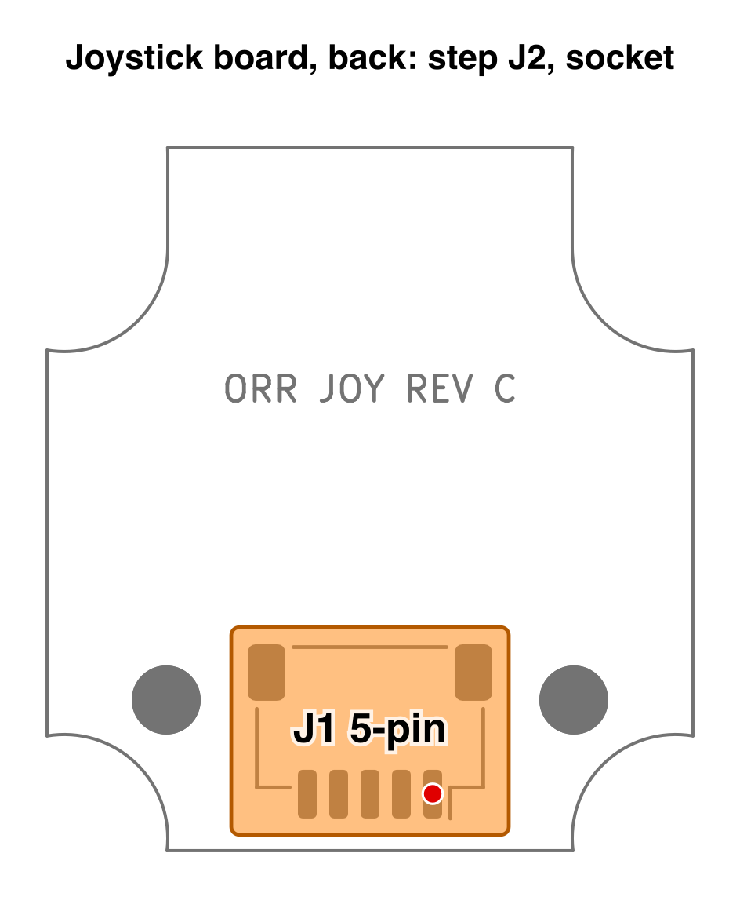
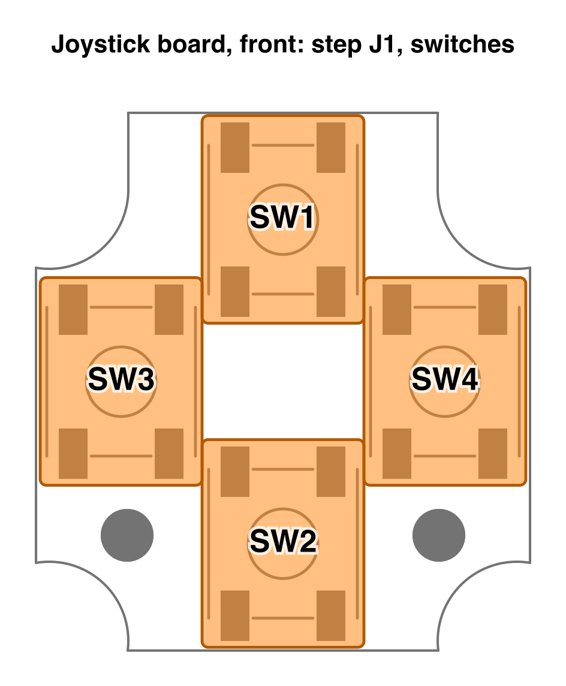
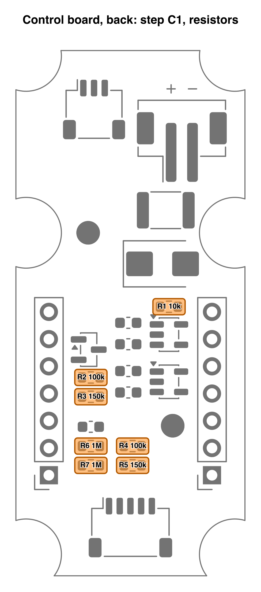
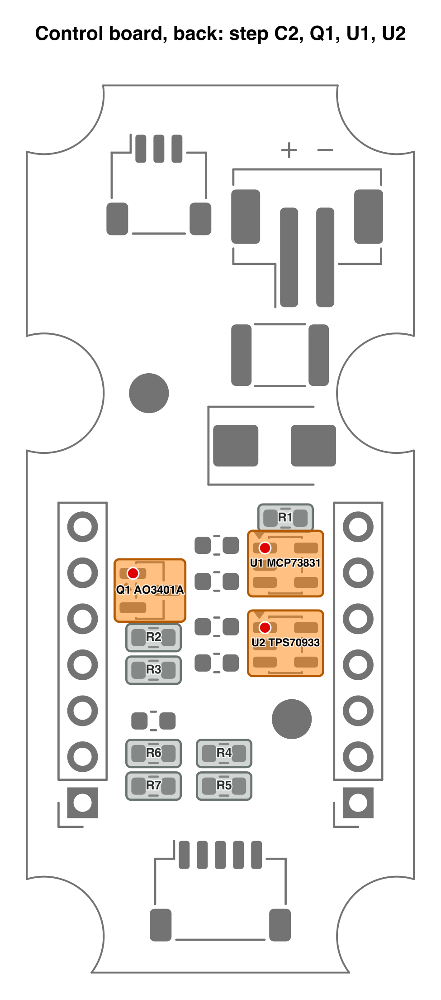
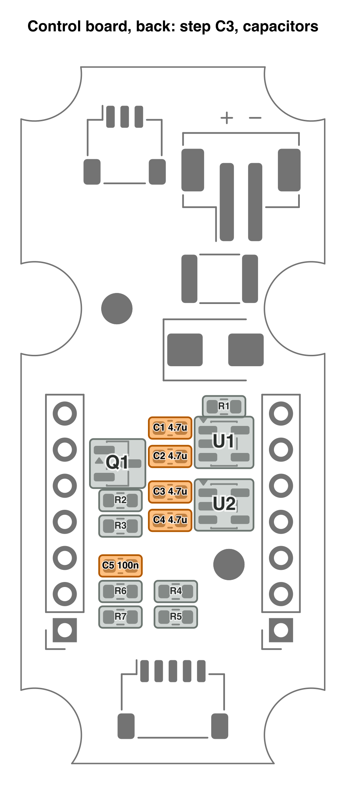
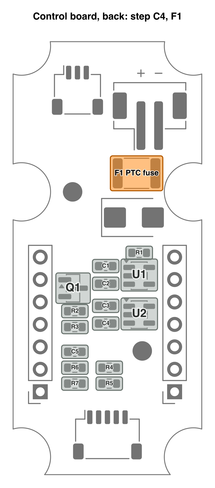
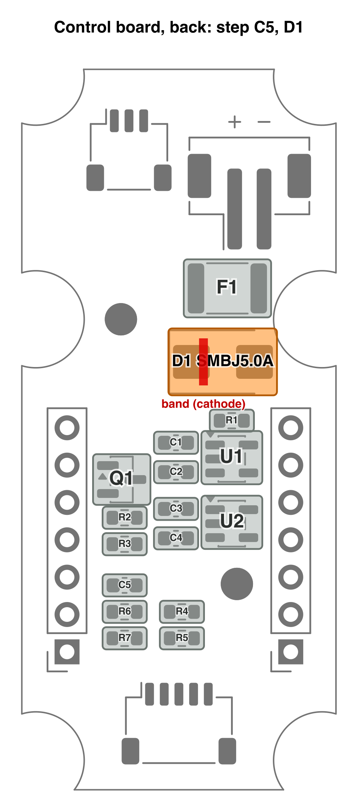
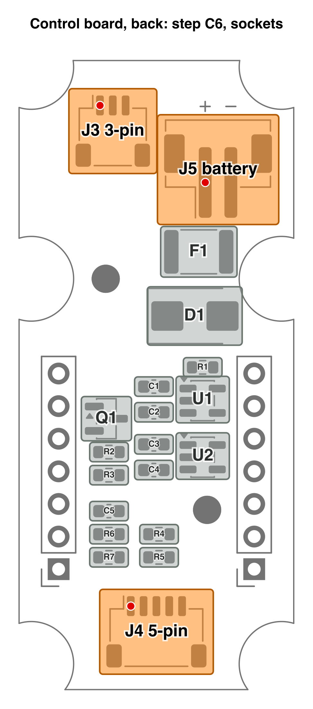
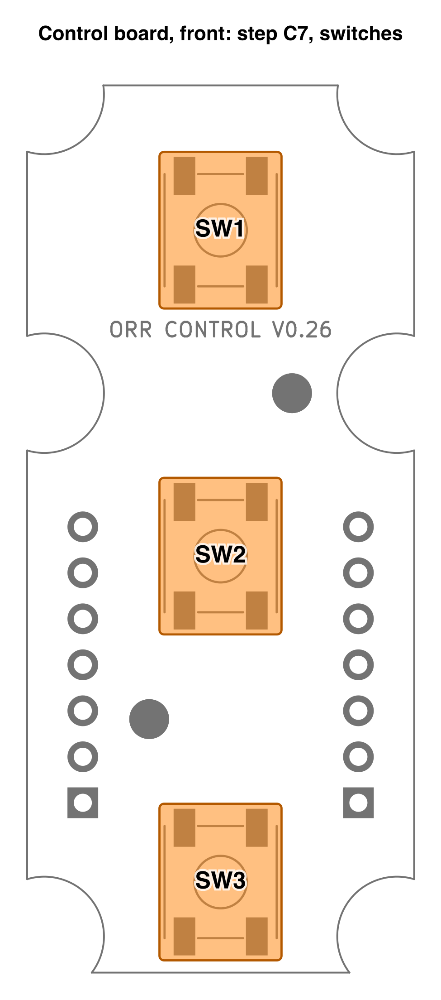

# Montaje de la electrónica con pasta de soldar y aire caliente — V0.32

> Traducción al castellano de [electronics-assembly-hot-air.md](electronics-assembly-hot-air.md). La versión en inglés es la de referencia; si las dos difieren, vale la inglesa. Los textos de las imágenes están en inglés.

Esta guía es una alternativa a la [guía con soldador](electronics-assembly.es.md). Suelda los componentes de montaje superficial con pasta de soldar y una estación de aire caliente, y deja el soldador para los componentes de inserción y los retoques. Las placas, los componentes, el orden de los pasos, las imágenes y las comprobaciones son los mismos; esta guía enlaza con ellos en vez de repetirlos.

**Por qué.** Con soldador, cada pad se calienta a través de la punta. Los pads unidos a los planos de masa (por ejemplo, el pad 2 de C1–C5) pierden ese calor en el cobre, y una punta fina no llega a darles suficiente. El aire caliente calienta toda la zona a la vez, y la pasta fundida atrae cada componente a sus pads.

**Estado.** Esta guía sale de la práctica habitual y de las hojas de datos de los componentes, no de un montaje. Nadie ha montado aún estas placas así. Los ajustes de abajo son puntos de partida. Lo que falta por confirmar está en [Puntos abiertos](#puntos-abiertos). Anota lo que cambie en el primer montaje y corrige esta guía.

## Índice

1. [Antes de empezar](#antes-de-empezar)
2. [Placa del joystick](#placa-joystick)
3. [Placa de control](#placa-control)
4. [Placa USB-C](#placa-usbc)
5. [Cables, pruebas, XIAO y barniz](#resto)
6. [Puntos abiertos](#puntos-abiertos)

## Antes de empezar

Los componentes, las imágenes y cómo leerlas están en la guía con soldador: [Componentes para un mando](electronics-assembly.es.md#componentes-para-un-mando) y [Cómo leer las imágenes](electronics-assembly.es.md#cómo-leer-las-imágenes).

### Herramientas

Todo lo de la [lista de herramientas de la guía con soldador](electronics-assembly.es.md#herramientas), y además:

| Herramienta | Notas |
|---|---|
| Pasta de soldar con plomo, Sn63/Pb37, en jeringa con aguja fina | Funde a 183 °C. La pasta sin plomo (SAC305) funde a unos 217–220 °C y necesita más calor. Un ejemplo es la Chip Quik SMD291AX10: jeringa de 10 cc con unos 35 g, suficiente para muchas placas. Su precio en euros no está confirmado; unos 23–28 € con IVA en distribuidores de la UE es plausible. Hay pastas genéricas más baratas; comprueba que la aleación sea Sn63/Pb37 y que venga en jeringa. |
| Estación de aire caliente con boquilla pequeña | Por ejemplo, una estación con soldador y pistola de aire, del tipo YCD-8582D. Usa una boquilla redonda de unos 5–8 mm. |
| Cinta resistente al calor (Kapton) o papel de aluminio | Para proteger los componentes que no deben recibir aire caliente. |
| Una superficie que aguante el calor | Una baldosa cerámica o una alfombrilla de silicona. No la mesa. |
| Soldador con control de temperatura | Sigue haciendo falta: zócalos de la XIAO, patas de la carcasa del USB-C y puentes. |

**La pasta.**
- Guárdala fresca y tapada. Chip Quik da más de 6 meses sin nevera y más de 12 meses en nevera.
- Si estaba en la nevera, deja que la jeringa cerrada llegue a temperatura ambiente antes de abrirla, o se condensa agua dentro.
- No la remuevas. Saca primero un poco sobre un trozo de cartón, para ver cómo queda un punto.

### Seguridad

Valen las [normas de seguridad de la guía con soldador](electronics-assembly.es.md#seguridad). Además:

- **Plomo.** La pasta es polvo de plomo en flux. Usa guantes de nitrilo al manipularla. Lávate las manos después de cada sesión. No comas ni bebas mientras trabajas. Limpia la mesa con un trapo húmedo, nunca soplando. Mantén la pasta lejos de los niños.
- **Humos.** El aire caliente empuja los humos del flux hacia ti. Trabaja con extracción, o con un ventilador que aleje los humos de ti.
- **Batería LiPo.** Tenla bien lejos de la zona del aire caliente.
- **Aire caliente.** El aire y la boquilla llegan a varios cientos de grados. No apuntes nunca la pistola a una persona, a tu otra mano ni a nada que arda.
- **Apagado.** Deja la pistola en su soporte y que la estación la enfríe. Corta la corriente solo cuando indique que está fría o apagada. Así lo dicen los manuales de estaciones parecidas; no está confirmado para todos los modelos.

### Método con aire caliente

El mismo método sirve para todos los componentes de montaje superficial de esta guía.

1. **Pasta.** Pon un punto pequeño de pasta en cada pad. Intenta que el punto sea más pequeño que el pad. Demasiada pasta hace puentes y bolitas; poca se arregla fácil después con el soldador. Con una jeringa a mano es difícil hacer un punto de menos de unos 0,4 mm, así que en los huecos más finos cuenta con que salgan puentes y quítalos con flux y malla.
2. **Colocar.** Coloca el componente con las pinzas, recto sobre sus pads. La pasta es pegajosa y lo sujeta. No lo aprietes fuerte: la pasta se sale y hace puentes.
3. **Precalentar.** Pon el aire a unos 150 °C, con el caudal más bajo que todavía sople, y la boquilla a unos 3–5 cm. Muévela en círculos sobre la zona durante 30–60 s. Así los planos de masa no roban tanto calor y ningún componente se levanta de un lado.
4. **Refundir.** Pon el aire a unos 300 °C, con el mismo caudal bajo. Acerca la boquilla a unos 1–2 cm y muévela en círculos pequeños sobre el componente.
   - La pasta pasa de gris a brillante, y el componente se asienta y se centra solo.
   - Sigue unos 5 s más y aparta la boquilla.
   - Si no funde nada en unos 30–40 s, sube el aire 20 °C y vuelve a probar. No pases de unos 350 °C.
   - La temperatura que marcas no es la de la placa. No pares nunca la boquilla encima de un componente.
5. **No toques** la placa durante unos 10 s, hasta que el estaño solidifique.
6. **Revisa** con aumento, como en [Después de cada placa](electronics-assembly.es.md#cómo-soldar): puentes, bolitas de estaño, un componente descentrado o levantado de un lado.

**Arreglos.**
- **Puente:** flux y malla con el soldador a unos 330 °C. Con estaño con plomo, el soldador lo funde fácil.
- **Componente descentrado:** ponle flux y vuelve a calentarlo con aire. Suele enderezarse solo.
- **Pad seco:** añade un poco de pasta con la aguja y vuelve a calentar, o tócalo con el soldador y un poco de hilo de estaño.

**Componentes vecinos.**
- El aire caliente vuelve a fundir los componentes ya soldados que están cerca. Se quedan en su sitio por la tensión superficial si el caudal es bajo y nadie toca la placa.
- **Las piezas de plástico** (conectores, interruptores, el receptáculo, el LED) aguantan el calor de refusión solo poco tiempo. Tapa con Kapton o papel de aluminio las que estén cerca y no sean del paso.
- **Nunca** eches aire caliente a la XIAO.

**Limpia** el flux con alcohol isopropílico después de cada paso o de cada placa.

### Orden

El mismo que en la [guía con soldador](electronics-assembly.es.md#orden): primero la placa del joystick, luego la de control, la USB-C la última, después las pruebas, y el barniz al final de todo. En las placas de control y USB-C, las piezas de plástico van después de los componentes pequeños, para que reciban el menor calor posible. La placa del joystick es la excepción: su conector va antes que sus interruptores, porque los interruptores solo admiten 2 refusiones.

## 1. Placa del joystick

La guía con soldador suelda primero los interruptores, para que la placa se apoye en ellos. Con aire caliente va primero el conector: los interruptores KSC2 solo admiten 2 refusiones, y refundir el conector después de ellos gastaría una.

Apoya la placa por los bordes, por ejemplo sobre dos tiras de baldosa, de modo que ningún componente toque nada mientras se refunde.

### Paso J2 primero: conector (cara trasera)

1. Pon un punto de pasta en cada uno de los cinco pads pequeños y en los dos pads grandes de las pestañas.
2. Coloca J1 como en el [paso J2 de la guía con soldador](electronics-assembly.es.md#paso-j2-conector-cara-trasera).
3. Precalienta y refunde. Apunta a los pines y a las pestañas, no a la boca del conector.
4. Mira a lo largo de la fila de pines por si hay puentes. Quítalos con flux y malla.

### Paso J1 después: interruptores (cara delantera)

La colocación es como en el [paso J1 de la guía con soldador](electronics-assembly.es.md#paso-j1).

1. Da la vuelta a la placa sobre los apoyos de los bordes. J1 queda colgando por debajo: no debe tocar nada.
2. Pon un punto de pasta en cada uno de los cuatro pads de SW1–SW4.
3. Coloca los cuatro interruptores rectos respecto a su contorno.
4. Precalienta y refunde cada interruptor por turno. Apunta el aire a los pads que asoman fuera del cuerpo, no a la parte de arriba del interruptor.
5. C&K da el KSC2 como apto para refusión sin plomo, **2 veces como máximo.** Que la pasta funda a 183 °C no limita cuánto se calienta el interruptor: aparta el aire en cuanto la pasta moje.

Si un interruptor cuesta de refundir, suéldalo con el soldador, como en la guía con soldador.

Después haz las [comprobaciones del joystick](electronics-assembly.es.md#comprobaciones-del-joystick).

## 2. Placa de control

Las imágenes y el porqué del orden están en la [guía con soldador](electronics-assembly.es.md#placa-control). Con aire caliente, el alcance de la punta ya no limita el orden, pero el mismo orden sigue sirviendo: primero el bloque central, las piezas de plástico al final.

Deja la placa plana sobre la superficie que aguanta el calor. Sujétala con Kapton por las esquinas, no con Blu-Tack cerca de la zona caliente. Se queda así hasta el paso C6.

### Pasos C1 y C2: resistencias, Q1, U1 y U2 (cara trasera)

 

1. Lee las notas sobre valores, identificación y polaridad en la guía con soldador: [paso C1](electronics-assembly.es.md#paso-c1-resistencias-cara-trasera) y [paso C2](electronics-assembly.es.md#paso-c2-q1-u1-u2-cara-trasera).
2. Pon pasta y coloca un valor cada vez, directamente de su tira: R1, luego R2 y R4, luego R3 y R5, luego R6 y R7.
3. Pon pasta y coloca Q1, U1 y U2. En el lado de tres patas de U1 y U2 los pads están a solo 0,35 mm: haz los puntos más pequeños que puedas, centrados en cada pad.
4. Comprueba con aumento que cada componente está sobre sus pads y que U1, U2 y Q1 están bien orientados.
5. Precalienta todo el bloque y luego refunde componente a componente.
6. Revisa las patas de U1 y U2. Con demasiada pasta es fácil que salga un puente entre patas: quítalo con flux y malla.
7. Limpia y mide como en la [tabla del final del paso C2](electronics-assembly.es.md#paso-c2-q1-u1-u2-cara-trasera).

### Paso C3: condensadores (cara trasera)

- 4,7 µF: C1–C4. 100 nF: C5. Un valor cada vez, directamente de la tira.
- El pad 2 de cada condensador, el derecho en la imagen, está en los planos de masa. Precalienta bien, para que los dos extremos fundan a la vez.
- Los pads derechos de C1–C4 están a unos 0,77 mm de las patas de U1 y U2. Haz los puntos pequeños.
- Revisa el hueco entre el pad izquierdo de C2 y el pad único de Q1, como en el [paso C3 de la guía con soldador](electronics-assembly.es.md#paso-c3-condensadores-cara-trasera).

**Rehacer soldaduras hechas con soldador.** Si alguno se soldó con soldador y la soldadura de un pad de masa está mal, ponle flux y refúndela con aire. Añade un punto mínimo de pasta si al pad le falta estaño. Una soldadura sin plomo solo funde a unos 217 °C o más: calienta hasta que toda la soldadura brille, no solo la pasta nueva. Mezclar pasta con plomo con una soldadura sin plomo es aceptable para esta reparación.

### Pasos C4 y C5: F1 y D1 (cara trasera)

 

- F1, el fusible PTC, no tiene polaridad. Es grande: precaliéntalo más rato.
- D1, el SMBJ5.0A, **tiene polaridad.** Su banda va en el extremo marcado en rojo, como en el [paso C5 de la guía con soldador](electronics-assembly.es.md#paso-c5-d1-cara-trasera). Compruébalo antes de refundir.

### Paso C6: conectores (cara trasera)

J3, J5 y J4, como en el [paso C6 de la guía con soldador](electronics-assembly.es.md#paso-c6). Cada uno entra de una sola manera. El pin 1 de J5 es el `+` de la batería, como indica el `+ −` serigrafiado.

1. Pon pasta en los pines y en los pads de las pestañas de los tres.
2. Coloca J3, J5 y J4.
3. Refunde cada uno por turno. Apunta a los pines y a las pestañas. Mantén el aire lejos de las bocas de los conectores y de la parte de arriba de J5.
4. Con aire caliente, las pestañas de J5 cogen estaño igual que sus pines; con el soldador costaba llegar a ellas.

Después limpia y haz las [comprobaciones antes de los interruptores y los zócalos](electronics-assembly.es.md#comprobaciones-antes-de-los-interruptores-y-los-zócalos).

### Paso C7: interruptores (cara delantera)

1. Da la vuelta a la placa. Apóyala por los bordes, nivelada, de modo que ningún componente de detrás toque nada: un componente que soporta el peso de la placa se mueve o se levanta cuando se refunde por debajo.
2. Pon pasta, coloca y refunde SW1–SW3 como en el [paso J1](#paso-j1). SW1 es la tecla A, SW2 la B y SW3 la C.
3. Los componentes de detrás que quedan bajo los interruptores pueden refundirse. No muevas la placa hasta que se enfríe.
4. El KSC2 admite 2 refusiones como máximo: una aquí y otra para una reparación.

Si un interruptor cuesta de refundir, suéldalo con el soldador, como en el [paso J1 de la guía con soldador](electronics-assembly.es.md#paso-j1).

Después haz la [comprobación del paso C7](electronics-assembly.es.md#paso-c7-interruptores-cara-delantera).

### Paso C8: zócalos de la XIAO (soldador)

Los zócalos son de inserción: suéldalos con el soldador, igual que en el [paso C8 de la guía con soldador](electronics-assembly.es.md#paso-c8-zócalos-de-la-xiao-se-meten-por-detrás-y-se-sueldan-por-delante). No les eches aire caliente, ni a ellos ni a la XIAO.

Después haz las [comprobaciones después de los zócalos](electronics-assembly.es.md#comprobaciones-después-de-los-zócalos).

## 3. Placa USB-C

Las imágenes y los detalles están en la [guía con soldador](electronics-assembly.es.md#placa-usbc). Todos los componentes van en la cara de arriba.

### Pasos U1 y U2: resistencias y conector

1. Pon pasta, coloca y refunde R1, R2 (5,1k) y R3 (1k).
2. Pon pasta, coloca y refunde J2, el conector de 3 pines, como en el [paso C6](#paso-c6).

### Paso U3: receptáculo USB-C

1. Lee las notas de colocación del [paso U3 de la guía con soldador](electronics-assembly.es.md#paso-u3-receptáculo-usb-c). Deja la junta sin poner.
2. Pon pasta en los seis pads de señal. Los huecos entre ellos son de solo unos 0,3 mm: haz los puntos pequeños.
3. Asienta el receptáculo: sus dos tetones entran en los dos agujeros pequeños.
4. Precalienta y refunde los pads de señal desde detrás del receptáculo. Mantén el aire lejos de su boca.
5. Suelda las cuatro patas de la carcasa en sus ranuras metalizadas **con el soldador**, con una punta grande (2.4D o 3C). Están en el plano de masa; ayuda un precalentamiento corto con aire. GCT también da el USB4736 como apto para pasta en las ranuras y refusión (pico de 260 °C, 5 s como máximo), así que pasta en las ranuras y aire caliente es una alternativa.
6. Revisa los pads de señal por si hay puentes. Después haz la prueba de la gota de agua de la guía con soldador.

Si el receptáculo ya está soldado con soldador, pasa al LED.

### Paso U4: LED de carga

Lee antes todo el [paso U4 de la guía con soldador](electronics-assembly.es.md#paso-u4-led-de-carga): la huella que parece invertida, por qué D1 va boca abajo y cómo dar la vuelta al LED sin perderle la pista. Eso no cambia. Con pasta, el soldador ya no tiene que llegar al pad 1, así que no hace falta la prueba de alcance.

1. Tapa con Kapton la boca del receptáculo y J2.
2. Pon en cada pad el punto de pasta más pequeño que puedas. La pasta que sube a la lente la oscurece.
3. Coloca el LED boca abajo, con la lente hacia el borde de la placa, como explica la guía con soldador.
4. **Comprueba la orientación ahora,** con aumento: lente hacia el borde, boca abajo como se explica. Los dos pads se refunden a la vez, así que no se puede hacer la prueba de diodo con el pad 1 aún libre, como en la guía con soldador. Un LED mal puesto obliga a quitarlo.
5. Sujétalo suavemente con las pinzas. Usa el caudal más bajo: el LED casi no pesa y sale volando fácil.
6. Pon el aire más bajo que para el resto, a unos 260 °C, y la boquilla a unos 2–3 cm. Lite-On admite 260 °C de pico, durante unos segundos. Que la pasta funda a 183 °C no limita cuánto se calienta el LED: aparta el aire en cuanto mojen los dos extremos.
7. La pata de la carcasa del receptáculo y sus pads de señal están cerca y pueden refundirse. No golpees la placa hasta que se enfríe.
8. Limpia y pruébalo como en la guía con soldador: la prueba de diodo y la tabla de lecturas. Un LED al revés o muerto se quita con aire caliente y las pinzas. Pon uno nuevo; no reutilices un LED ya soldado.

Después haz las [comprobaciones de la placa USB-C](electronics-assembly.es.md#comprobaciones-de-la-placa-usb-c).

## 4. Cables, pruebas, XIAO y barniz

Estos pasos no dependen de cómo se soldaron las placas. Sigue la guía con soldador:

1. [Cables](electronics-assembly.es.md#cables).
2. [Pruebas de alimentación, sin la XIAO](electronics-assembly.es.md#pruebas-alimentacion).
3. [XIAO, firmware y prueba de funcionamiento](electronics-assembly.es.md#xiao).
4. [Barniz de protección](electronics-assembly.es.md#barniz). Antes, limpia todo el flux de la pasta.

## Puntos abiertos

Cada uno se comprueba en el primer montaje. Anota aquí el resultado.

- **Ajustes.** Las temperaturas del aire, el caudal y los tiempos son puntos de partida de la práctica habitual, no de estas placas ni de una estación concreta.
- **Cantidad de pasta.** Qué tamaño de punto evita puentes en los huecos de 0,35 mm de U1 y U2 y en los de 0,3 mm del USB4736.
- **Piezas de plástico.** El KSC2 es apto para refusión sin plomo, 2 veces como máximo, y GCT da el USB4736 para un pico de 260 °C. Los conectores JST SH y PH son de montaje superficial, pero no se ha comprobado su límite de refusión para esta guía.
- **Segunda cara.** Si los componentes de detrás se quedan en su sitio al refundir los interruptores de delante.
- **Orden del joystick.** El conector primero y luego los interruptores es al revés que en la guía con soldador. No se ha probado si la placa se sostiene bien sobre apoyos en los bordes.
- **Los puntos abiertos de la guía con soldador** que no dependen del soldador: [Puntos abiertos](electronics-assembly.es.md#puntos-abiertos).
