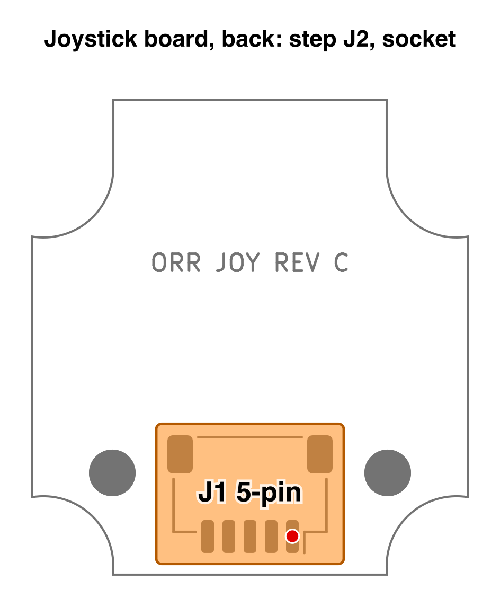
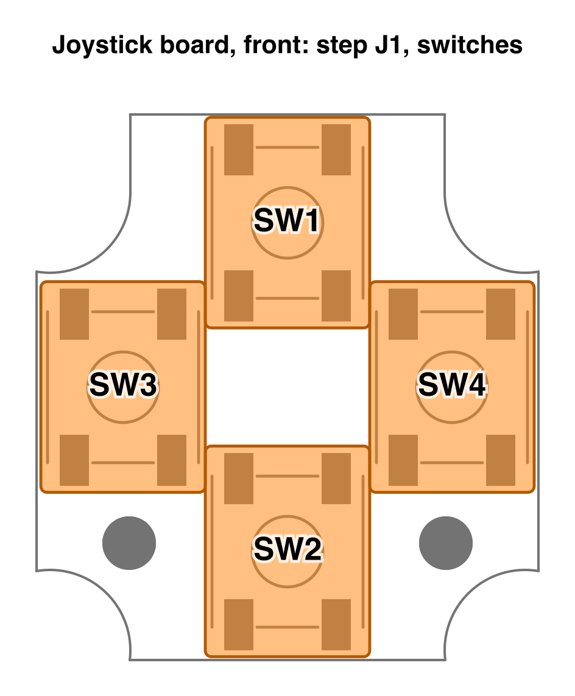
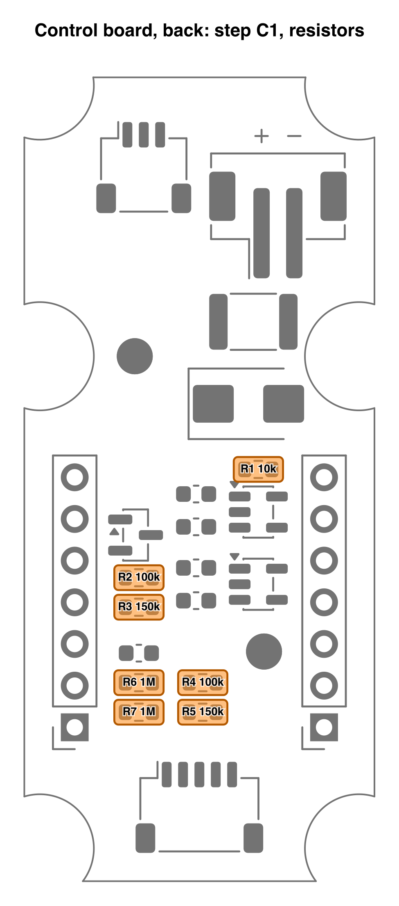
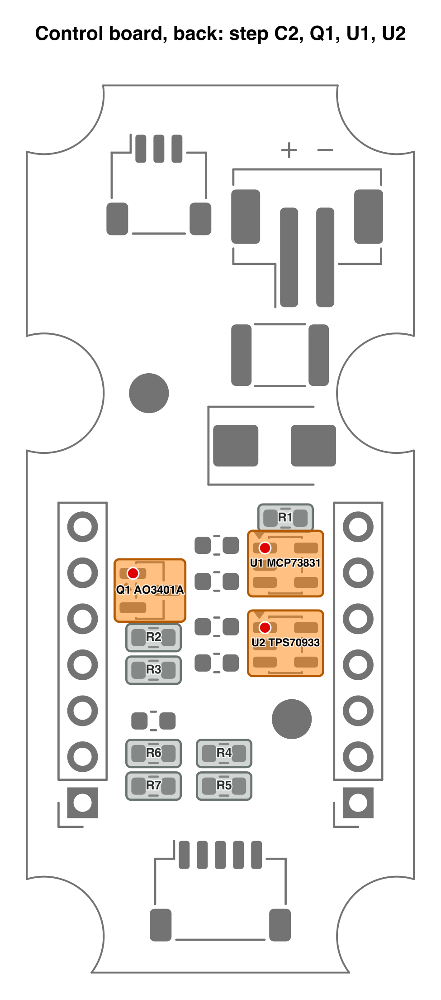
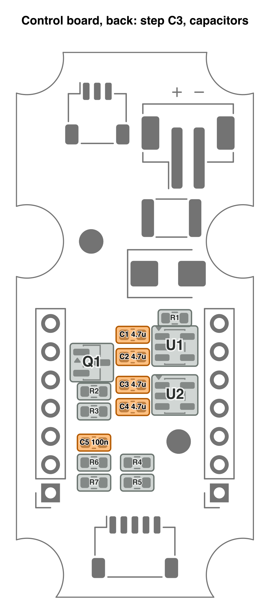
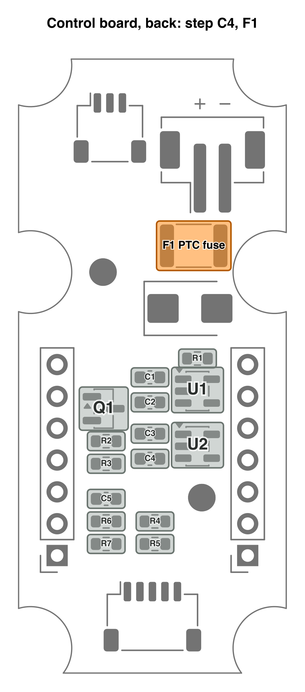
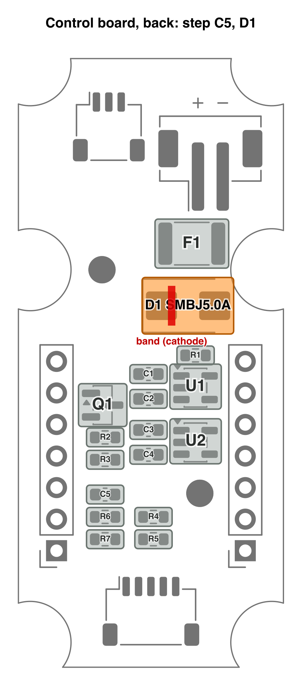
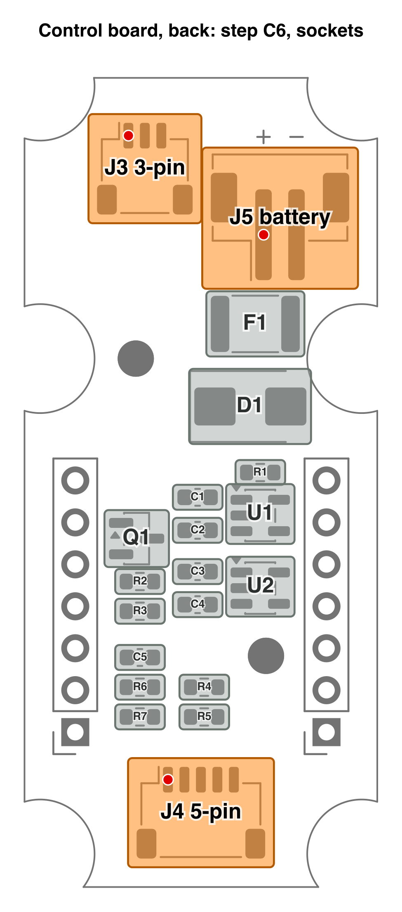
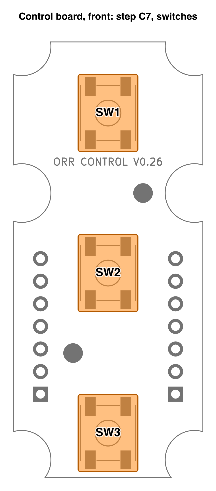

# Electronics Assembly with Solder Paste and Hot Air — V0.32

> Spanish version: [electronics-assembly-hot-air.es.md](electronics-assembly-hot-air.es.md).

This guide is an alternative to the [iron guide](electronics-assembly.md). It solders the surface-mount parts with solder paste and a hot-air station, and keeps the iron for the through-hole parts and for touch-ups. The boards, the parts, the step order, the images and the checks are the same; this guide links to them instead of repeating them.

**Why.** With an iron, each pad has to be heated through the tip. The pads tied to the ground pours (pad 2 of C1–C5, for example) lose that heat into the copper, and a fine tip cannot give enough of it. Hot air heats the whole area at once, and the molten paste pulls each part onto its pads.

**Status.** This guide comes from general practice and the part datasheets, not from a build. Nobody has built these boards this way yet. The settings below are starting points. The points not yet confirmed are listed under [Open points](#open-points). Note what differs on the first build and correct this guide.

## Contents

1. [Before you start](#before-you-start)
2. [Joystick board](#1-joystick-board)
3. [Control board](#2-control-board)
4. [USB-C board](#3-usb-c-board)
5. [Cables, tests, XIAO and coating](#4-cables-tests-xiao-and-coating)
6. [Open points](#open-points)

## Before you start

The parts, the images and how to read them are in the iron guide: [Parts for one remote](electronics-assembly.md#parts-for-one-remote) and [How to read the images](electronics-assembly.md#how-to-read-the-images).

### Tools

Everything in the [iron guide's tool list](electronics-assembly.md#tools), plus:

| Tool | Notes |
|---|---|
| Solder paste, lead-free SAC305 (Sn96.5/Ag3.0/Cu0.5), no-clean, in a syringe with a fine needle | It melts at about 217–221 °C. Examples, from DigiKey Spain on 2026-11-19 with VAT: MG Chemicals 4900P-25G, 25 g, €45.11, out of stock there until March 2027 but also listed on Amazon.es; Chip Quik SMD291SNL10T5, 35 g, €41.84. DigiKey charges €25 shipping on orders under €75. 25 g is enough for many boards. See the notes below on leaded and low-temperature pastes. |
| Hot-air station with a small nozzle | For example a station with an iron and a hot-air gun, such as the YCD-8582D type. Use a round nozzle of about 5–8 mm. |
| Heat-resistant tape (Kapton) or aluminium foil | To shield parts that must not get hot air. |
| A heat-proof surface | A ceramic tile or a silicone mat. Not the table. |
| Soldering iron with temperature control | Still needed: XIAO headers, USB-C shell tabs, and bridges. |

**Why lead-free.**
- In the EU, lead may not be supplied to the general public in mixtures such as solder (REACH Annex XVII, entry 30, since 2018). The rule was read in secondary sources, not in the official text; see [Open points](#open-points).
- Several leaded pastes were no longer available at DigiKey and RS in November 2026.
- Lead-free paste needs more heat. The joints need about 235–250 °C, and the LED and the USB4736 allow 260 °C at the peak, so the margin is small. Leaded Sn63/Pb37 (183 °C) would leave about 35–55 °C, by estimate.
- Do not use low-temperature Sn42/Bi58 paste. It melts at 138 °C, but its joints are brittle under drops and vibration, and the remote rides on a handlebar.

**The paste.**
- Store it as its label says, capped. DigiKey lists 4–10 °C, in the fridge, for the 4900P.
- If it was in the fridge, let the closed syringe reach room temperature before you open it, or water condenses in it.
- Stir nothing. Push out a little onto a scrap of card first, to see how a dot looks.

### Safety

The [iron guide's safety notes](electronics-assembly.md#safety) apply. In addition:

- **Paste.** The paste is metal powder in flux. Wear nitrile gloves when you handle it. Wash your hands after each session. Do not eat or drink while you work. Clean the bench with a damp cloth, never by blowing. Keep the paste away from children.
- **Fumes.** Hot air pushes the flux fumes toward you. Work with extraction, or with a fan that draws the fumes away from you.
- **LiPo cell.** Keep it well away from the hot-air area.
- **Hot air.** The air and the nozzle reach several hundred °C. Never point the gun at a person, at your other hand or at anything that burns.
- **Switching off.** Put the gun in its holder and let the station cool it. Switch the mains off only after it reports cool or off. The manuals of similar stations say so; it was not confirmed for every model.

### Hot-air method

The same method serves every surface-mount part in this guide.

1. **Paste.** Put one small dot of paste on each pad. Aim for a dot smaller than the pad. Too much paste makes bridges and balls; too little is easy to fix with the iron later. A hand syringe rarely makes a dot smaller than about 0.4 mm, so on the finest gaps expect bridges and clear them with flux and braid.
2. **Place.** Place the part with the tweezers, square on its pads. The paste is tacky and holds it. Do not press it down hard: the paste squeezes out and bridges.
3. **Preheat.** Set the air to about 150–180 °C, the lowest airflow that still blows, and hold the nozzle about 3–5 cm away. Move it in circles over the area for 60–90 s. This takes the chill off the ground pours and stops a part from standing up on one end.
4. **Reflow.** Set the air to about 330 °C, same low airflow. Bring the nozzle to about 1–2 cm and keep it moving in small circles over the part.
   - The paste turns from grey to liquid metal, and the part settles and centres itself.
   - Keep heating about 3–5 s more, then lift the nozzle away. Lead-free joints set satin, not mirror-bright.
   - If nothing melts in about 30–40 s, raise the air by 20 °C and try again. Do not go above about 380 °C, and never that high near the LED.
   - The set temperature is not the board's temperature. Never stop the nozzle over a part.
5. **Do not touch** the board for about 10 s, until the solder sets.
6. **Inspect** under magnification, as in [After each board](electronics-assembly.md#soldering-method): bridges, balls of solder, a part off centre or standing on one end. A smooth, satin joint is good; a grainy, lumpy one did not melt fully.

**Fixing.**
- **Bridge:** flux, then braid with the iron at about 350 °C.
- **Part off centre:** flux it and reheat with air. It usually pulls itself straight.
- **Dry pad:** add a little paste with the needle and reheat, or touch it with the iron and a little wire solder.

**Neighbouring parts.**
- Hot air reflows the parts already soldered nearby. They stay in place by surface tension if the airflow is low and nobody touches the board.
- **Plastic parts** (sockets, switches, the receptacle, the LED) take reflow heat for a short time only. Shield any that are near but not part of the step with Kapton tape or foil.
- **Never** blow hot air on the XIAO.

**Clean** the flux off with isopropyl alcohol after each step or each board.

### Order

The same order as the [iron guide](electronics-assembly.md#order): joystick board first, then the control board, the USB-C board last, then the tests, and the coating last of all. On the control and USB-C boards, the plastic parts come after the small parts, so they take the least heat. The joystick board is the exception: its socket goes before its switches, because the switches allow only 2 reflows.

## 1. Joystick board

The iron guide solders the switches first, so the board rests on them. With hot air, the socket goes first instead: the KSC2 switches allow only 2 reflows, and reflowing the socket after them would use one up.

Rest the board on supports at its edges, for example two strips of tile, so no part touches anything while it reflows.

### Step J2 first: socket (back)

1. Put a dot of paste on each of the five small pads and on the two large tab pads.
2. Place J1 as in the [iron guide's step J2](electronics-assembly.md#step-j2-socket-back).
3. Preheat, then reflow. Aim at the pins and the tabs, not at the socket's mouth.
4. Look along the row of pins for bridges. Clear them with flux and braid.

### Step J1 next: switches (front)

The placement is as in the [iron guide's step J1](electronics-assembly.md#step-j1-switches-front).

1. Turn the board over onto the edge supports. J1 now hangs below the board: it must not touch anything.
2. Put a dot of paste on each of the four pads of SW1–SW4.
3. Place the four switches square to their outlines.
4. Preheat, then reflow each switch in turn. Aim the air at the pads that show past the body, not at the top of the switch.
5. C&K rates the KSC2 for lead-free reflow, **at most 2 times.** The air heats the switch as well as the paste: lift the air as soon as the paste wets.

If a switch is hard to reflow, solder it with the iron instead, as in the iron guide.

Then run the [joystick checks](electronics-assembly.md#joystick-checks).

## 2. Control board

The images and the reasons for the order are in the [iron guide](electronics-assembly.md#2-control-board). With hot air, the reach of the tip no longer limits the order, but the same order still works: the central block first, the plastic parts last.

Lay the board flat on the heat-proof surface. Hold it with Kapton tape at the corners, not with Blu-Tack near the heated area. It stays that way up to step C6.

### Step C1 and C2: resistors, Q1, U1 and U2 (back)

 

1. Read the notes on values, identification and polarity in the iron guide: [step C1](electronics-assembly.md#step-c1-resistors-back) and [step C2](electronics-assembly.md#step-c2-q1-u1-u2-back).
2. Paste and place one value at a time, straight from its strip: R1, then R2 and R4, then R3 and R5, then R6 and R7.
3. Paste and place Q1, U1 and U2. On the three-leg side of U1 and U2 the pads are only 0.35 mm apart: use the smallest dots you can make, centred on each pad.
4. Check under magnification that every part sits on its pads and that U1, U2 and Q1 face the right way.
5. Preheat the whole block, then reflow it part by part.
6. Inspect the legs of U1 and U2. A bridge between legs is likely with too much paste: clear it with flux and braid.
7. Clean, then measure as in the [table at the end of step C2](electronics-assembly.md#step-c2-q1-u1-u2-back).

### Step C3: capacitors (back)

- 4.7 µF: C1–C4. 100 nF: C5. Do one value at a time, straight from the strip.
- Pad 2 of each capacitor, the right pad in the image, is on the ground pours. Preheat well, so both ends melt together.
- The right pads of C1–C4 are about 0.77 mm from the legs of U1 and U2. Keep the dots small.
- Check the gap between the left pad of C2 and the single pad of Q1, as in the [iron guide's step C3](electronics-assembly.md#step-c3-capacitors-back).

**Rework of iron joints.** If some of these were soldered with the iron and the joint on a ground pad is poor, flux it and reflow it with air. Add a tiny dot of paste if the pad has too little solder. An iron joint made with lead-free wire melts only at about 217 °C or more: heat until the whole joint melts, not only the new paste. Lead-free paste on a lead-free joint does not mix alloy families.

### Step C4 and C5: F1 and D1 (back)

 

- F1, the PTC fuse, has no polarity. It is large: give it a longer preheat.
- D1, the SMBJ5.0A, is **polarised.** Its band goes at the end marked in red, as in the [iron guide's step C5](electronics-assembly.md#step-c5-d1-back). Check it before you reflow.

### Step C6: sockets (back)

J3, J5 and J4, as in the [iron guide's step C6](electronics-assembly.md#step-c6-sockets-back). Each fits one way only. J5's pin 1 is battery `+`, as the silkscreen `+ −` shows.

1. Paste the pins and the tab pads of all three.
2. Place J3, J5 and J4.
3. Reflow each one in turn. Aim at the pins and the tabs. Keep the air off the socket mouths and off the top of J5.
4. With hot air, J5's tabs take solder as well as its pins; with the iron they were hard to reach.

Then clean and run the [checks before the switches and headers](electronics-assembly.md#checks-before-the-switches-and-headers).

### Step C7: switches (front)

1. Turn the board over. Rest it on supports at its edges, level, so that no back part touches anything: a part that carries the board's weight shifts or lifts when it reflows from below.
2. Paste, place and reflow SW1–SW3 as in [step J1](#step-j1-next-switches-front). SW1 is key A, SW2 key B, SW3 key C.
3. The back parts under the switches may reflow. Do not move the board until it cools.
4. The KSC2 allows at most 2 reflows: one here, one for a repair.

If a switch is hard to reflow, solder it with the iron instead, as in the [iron guide's step J1](electronics-assembly.md#step-j1-switches-front).

Then run the [check after step C7](electronics-assembly.md#step-c7-switches-front).

### Step C8: XIAO headers (iron)

The headers are through-hole: solder them with the iron, exactly as in the [iron guide's step C8](electronics-assembly.md#step-c8-xiao-headers-inserted-from-the-back-soldered-on-the-front). Do not use hot air on them or on the XIAO.

Then run the [checks after the headers](electronics-assembly.md#checks-after-the-headers).

## 3. USB-C board

The images and the details are in the [iron guide](electronics-assembly.md#3-usb-c-board). All the parts are on the top.

### Step U1 and U2: resistors and socket

1. Paste, place and reflow R1, R2 (5.1k) and R3 (1k).
2. Paste, place and reflow J2, the 3-pin socket, as in [step C6](#step-c6-sockets-back).

### Step U3: USB-C receptacle

1. Read the seating notes in the [iron guide's step U3](electronics-assembly.md#step-u3-usb-c-receptacle). Leave the gasket off.
2. Paste the six signal pads. The gaps between them are only about 0.3 mm: keep the dots small.
3. Seat the receptacle: its two posts drop into the two small holes.
4. Preheat, then reflow the signal pads from behind the receptacle. Keep the air off its opening.
5. Solder the four shell tabs in their plated slots **with the iron**, using a large tip (2.4D or 3C). They sit on the ground pour; a quick preheat with air helps. GCT also rates the USB4736 for paste in the slots and reflow (260 °C peak, 5 s at most), so paste in the slots and hot air is an alternative.
6. Inspect the signal pads for bridges. Then do the water drop check from the iron guide.

If the receptacle is already soldered with the iron, go on to the LED.

### Step U4: charge LED

Read the whole [iron guide's step U4](electronics-assembly.md#step-u4-charge-led) first: the suspected mirrored footprint, why D1 goes upside down, and how to turn the LED over without losing track of it. Those parts do not change. With paste, the iron no longer has to reach pad 1, so the reach check is not needed.

1. Shield the receptacle's opening and J2 with Kapton tape.
2. Put the smallest dot of paste you can make on each pad. Paste that climbs onto the lens dims it.
3. Place the LED upside down, lens toward the board edge, as the iron guide describes.
4. **Check the orientation now,** under magnification: lens toward the edge, upside down as described. Both pads reflow at once, so the iron guide's diode test with pad 1 still free is not possible. A wrong LED costs a removal.
5. Hold it lightly with the tweezers. Use the lowest airflow: the LED weighs almost nothing and blows away easily.
6. Set the air about 30 °C lower than for the other parts, to about 300 °C, and keep the nozzle about 2–3 cm away. Lite-On allows 260 °C at the peak, for a few seconds, and the joints need about 235–250 °C: lift the air as soon as both ends wet. If they do not wet in about 20 s, stop, let the board cool and solder the LED with the iron, as in the iron guide.
7. The receptacle's shell tab and signal pads are close and may reflow. Do not bump the board until it cools.
8. Clean, then test it as in the iron guide: the diode test and the table of readings. A reversed or dead LED comes off with hot air and the tweezers. Use a new one; do not reuse a soldered LED.

Then run the [USB-C board checks](electronics-assembly.md#usb-c-board-checks).

## 4. Cables, tests, XIAO and coating

These steps do not depend on how the boards were soldered. Follow the iron guide:

1. [Cables](electronics-assembly.md#4-cables).
2. [Power tests, without the XIAO](electronics-assembly.md#5-power-tests-without-the-xiao).
3. [XIAO, firmware and function test](electronics-assembly.md#6-xiao-firmware-and-function-test).
4. [Conformal coating](electronics-assembly.md#7-conformal-coating). Clean all paste flux off first.

## Open points

Each of these is checked on the first build. Record the result here.

- **Settings.** The air temperatures, airflow and times are starting points from general practice, not from these boards or a given station.
- **Paste amount.** How small a dot avoids bridges on the 0.35 mm gaps of U1 and U2 and the 0.3 mm gaps of the USB4736.
- **Lead-free margin.** The joints need about 235–250 °C; the LED and the USB4736 allow a 260 °C peak. Whether hand-held hot air stays inside that window on these boards.
- **REACH.** The rule on lead in solder for the general public (REACH Annex XVII, entry 30, Appendix 5) was read in secondary sources (the International Lead Association, reachonline.eu, a retailer), not in the official text on EUR-Lex.
- **Plastic parts.** The KSC2 is rated for lead-free reflow, at most 2 times, and GCT rates the USB4736 for a 260 °C peak. The JST SH and PH sockets are surface-mount parts, but their reflow ratings were not checked for this guide.
- **Second side.** Whether the back parts stay in place while the front switches are reflowed.
- **Joystick order.** The socket first, then the switches, is the reverse of the iron guide. Whether the board sits well on edge supports was not tried.
- **The open points of the iron guide** that do not depend on the iron: [Open points](electronics-assembly.md#open-points).
