# Montaje de la electrónica — V0.32

> Traducción al castellano de [electronics-assembly.md](electronics-assembly.md). La versión en inglés es la de referencia; si las dos difieren, vale la inglesa. Los textos de las imágenes están en inglés.

Esta guía lleva las tres placas desnudas del pedido de JLCPCB y los componentes de [`electronics/lcsc-parts.csv`](../electronics/lcsc-parts.csv) hasta tener tres placas soldadas, probadas y barnizadas. Después, el [montaje mecánico](mechanical-concept.es.md#assembly) las coloca en el mando.

Si las placas llegaron montadas, sáltate la soldadura y empieza en [Cables](#cables). Con el montaje Economic de JLCPCB aún hay que soldar los interruptores y los zócalos de la XIAO (pasos J1, C7 y C8) y el receptáculo USB-C (paso U3).

**Estado.** Esta guía sale de los ficheros de diseño, no de un montaje real. Nadie ha montado todavía estas placas. Lo que aún no se ha comprobado con piezas reales está en [Puntos abiertos](#puntos-abiertos). Apunta lo que salga distinto en el primer montaje y corrige la guía.

## Índice

1. [Antes de empezar](#antes-de-empezar)
2. [Placa del joystick](#placa-joystick) (placa de práctica)
3. [Placa de control](#placa-control)
4. [Placa USB-C](#placa-usbc)
5. [Cables](#cables)
6. [Pruebas de alimentación, sin la XIAO](#pruebas-alimentacion)
7. [XIAO, firmware y prueba de funcionamiento](#xiao)
8. [Barniz de protección](#barniz)
9. [Puntos abiertos](#puntos-abiertos)

<a id="antes-de-empezar"></a>
## Antes de empezar

### Componentes para un mando

| Placa | Componentes | Cantidad |
|---|---|---:|
| Joystick rev C | Interruptor KSC221JLFS (SW1–SW4); conector de 5 pines, paso 1,0 mm, entrada lateral (J1) | 5 |
| Control | Interruptor KSC221JLFS (SW1–SW3); MCP73831 (U1); TPS70933 (U2); AO3401A (Q1); resistencias 0603 de 10k (R1), 100k (R2, R4), 150k (R3, R5), 1M (R6, R7); condensadores 0603 de 4,7 µF (C1–C4) y 100 nF (C5); fusible PTC 1812 (F1); SMBJ5.0A (D1); conectores de 3 y 5 pines, paso 1,0 mm, entrada lateral (J3, J4); conector JST PH de 2 pines, entrada por arriba (J5); dos zócalos hembra 1 × 7, paso 2,54 mm, 5,7 mm de alto (J1, J2) | 28 |
| USB-C rev B | 5,1k 0603 (R1, R2); 1k 0603 (R3); LED rojo de vista lateral LTST-S270KRKT (D1); conector de 3 pines, paso 1,0 mm, entrada lateral (J2); receptáculo GCT USB4736-GF-A (J1; su junta se pone después) | 6 |
| Fuera de las placas | XIAO nRF52840 con pines; batería LiPo con cable JST PH; cables JST SH de 3 y 5 pines | |

Los números de LCSC están en el CSV y en el `fab/*-bom.csv` de cada placa. Los componentes pequeños vienen en tiras de cinta. Deja cada pieza en su tira hasta colocarla. Los condensadores 0603 no llevan ninguna marca, y las resistencias 0603 puede que tampoco. Una pieza suelta de valor desconocido no se puede identificar: tírala.

### Herramientas

| Herramienta | Notas |
|---|---|
| Soldador con control de temperatura | Punta cónica fina o de cincel de 1–1,5 mm. Unos 330 °C con estaño con plomo y 360 °C sin plomo. Los planos de masa y las patas de la carcasa del USB-C necesitan una punta más caliente o más grande. El LED de carga tiene un límite más bajo: mira el [paso U4](#paso-u4-led-de-carga). |
| Flux sin limpieza (jeringa), estaño de 0,5 mm con alma de flux, malla desoldadora de 2 mm | El estaño de 0,8 mm es demasiado grueso para los 0603 y los conectores de paso 1 mm. |
| Pinzas finas, no magnéticas | **Imprescindibles.** Sin ellas no se pueden colocar los 0603. |
| Lupa o cámara del móvil en modo macro | Para revisar cada soldadura. |
| Alcohol isopropílico y un cepillo de dientes viejo | Para quitar el flux. |
| Multímetro | Continuidad, resistencia, voltios en continua y modo diodo. |
| Un cable Dupont macho (del kit del banco) | Metido en un zócalo, da a la punta del multímetro algo que tocar. |
| Una aguja de coser | Para tocar los contactos de los cables JST SH a través de la carcasa. |
| Cinta de pintor, Blu-Tack o un soporte de PCB | Para sujetar la placa mientras sueldas. |

### Seguridad

- Suelda en un sitio ventilado: los humos del flux irritan.
- Ponte gafas cuando cortes patas o retires estaño con la malla.
- Lávate las manos después de soldar, sobre todo si usas estaño con plomo.
- Batería LiPo: no cortocircuites sus cables, no la perfores y no la dobles. Conéctala solo cuando un paso lo diga.
- Aplica el barniz al aire libre o con extracción, lejos de llamas.

### Cómo leer las imágenes

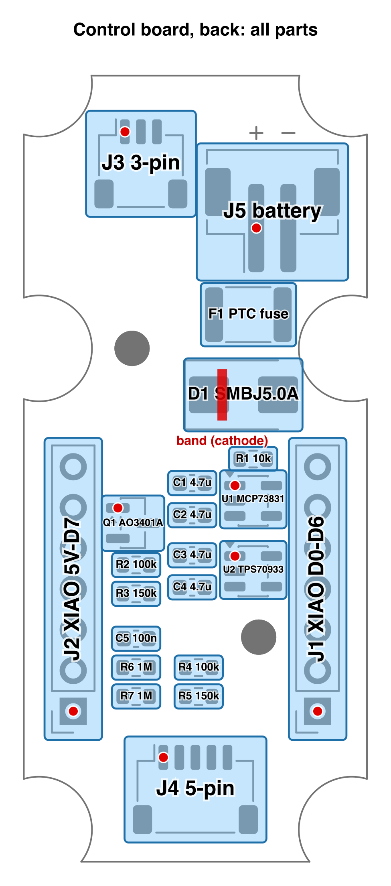

- **Naranja:** las piezas del paso actual, con su referencia y su valor.
- **Gris:** las piezas ya soldadas.
- **Punto rojo:** el pin 1 de una pieza con polaridad o de un conector.
- **Cara trasera en espejo.** Las imágenes de la cara trasera están dibujadas como la ves al darle la vuelta a la placa. El texto del dibujo no sale en espejo.
- **Serigrafía.** La placa real lleva contornos, marcas de pin 1 y el `+ −` junto a J5, pero **no lleva las referencias** (R1, C2…). Estas imágenes son el único mapa de qué va dónde: imprímelas o tenlas abiertas al lado.

Las placas desnudas son así; el texto impreso permite distinguir las caras.

| Control, trasera | Control, delantera ("ORR CONTROL V0.26") | Joystick, trasera ("ORR JOY REV C") | Joystick, delantera | USB-C, cara superior |
|---|---|---|---|---|
| 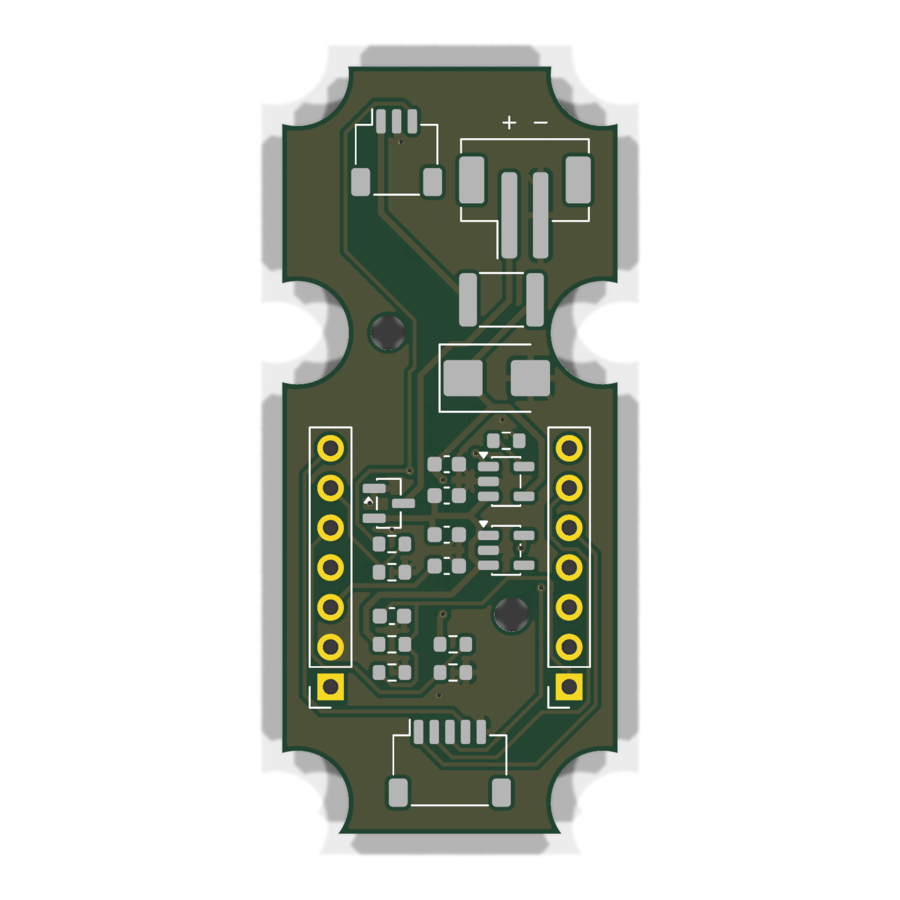 | 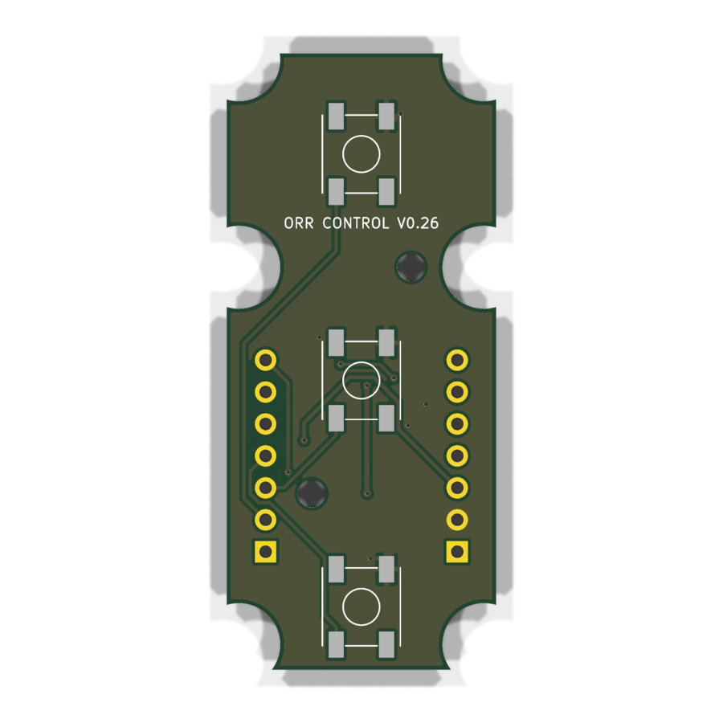 | 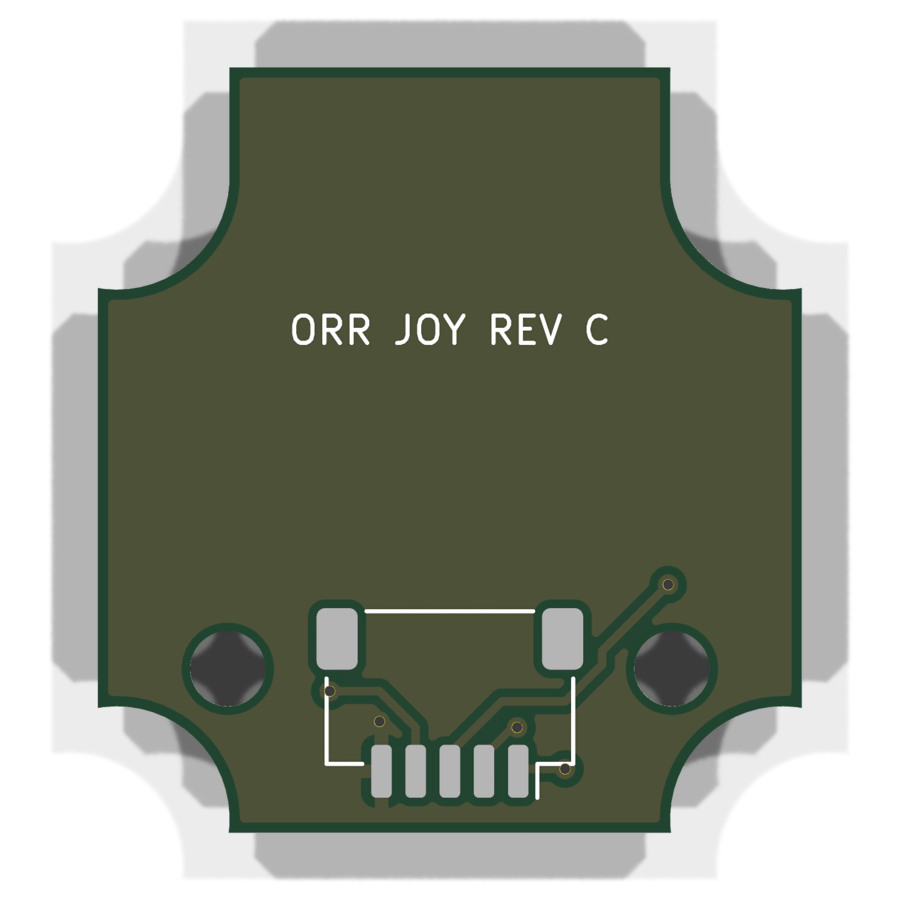 | 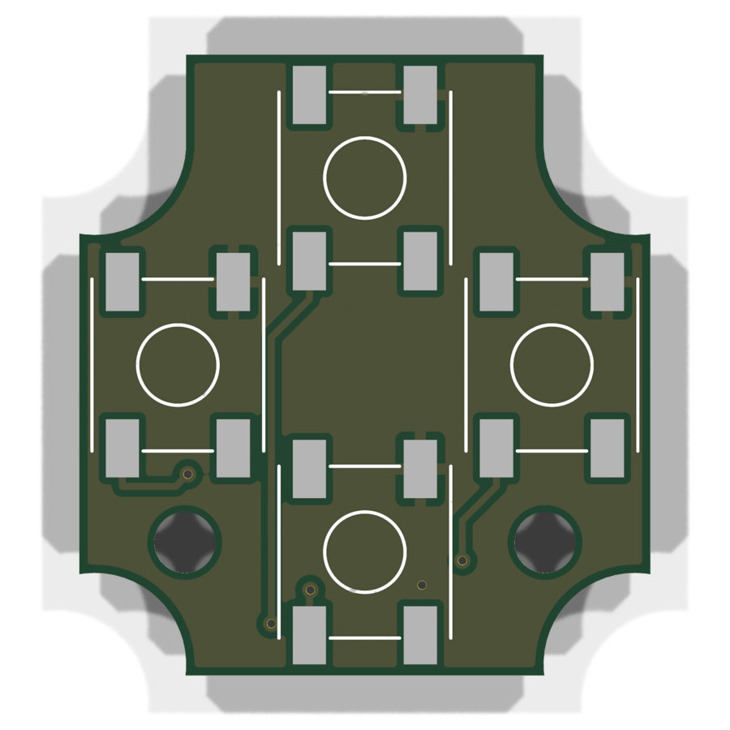 | 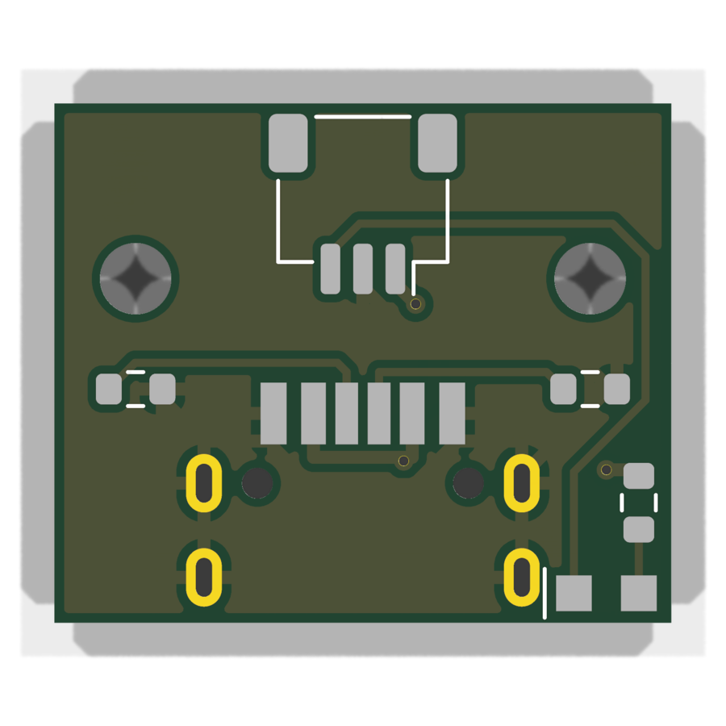 |

### Cómo soldar

- **Piezas de dos pads (0603, 1812, SMB).**
  1. Pon flux en los dos pads.
  2. Pon una gota pequeña de estaño en un pad.
  3. Sujeta la pieza plana con las pinzas, calienta la gota y desliza la pieza dentro.
  4. Suelta cuando el estaño solidifique.
  5. Comprueba que la pieza queda recta y plana.
  6. Suelda el otro pad.
  7. Repasa el primero con un poco de flux.
- **SOT-23 y SOT-23-5.** Estaña un pad de una esquina, fija la pieza en ese pad, comprueba que todas sus patas caen sobre sus pads y suelda el resto.
- **Conectores de paso 1,0 mm.**
  1. Fija primero una de las dos pestañas grandes de sujeción.
  2. Comprueba que los pines coinciden con sus pads.
  3. Suelda la otra pestaña y luego los pines, con mucho flux.
  4. Los puentes entre pines se quitan con la malla.
- **Zócalos de agujero pasante.** Calienta a la vez el pin y el pad durante 2–3 s y aporta el estaño a la unión, no a la punta. Una buena soldadura es un cono brillante.
- **Después de cada placa.**
  1. Frota el flux con alcohol isopropílico.
  2. Deja secar la placa.
  3. Revisa cada soldadura con aumento: puentes, bolitas de estaño, soldaduras mates o agrietadas y patas levantadas.

### Orden

1. **Primero la placa del joystick.** Sus piezas son las más grandes, y su conector sirve de práctica para el paso de 1 mm.
2. **Después la placa de control.** Primero la cara trasera: las resistencias, luego Q1, U1 y U2, y después las demás piezas, en general de la más baja a la más alta. Luego los interruptores, y al final los zócalos de la XIAO. El motivo está en [su sección](#placa-control).
3. **La placa USB-C la última.** Su receptáculo y su LED son las piezas más difíciles.
4. **Pruebas.** Luego los cables y las pruebas.
5. **El barniz al final.** Barniza solo cuando todo funcione: retocar a través del barniz es más difícil.

<a id="placa-joystick"></a>
## 1. Placa del joystick

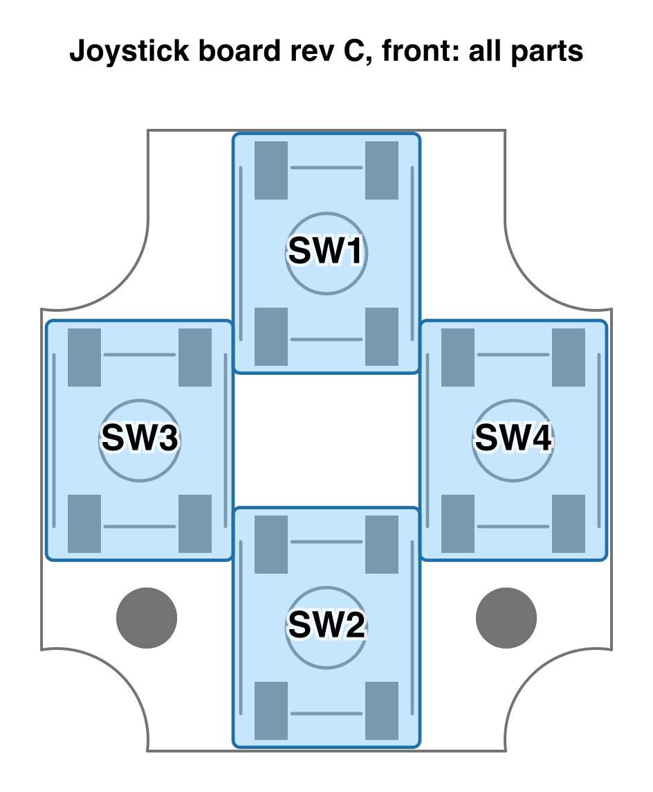

<a id="paso-j1"></a>
### Paso J1: interruptores (cara delantera)

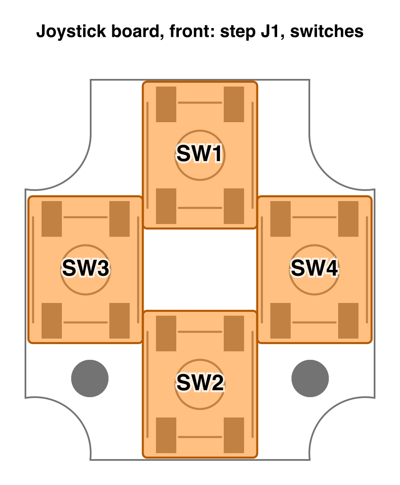

- **Coloca SW1–SW4, los interruptores KSC221JLFS**, en la cara delantera, con el cuerpo alineado con el contorno de la serigrafía. Cada interruptor tiene cuatro patas en J. La placa usa dos pads en diagonal; los otros dos solo lo sujetan. Por eso funciona en cualquiera de sus cuatro giros.
- **Patas en J.** Quedan casi debajo del cuerpo; de cada pad asoma alrededor de 1 mm.
- **Cómo soldarlos:**
  1. Pon flux en los cuatro pads.
  2. Estaña un pad un poco.
  3. Aprieta el interruptor contra la placa y calienta el extremo libre de ese pad hasta que la pata se asiente.
  4. Suelda los otros tres igual. Calienta el pad, no el cuerpo del interruptor: es de plástico sellado.

### Paso J2: conector (cara trasera)

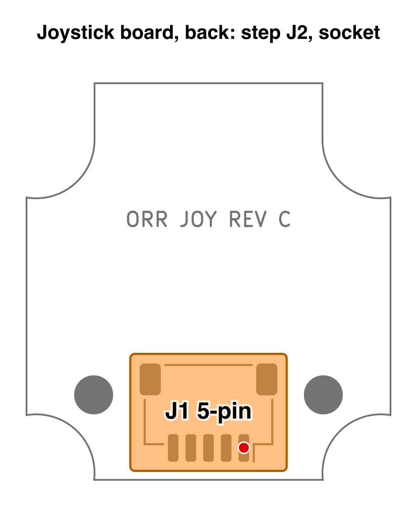

1. Dale la vuelta a la placa: se apoya estable sobre sus cuatro interruptores.
2. Coloca J1, el conector de 5 pines. Solo entra de una forma: sus cinco pines sobre la fila de cinco pads pequeños, y sus dos pestañas sobre los pads grandes.
3. Fija una pestaña, comprueba los pines y suelda la segunda pestaña y los cinco pines.

### Comprobaciones del joystick

Mide en J1 por el lado de los pines, sobre los pads. El pin 1 es el punto rojo; el pin 5 es GND.

- Sin pulsar nada: ningún pin tiene continuidad con el pin 5.
- Pulsando cada interruptor pita con el pin 5: el pin 1 (SW1, UP), el pin 2 (SW2, DOWN), el pin 3 (SW3, LEFT) y el pin 4 (SW4, RIGHT).
- Ningún par de pines pita entre sí.

<a id="placa-control"></a>
## 2. Placa de control

 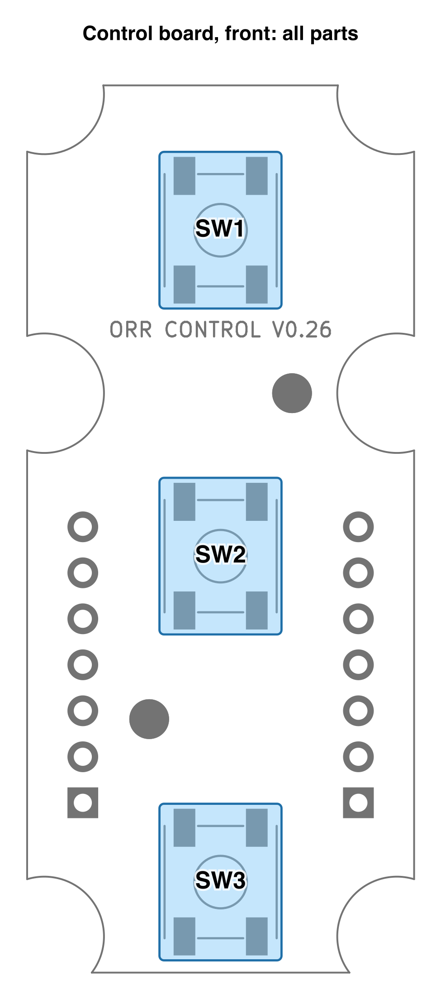

**Por qué este orden.** En general, las piezas más bajas van primero y las más altas al final, para que el soldador siga llegando a cada pad. Q1, U1 y U2 son la excepción: van antes que los condensadores, que son más bajos, porque el lado de U1 y U2 con tres patas da a C1–C4. Un modelo 3D de la punta, comprobado con una revisión independiente, dio el orden de abajo. No se ha probado en una placa real.

| Pieza | Altura | Por qué va ahí |
|---|---|---|
| R1–R7 | Unos 0,55 mm | U1 y D1 estorban a R1; Q1 estorba a R2 |
| Q1, U1, U2 | Unos 1,25 y 1,45 mm | Sin C1–C4, una punta de 2 mm junto a los pads de tres patas tiene unas 2–7 veces más posiciones libres en el modelo, y una de 1,2 mm unas 1,5 veces. D1 estorba a U1 |
| C1–C5 | Unos 0,8 mm | Con Q1, U1 y U2 puestos, los pads derechos de C1–C4 pierden sitio: un 16–19 % en un modelo simple, un tercio o más contando las piezas vecinas. Una punta de 2 mm no tiene ahí una posición libre en ninguno de los dos órdenes. Por eso se empieza por el pad izquierdo |
| F1 | 0,85 mm | D1 y J5 le estorban |
| D1 | 2,6 mm | Va después de las piezas que tiene alrededor |
| J3, J5, J4 | 2,72, 6,6 y 2,72 mm | J3 va antes que J5, para tener sitio con las pinzas |
| SW1–SW3 | 3,5 mm | Van después de las piezas de atrás, para que la placa quede plana mientras sueldas todas esas |
| J1, J2 | 5,7 mm | Al final: estorban al bloque central más que ninguna otra pieza |

El orden ayuda a que el soldador llegue a los pads. No evita los puentes. En el bloque central, piezas de redes distintas quedan a 0,77–0,85 mm, y los pads de U1 y U2 a solo 0,35 mm.

### Paso C1: resistencias (cara trasera)

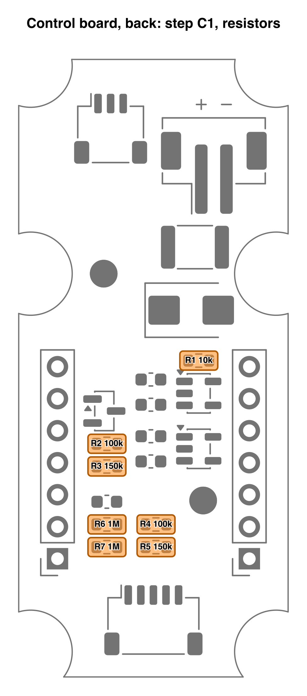

Pon la placa plana sobre la mesa y sujétala con Blu-Tack. Sigue así hasta el paso C6.

- Suelda un valor cada vez, directamente desde su tira:
  - 10k: R1.
  - 100k: R2 y R4.
  - 150k: R3 y R5.
  - 1M: R6 y R7.
- Las resistencias no tienen polaridad.
- Intercambiar R2 con R3, o R4 con R5, invierte un divisor y mete demasiada tensión en un pin de la XIAO. Comprueba el valor antes de colocar cada una.

### Paso C2: Q1, U1, U2 (cara trasera)

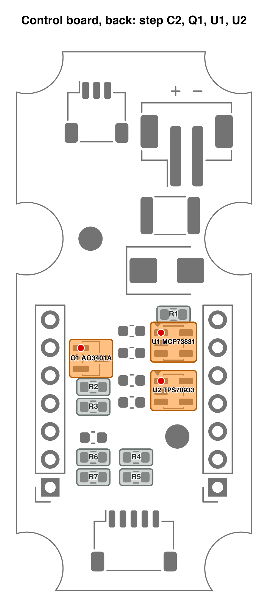

- **Identifícalos.** U1 es el MCP73831 (lleva una marca, a menudo un código corto) y U2 es el TPS70933. Los dos son SOT-23-5 y se parecen: no los saques de su tira hasta colocarlos. Q1 es el AO3401A, en SOT-23.
- **Polaridad.** Estos encapsulados solo entran de una forma: el lado con más patas va sobre la fila con más pads. El pin 1 (punto rojo) coincide con el punto o triángulo de la serigrafía.
- **Sujétalos desde arriba.** R1 y R2 dejan menos de 1 mm junto a U1 y Q1 para las pinzas.

Suelda en este orden, con la placa vista como en la imagen:

1. **Q1.** Estaña el pad de abajo a la izquierda (pad 2) y fija Q1 en él. Comprueba todas las patas. Luego suelda el pad de arriba a la izquierda (pad 1) y el pad suelto.
2. **U1.**
   1. Antes de colocarlo, estaña los tres pads de su lado izquierdo (pads 1, 2 y 3). Deja una capa fina y plana, no una gota. Aplana una gota con la malla.
   2. Estaña el pad de abajo a la derecha (pad 4) y fija U1 en él. No empieces por el de arriba a la derecha (pad 5): está cerca de R1.
   3. Aprieta U1 contra la placa mientras recalientas el pad 4. Comprueba todas las patas.
   4. Suelda el pad 5.
   5. Suelda las tres patas de la izquierda como se explica abajo.
3. **U2.** Igual. Su pad 4 no tiene conexión, así que un error ahí es el que menos cuesta.

**Las tres patas de la izquierda de U1 y U2.** Son las soldaduras más difíciles de la placa, y sus pads están a 0,35 mm.

1. Pon flux en las tres patas.
2. Entra desde la izquierda, por encima de los pads vacíos de los condensadores, a unos 40° de la placa. Más plana, la punta o su cono tocan Q1, R2 o R3. No apoyes la punta en el encapsulado.
3. Toca el extremo exterior de los pads con muy poco estaño. El estaño de 0,5 mm ayuda aquí.
4. Quita cualquier puente con flux y malla, también desde la izquierda.

Una punta de más de unos 1,2 mm también toca el pad de al lado. Incluso con 1,2 mm solo quedan 0,05 mm, y solo si está centrada. Cuenta con que saldrán puentes con cualquier punta, y quítalos con la malla.

**Comprueba** que las patas quedan centradas en sus pads y que ninguna hace puente con la siguiente.

Limpia el flux y mide ahora. Retocar es más fácil antes de poner los condensadores, y las lecturas se estabilizan enseguida. Sin la XIAO y sin la batería. GND es el agujero vacío de J2 pin 2, y la izquierda es la de la imagen.

| Punta roja | Punta negra | Esperado | Fallo |
|---|---|---|---|
| Extremo izquierdo de R2 (STAT) | GND | Unos 130–250 kΩ | Cerca de 0: puente de la pata 1 a la 2 de U1. Unos 10 kΩ: puente de la pata 1 de U1 al extremo izquierdo de R1 |
| Extremo izquierdo de R6 (BAT_SYS) | GND | Unos 0,4–2 MΩ | Cerca de 0: puente de la pata 2 a la 3 de U1, de la pata 2 a la 1 o la 3 de U2, o del pad 1 al 2 de Q1. Unos 220 kΩ: puente del pad 2 de Q1 al extremo izquierdo de R2 |
| Extremo izquierdo de R1 (PROG) | GND | Unos 10 kΩ | Cerca de 0: puente del pad 5 de U1 al extremo derecho de R1 |

Estas lecturas son estimaciones, porque el multímetro también ve U1 y U2. El resultado depende de la tensión de prueba del multímetro.

### Paso C3: condensadores (cara trasera)

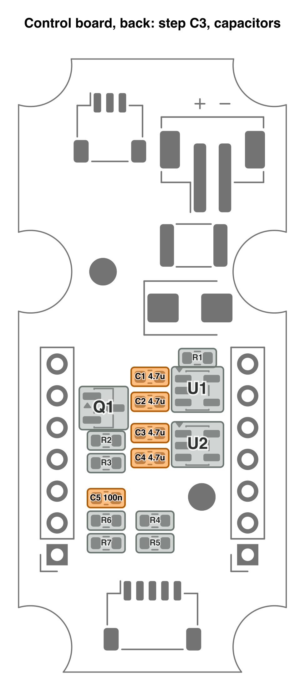

- 4,7 µF: C1–C4.
- 100 nF: C5.
- No tienen polaridad. Los dos valores parecen iguales: haz un valor cada vez.
- **C1–C4: empieza por el pad izquierdo.** Pon la gota de estaño en el pad izquierdo y luego suelda el pad derecho con muy poco estaño. El pad derecho queda a unos 0,77 mm de las patas de U1 o U2.
- **Pad izquierdo de C2.** Queda a 0,8 mm del pad suelto de Q1. Revisa ese hueco con aumento. Un puente ahí anula la protección contra la batería invertida.

### Paso C4: F1 (cara trasera)

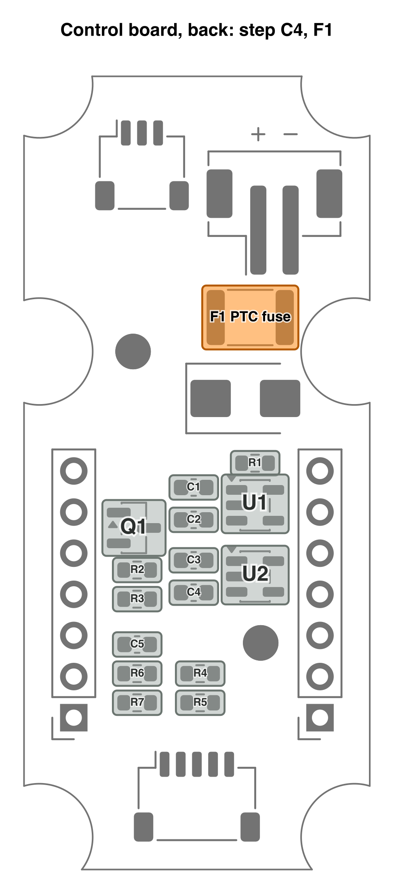

F1 es el fusible PTC. No tiene polaridad. Es grande: da tiempo a que el estaño moje cada pad.

### Paso C5: D1 (cara trasera)

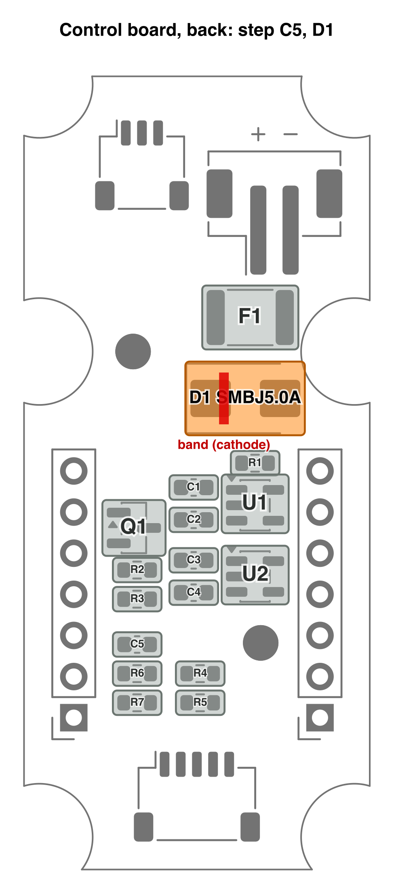

D1, el SMBJ5.0A, **tiene polaridad.**
- Su cuerpo lleva una banda en un extremo. La banda (cátodo) va en el extremo marcado en rojo: el izquierdo, mirando la cara trasera como en la imagen.
- Al revés, D1 cortocircuita la entrada de 5 V y F1 salta en cuanto conectas un cargador.

### Paso C6: conectores (cara trasera)

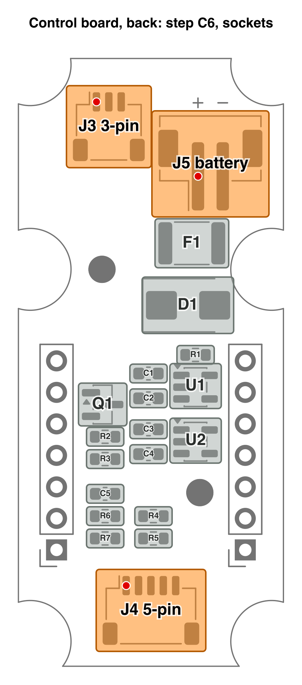

Cada conector entra de una sola forma, con los pines sobre la fila de pads pequeños. Suéldalos en este orden:

1. **J3:** 3 pines, placa USB-C. Su pestaña junto a J5 solo está libre ahora, así que suelda las dos pestañas y los pines.
2. **J5:** JST PH de 2 pines, entrada por arriba, batería. Su pin 1 es el `+` de la batería, como indica el `+ −` de la serigrafía.
   1. Estaña poco los dos pads grandes de las pestañas antes de colocar J5.
   2. Suelda primero los dos pines. Esto sustituye al "fija primero una pestaña" del [método de soldadura](#cómo-soldar).
   3. Recalienta cada pad de pestaña por donde asoma del cuerpo. Solo asoman unos 0,2 mm, y a la pestaña junto a J3 cuesta llegar.
   4. Las pestañas no llevan señal. Si una no agarra, el circuito funciona igual, pero J5 queda más débil: no tires del cable de la batería.
3. **J4:** 5 pines, joystick.

### Comprobaciones antes de los interruptores y los zócalos

Hazlas ahora. Con J1 y J2 puestos, retocar Q1, U1 y U2 es difícil, porque las paredes de los zócalos quedan a 0,7–0,9 mm.

Antes limpia y revisa la placa, como en [Después de cada placa](#cómo-soldar). Mide sin la XIAO y sin la batería, en el rango de resistencia salvo que la fila diga otra cosa. Aquí J1 y J2 son sus agujeros metalizados vacíos, numerados como en la [imagen de los puntos de medida](#puntos-de-medida). GND es J2 pin 2. Izquierda y derecha son las de las imágenes de la cara trasera.

| Punta roja | Punta negra | Esperado | Si no |
|---|---|---|---|
| Extremo de C2 junto a Q1 (BAT_SYS) | GND | Lejos de 0 Ω; sube mientras cargan los condensadores | Puente junto a C1–C4, U1, U2 o Q1 |
| J2 pin 3 (3V3) | GND | Lejos de 0 Ω; sube mientras carga C4 | Puente junto a U2 o C4 |
| J3 pin 1 (entrada de 5 V), en modo diodo | J3 pin 2 (GND), sobre los pads | OL o lectura alta | Unos 0,6–0,8 V: D1 está al revés. Cerca de 0: puente junto a F1, D1, C1 o U1 |
| Pad `+` de J5 | Pad `−` de J5 | Lejos de 0 Ω | Puente junto a J5, Q1 o F1 |
| Pad `+` de J5, en modo diodo. Antes, cortocircuita un momento los dos pads de C2 con las pinzas: la carga que queda en C2 y C3 enciende Q1 y también da cerca de 0 | Extremo de C2 junto a Q1 (BAT_SYS) | Unos 0,4–0,8 V, el diodo interno de Q1 | Cerca de 0: puente del pad suelto de Q1 a C2 o al pad 2 de Q1, que anula la protección contra la batería invertida. OL: la soldadura del pad 2 o del pad suelto de Q1. Esta prueba no comprueba el pad 1: revísalo a la vista |
| J3 pin 3 (STAT), sobre el pad | GND | Unos 130–250 kΩ | Cerca de 0: puente del pin 3 al 2 de J3, de la pata 1 a la 2 de U1, o de C1 a la pata 1 de U1 |
| J2 pin 5 (detección de VBUS) | GND | Unos 150 kΩ | R4 y R5 intercambiadas, o falta alguna o tiene un puente |
| J2 pin 6 (detección de carga) | GND | Unos 150 kΩ | R2 y R3 intercambiadas, o falta alguna o tiene un puente |
| Extremo derecho de F1 (VBUS) | J2 pin 5 | Unos 100 kΩ | R4 con un puente o equivocada: VBUS llegaría a un pin de la XIAO |
| J3 pin 3 (STAT), sobre el pad | J2 pin 6 | Unos 100 kΩ | R2 con un puente o equivocada |
| Extremo izquierdo de R1 (PROG) | GND | Unos 10 kΩ | R1 equivocada, o un puente junto a U1 |
| J1 pin 1 (detección de VBAT) | GND | Sube de unos 0,5 MΩ a unos 1 MΩ, en hasta unos 30 s | R7 equivocada, o un puente |
| Extremo de C2 junto a Q1 | J1 pin 1 | Sube de unos 0,5 MΩ a unos 1 MΩ, en hasta unos 30 s | R6 equivocada, o un puente |
| Extremo derecho de F1 | Pad `+` de J5 | Abierto, no pita | Puente de F1 a J5: pondría 5 V en la batería |
| J1 pines 5, 6, 7 y J2 pin 7 (joystick) | GND, y entre ellos | Abierto | Puente junto a J4 |

Las lecturas en kΩ y MΩ son estimaciones: el multímetro también ve las demás piezas de cada nudo. Lo que indica fallo es una lectura muy por debajo. Si una lectura se queda fija donde debería subir o dar abierto, limpia otra vez la placa: el flux quemado puede tener fugas.

### Paso C7: interruptores (cara delantera)

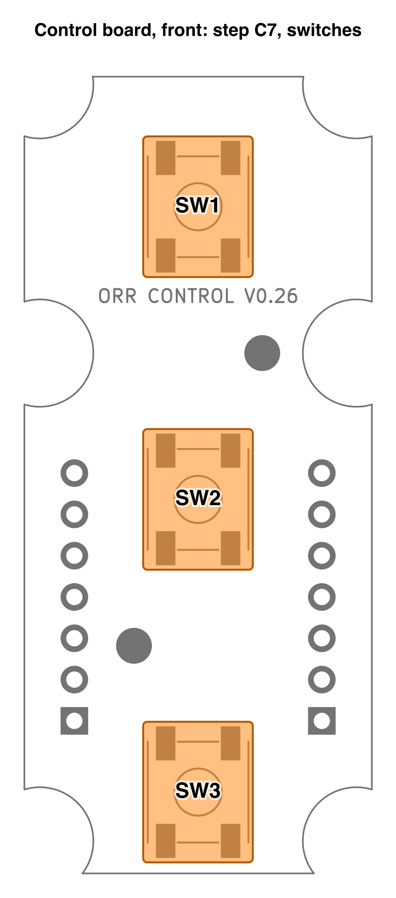

1. Dale la vuelta a la placa. Ya no queda plana: J5 mide 6,6 mm, y J3 y J4 2,72 mm. Sin calzar queda inclinada unos 6°.
2. Nivélala y sujétala con Blu-Tack o un soporte. Mantén el Blu-Tack lejos de los agujeros de J1 y J2 y de las bocas de los conectores.
3. Suelda SW1–SW3 como en el [paso J1](#paso-j1). SW1 es la tecla A, SW2 la B y SW3 la C.
4. No hagas fuerza sobre J3 mientras sueldas SW1: una vía de GND une SW1 con una soldadura de J3, que puede ablandarse.

**Comprueba:** J1 pines 2, 3 y 4 (botones) a GND dan abierto, y 0 Ω mientras pulsas SW1, SW2 o SW3. Si no, mira las soldaduras de ese interruptor.

### Paso C8: zócalos de la XIAO (se meten por detrás y se sueldan por delante)

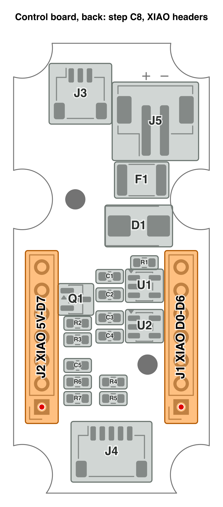

Los dos zócalos hembra 1 × 7, J1 y J2, se meten por la cara trasera. Sus pines salen por la delantera, donde se sueldan. Los pads cuadrados marcan el pin 1, en el extremo de J4.

**Elige primero el zócalo.** El diseño usa el de 5,7 mm de alto (C55218877).
- **Pruébalo antes:** mete los pines de la XIAO en un zócalo de 5,7 mm suelto. Deben entrar del todo y sujetar la XIAO con firmeza.
- **Zócalo de 8,5 mm (C54876729):** úsalo solo si el de 5,7 mm no pasa esa prueba.
  - En el CAD (V0.32, `header_h` = 8,5) la XIAO queda 2,4 mm más alta, hacia la batería.
  - No choca con la batería, la carcasa ni la tapa. Entre la parte de atrás de la XIAO y la batería quedan 4,5 mm en vez de 6,9 mm.
  - La espuma sobre la XIAO pasa entonces de 6 capas a 4.
  - Con este zócalo no se ha vuelto a comprobar el recorrido de montaje.

**Para que los zócalos queden rectos, suéldalos con la XIAO puesta.**
1. Mete los pines de la XIAO en los dos zócalos, para que los mantenga paralelos y a la distancia justa.
2. Mete los zócalos en la placa por la cara trasera, con la XIAO bien orientada (mira [la imagen de la XIAO](#xiao)): componentes hacia ti y USB-C en el extremo de J4.
3. Da la vuelta al conjunto y apóyalo sobre la XIAO. Nivela el extremo libre con Blu-Tack, lejos de las bocas de los conectores.
4. Suelda un pin en cada extremo de cada zócalo. No pases de 2–3 s por pin y haz pausas: el plástico del zócalo aguanta 220 °C solo 5 s.
5. Comprueba que los zócalos quedan planos contra la placa. Si alguno no, recalienta un pin y aprieta el zócalo.
6. Suelda el resto de pines.
7. Quita la XIAO. Los pines del zócalo son cortos, así que a sus componentes les llega poco calor.

### Comprobaciones después de los zócalos

Usa los [puntos de medida de los zócalos](#puntos-de-medida). Mete el cable Dupont macho en un zócalo y toca con la punta del multímetro. Mide sin la XIAO y sin la batería.

| Entre | Esperado | Si no |
|---|---|---|
| J2 pin 3 (3V3) y J2 pin 2 (GND) | Lejos de 0 Ω; puede subir mientras se carga C4 | Puente en la cara delantera |
| Cada pin de los zócalos con sus vecinos | No pita | Puente en la cara delantera |

<a id="puntos-de-medida"></a>
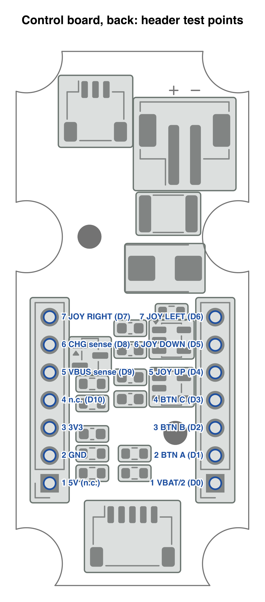

<a id="placa-usbc"></a>
## 3. Placa USB-C

Todas sus piezas van en la cara superior. La placa tiene 1,2 mm de grosor.

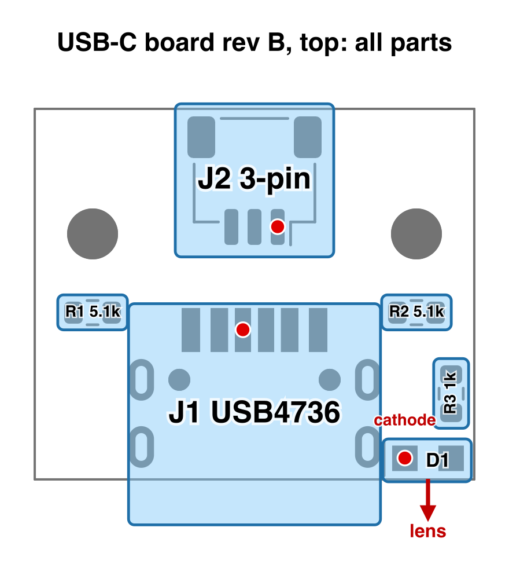

### Paso U1: resistencias

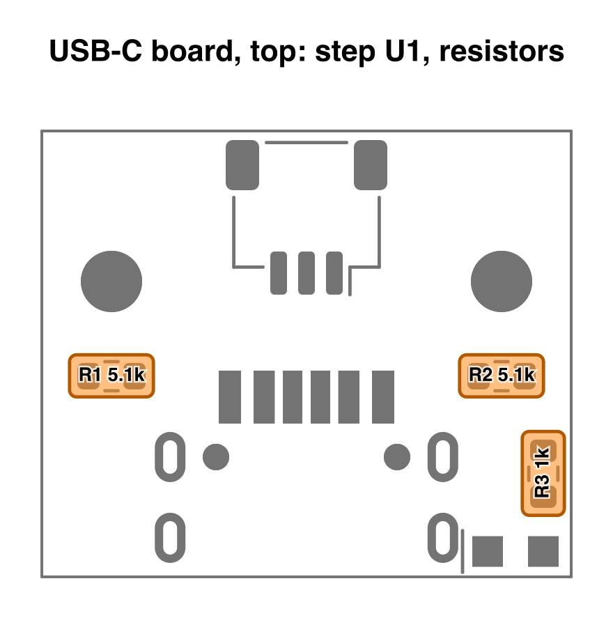

- 5,1k: R1 y R2, las resistencias a masa de las líneas CC del USB-C.
- 1k: R3, la resistencia del LED.

### Paso U2: conector

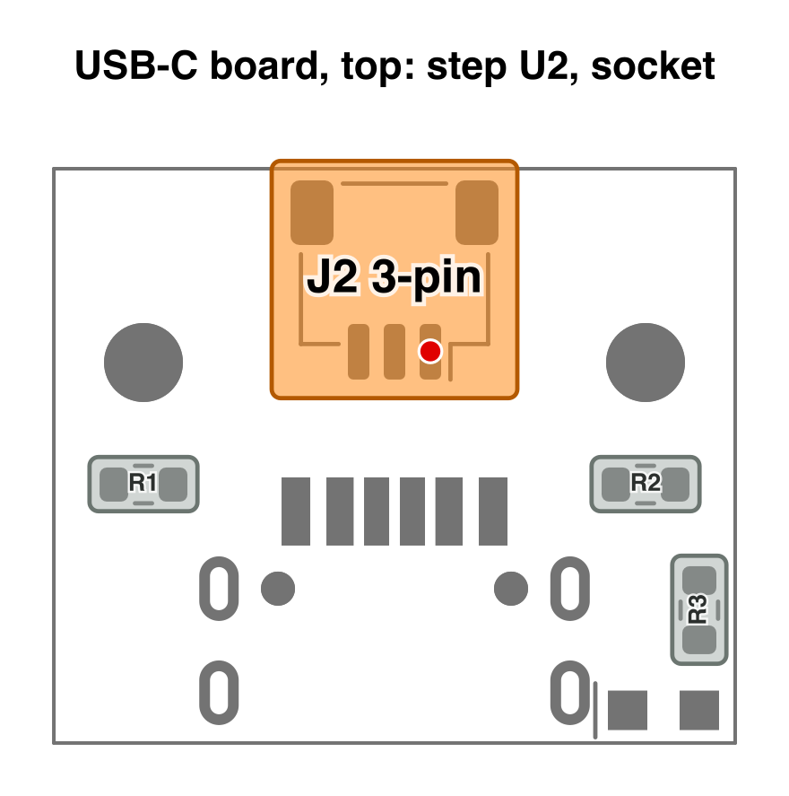

J2 es el conector de 3 pines; se suelda como en el paso C6.

### Paso U3: receptáculo USB-C

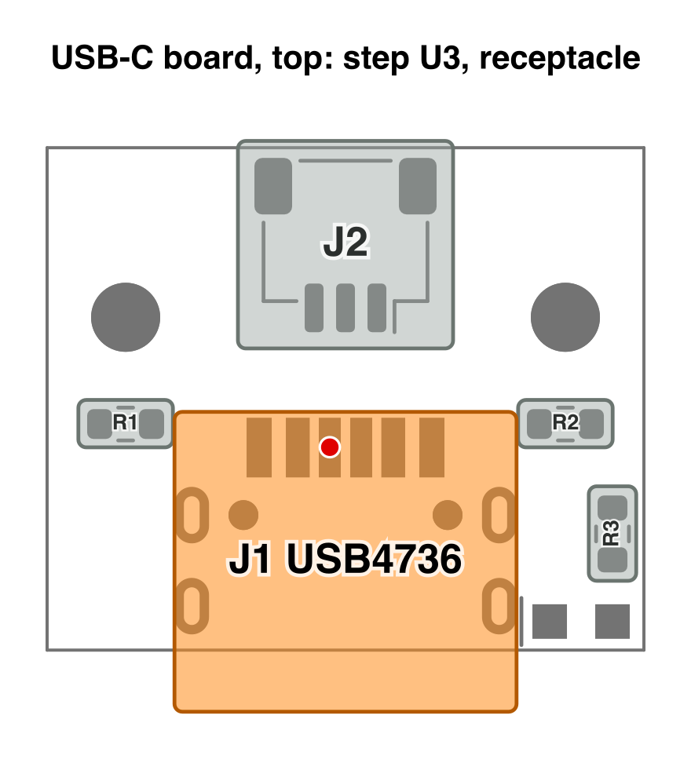

- **Colocación.** J1 es el GCT USB4736-GF-A, sin su junta. Sus dos tetones de posicionado entran en los dos agujeros pequeños, y su boca sobresale unos 1,7 mm del borde de la placa: 1,5–1,9 mm en las primeras placas, porque el contorno fresado varía unos ±0,2 mm. Los agujeros taladrados, no el borde, fijan dónde queda el receptáculo.
- **Primero los pads de señal.** Suelda los seis pads de señal de la parte de atrás del receptáculo mientras los tetones lo sujetan.
  - Usa mucho flux y una punta fina.
  - Entre pads solo hay unos 0,3 mm. Busca puentes con aumento y quítalos con la malla.
- **Después las cuatro patas de la carcasa**, en sus ranuras metalizadas, desde cualquier cara. Están sobre el plano de masa y necesitan calor: usa la punta más caliente o más grande y dale unos segundos a cada una.
- **No pongas la junta todavía.** La junta USBTJ-06 y la ventana del LED van en el [montaje mecánico](mechanical-concept.es.md#assembly), paso 2. El receptáculo solo se rellena de epoxi si falla la prueba de estanqueidad.
- **Prueba de la gota de agua.** Con la placa limpia, sujétala con la boca del receptáculo hacia arriba y llena la boca con una gota de agua. Pasados 30 minutos, mira la parte de atrás del receptáculo con aumento. Si ahí hay humedad, el receptáculo deja pasar agua y habrá que rellenarlo. No es una prueba tan dura como estar bajo el agua: la prueba de estanqueidad sigue siendo la que decide.

### Paso U4: LED de carga

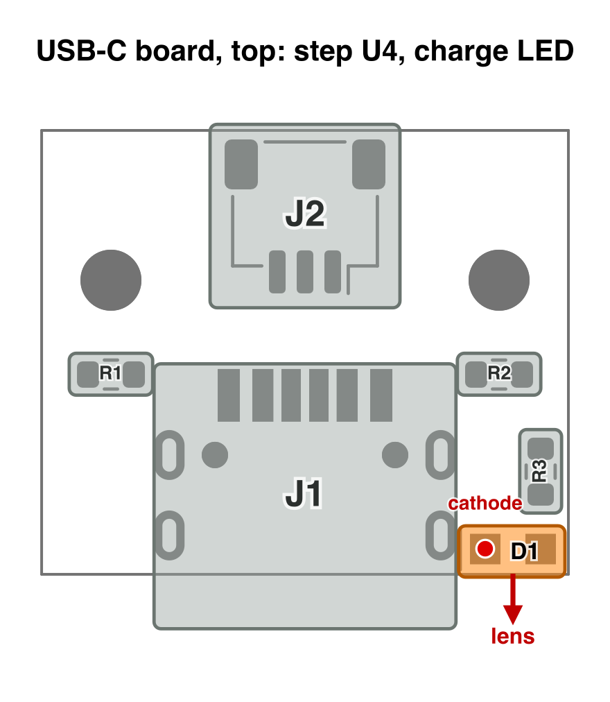

D1 es el LTST-S270KRKT, un LED de vista lateral de 1,65 × 1,15 mm. Su lente alumbra de lado, hacia fuera del borde de la placa y hacia la pared trasera, como indica la flecha.

D1 es opcional. Sin él el mando funciona, pero con la carcasa cerrada nada indica que está cargando. Suéldalo el último en esta placa.

**Posible defecto de la rev B.** La huella parece invertida: con la lente hacia el borde y la cara de arriba de la pieza hacia arriba, el cátodo cae en el pad 2, no en el pad 1. Sale del plano de la cinta de Lite-On y de la huella de LCSC; no se ha probado con una pieza. Por eso, en la rev B, D1 va **boca abajo**: la lente sigue mirando al borde y el cátodo cae en el pad 1 (punto rojo, junto a la raya de la serigrafía). Es un remedio para las placas ya fabricadas, no lo que pretende el diseño.

**Comprueba que el soldador llega.** Con el soldador frío y un LED de sobra sobre los pads, que luego apartas, acerca la punta al pad 1. El pad 1 solo deja ver unos 0,7 mm de cobre, en un hueco de 1,2 mm entre el LED y la pata de la carcasa del receptáculo. Si la punta no lo toca sin tocar la pata o el LED, no pongas D1.

**Da la vuelta al LED sin perder la orientación.** Sus caras y su marca de cátodo cuestan de ver incluso con aumento, así que aprovecha el orden en que viene en la cinta. Usa la lupa en los pasos 1 y 4.
1. Sujeta la cinta con los agujeros de arrastre lejos de ti y la cubierta hacia arriba. La lente debería quedar a la derecha. Si queda a la izquierda, para.
2. Despega la cubierta de un solo hueco.
3. Pon una tarjeta plana sobre el hueco. Da la vuelta a la cinta y a la tarjeta juntas, da un golpecito y levanta la cinta. No uses cinta adhesiva: deja residuo en los terminales.
4. Gira la tarjeta, no el LED, hasta que la lente quede a tu izquierda.
5. Gira la placa para que el borde del receptáculo quede a tu izquierda. El pad 1 es ahora el pad lejano.
6. Deja el LED en la tarjeta hasta el paso 3 de "Suéldalo".

**Suéldalo.** Lite-On permite 300 °C durante 3 s, una sola vez.
1. Pon el soldador a 300 °C. Un soldador sin control de temperatura no puede cumplirlo y el LED puede morir: suelda poco después de que empiece a fundir el estaño, antes de que llegue a toda su temperatura.
2. Añade flux. Estaña el pad 2 sin el LED. Usa muy poco estaño: limpia la punta después de cargarla. El estaño que sube a la lente le quita luz.
3. Coge el LED por sus dos extremos metálicos, llévalo en línea recta hasta los pads sin girarlo y refunde el pad 2 mientras lo sujetas con las pinzas. Retira la punta en cuanto el estaño moje, en cerca de 1 s y nunca más de 2 s.
4. Deja que enfríe y comprueba que la lente mira al borde.
5. Comprueba la polaridad con el pad 1 aún libre. Pon el multímetro en modo diodo, con la roja en el pad 2 y la negra en el extremo libre del LED. Debe marcar unos 1,4–2 V o brillar débilmente. Si solo marca con las puntas cambiadas, mira la tabla de abajo antes de soldar el pad 1.
6. Suelda el pad 1 con la menor cantidad posible.
7. Mira con aumento el hueco entre el pad 1 y la pata.

**Pruébalo.**
1. Limpia con alcohol isopropílico: el flux quemado puede falsear las lecturas.
2. Pasa las [comprobaciones de la placa USB-C](#comprobaciones-de-la-placa-usb-c).
3. Pon el multímetro en modo diodo, con la roja en el pad 2 y la negra en el pad 1, sobre el cobre que asoma junto al LED.

| Lectura | Significa | Qué hacer |
|---|---|---|
| Unos 1,4–2 V, o un brillo débil | Correcto | Terminado |
| Solo marca con las puntas cambiadas | Invertido | Comprueba que la lente mira al borde. Si no, quita el LED y repite los pasos con uno nuevo. Si sí, quita el LED y coloca uno nuevo directamente de la cinta, con la cara de arriba hacia arriba y la lente hacia el borde, girándolo con las pinzas. Si este marca bien, el posible defecto queda desmentido: anótalo. Si también marca invertido, alguna de las dos colocaciones no fue la prevista: para (mira "Cuándo parar") |
| Cerca de 0 V en los dos sentidos | Un puente bajo el LED | Quítalo con malla |
| OL en los dos sentidos | Soldadura abierta, LED muerto o poca tensión de prueba en el multímetro | No refundas todavía: mira las soldaduras con aumento |

La prueba definitiva es que el LED se encienda mientras carga la batería.

**Cuándo parar.** Deja la placa sin D1, o con el LED muerto en su sitio, tras dos LEDs fallidos, un pad levantado o una pata movida. No reutilices un LED ya soldado. La ventana del LED se rellena igual en el [montaje mecánico](mechanical-concept.es.md#assembly), paso 2. Sin LED detrás nada frena el epoxi, así que usa una mezcla espesa, ya medio curada, y poca cantidad: no debe llegar a la placa ni a la junta.

### Comprobaciones de la placa USB-C

| Entre | Esperado |
|---|---|
| J2 pin 1 (VBUS) y J2 pin 2 (GND) | Abierto |
| Sobre R1, y luego sobre R2 | Unos 5,1 kΩ |
| Un pad CC (de R1 o R2, del lado del receptáculo) y J2 pin 1 | Abierto (un puente aquí pondría 5 V en CC) |
| J2 pin 3 (cátodo del LED) y J2 pin 2 (GND) | Abierto. Un corto aquí suele ser un puente del pad 1 de D1 a la pata: une la salida STAT del cargador con GND y puede dañar el cargador (U1 de la placa de control). Quítalo antes de conectar el cable |
| J2 pin 1 a J2 pin 3, en modo diodo, punta roja en el pin 1 | El LED se enciende débilmente, o el multímetro marca su tensión directa más la caída en R3. "OL" no dice nada: la tensión de prueba puede no dar para el LED y 1 kΩ juntos, y es lo que sale con D1 ausente o invertido. |

<a id="cables"></a>
## 4. Cables

Los dos cables tienen que ser rectos: el pin 1 de un extremo va al pin 1 del otro.

1. **Busca el pin 1.** Pon las dos clavijas una al lado de la otra, con las pestañas hacia arriba, y mira por las ventanas de la carcasa.
2. **Mide cada hilo** con la aguja, en el rango de continuidad: pin 1 con pin 1, y así con todos.
3. **Sin vecinos.** Ningún contacto pita con el de al lado.

En AliExpress el cable recto se vende como `reverse direction`: con el cable estirado, sus dos clavijas enseñan caras opuestas. Un cable vendido como `same direction` enseña la misma cara en los dos extremos y une el pin 1 con el último. No lo uses: en el cable de 3 pines llevaría VBUS a la patilla STAT del cargador.

Los cables se vuelven a comprobar ya conectados, en las dos secciones siguientes.

<a id="pruebas-alimentacion"></a>
## 5. Pruebas de alimentación, sin la XIAO

La primera prueba se hace sin la XIAO y sin la batería.

1. **Une las placas.** Conecta el cable de 3 pines entre el J2 de la placa USB-C y el J3 de la placa de control, con las pestañas bien encajadas. Comprueba con el multímetro que el cable es recto:
   - El pin 1 de J2 en la placa USB-C pita con el pin 1 de J3 en la de control, y el 3 con el 3. Mide en los pines de los conectores, sobre sus pads; el pin 1 es el punto rojo de las imágenes.
   - El pin 1 de J2 no pita con el pin 3 de J3.
2. **Da alimentación USB.** Conecta un cargador USB-C de 5 V al receptáculo. Lo más seguro es un cable USB-C a USB-C desde un cargador USB-C. Un cable USB-A a USB-C también sirve, porque la placa lleva sus propias resistencias CC.
3. **Mide tensiones respecto a J2 pin 2 (GND), en voltios de continua:**

| Punto | Esperado | Notas |
|---|---|---|
| Pad `+` de J5 | Unos 4,2 V | La salida del cargador sin batería. Puede oscilar; sin batería es normal. |
| J2 pin 3 (3V3) | 3,3 V | |
| J2 pin 5 (detección de VBUS) | Unos 3,0 V | |
| LED de carga | Apagado o parpadeando | Sin batería, la salida STAT queda en alta impedancia |

Si F1 se calienta o la lectura es 0 V, desconecta enseguida y busca un cortocircuito en D1, C1 o U1.

4. **Comprueba la clavija de la batería.** Desconecta el cargador. Con el multímetro en la clavija de la batería, localiza el hilo `+`. El `+` de la clavija tiene que coincidir con el `+` de J5.
   - Q1 protege la placa de una batería al revés. Pero con el USB conectado, una batería al revés se va descargando poco a poco (mira el [README de la placa de control](../electronics/control-pcb/README.md#checks)).
5. **Conecta la batería** en J5 y vuelve a medir:
   - J2 pin 3: 3,3 V. Si la batería está por debajo de unos 3,6 V, saldrá algo menos: el regulador ya no tiene margen.
   - J1 pin 1 (VBAT/2): más o menos la mitad de la tensión de la batería. Un multímetro de 10 MΩ marca alrededor de un 5 % menos en este divisor de 1 MΩ.
6. **Vuelve a conectar el cargador.** Si D1 está montado, el LED de carga se enciende mientras la batería carga y se apaga cuando está llena.

Opcional: mide la corriente de la batería con un alargador JST PH, con el multímetro en serie en el rango de mA y el cargador desconectado. Sin la XIAO debe marcar 0,00 mA (son unos pocos µA, por debajo de lo que mide el multímetro). Más de 1 mA indica una avería.

<a id="xiao"></a>
## 6. XIAO, firmware y prueba de funcionamiento

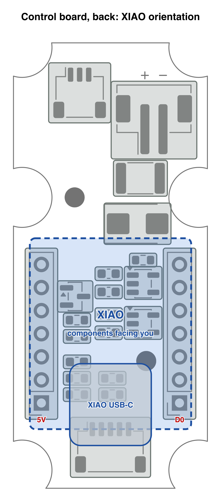

1. **Carga el firmware** con la XIAO fuera de la placa.
   - Pon `BOARD_V026 = true` en [`open-rally-remote.ino`](../firmware/xiao-nrf52840/open-rally-remote.ino).
   - Compila y carga como indica el [README del firmware](../firmware/xiao-nrf52840/README.md).
   - El firmware del banco (`false`) usa otro mapa de pines y activa D8 como salida, que en esta placa es la entrada de estado del cargador.
2. **Pincha la XIAO.** Desconecta antes la batería. Pincha la XIAO en los zócalos:
   - con los componentes hacia fuera de la placa;
   - con el USB-C en el extremo de J4;
   - con D0 en el pin 1 de J1 y 5V en el pin 1 de J2.
   Girada, sus pines de 3V3 y GND caen en señales que no son.
3. **Conecta la batería.**
4. **Conecta un ordenador.** Conecta el USB-C de la propia XIAO a un ordenador y abre el Monitor Serie a 115200 baudios. Su regulador y el de la placa alimentan los dos la línea de 3V3; el TPS70933 de la placa bloquea la corriente de vuelta.
5. **Botones.** Pulsa SW1, SW2 y SW3: el Monitor Serie muestra cada control y su gesto.
6. **Joystick.**
   - Une la placa del joystick a J4 con el cable de 5 pines.
   - Pulsa cada interruptor del joystick: aparecen UP, DOWN, LEFT y RIGHT.
   - Aquí se nota un cable al revés: solo funciona UP, porque la masa de la placa del joystick acaba en la línea de UP.
7. **Batería y cargador.** La línea `Battery:` muestra más o menos la tensión de la batería, `USB` y `CHG`. Conecta el cargador a la placa USB-C: `USB` y `CHG` cambian y el LED se enciende si D1 está montado.
8. **Teléfono.** Empareja el teléfono y haz la [primera prueba](../firmware/xiao-nrf52840/README.md#first-test).

Sin ordenador, los pasos 5 a 7 también se pueden comprobar desde el teléfono con un comprobador de teclado.

<a id="barniz"></a>
## 7. Barniz de protección

Barniza las tres placas y la XIAO cuando todas las pruebas estén bien.

1. **Desconéctalo todo.** Quita la batería, los cables y la XIAO.
2. **Limpia.** Vuelve a limpiar con alcohol isopropílico y deja secar.
3. **Tapa con cinta:**
   - Todos los conectores JST: J3, J4, J5 y los dos J2, más J1 en la placa del joystick.
   - Las bocas de los zócalos de la XIAO.
   - El receptáculo USB-C: la boca y el morro.
   - La parte de arriba (el pulsador) de los siete interruptores.
   - En la XIAO: sus pines, su USB-C, su botón de reset y su LED RGB.
4. **Pulveriza.** Da capas finas de barniz acrílico por las dos caras de cada placa, a la distancia que indique el bote: de 20 a 30 cm para el Plastik 70. Dos capas finas chorrean menos que una gruesa.
5. **Deja curar.** Deja secar cada capa el tiempo que diga el bote. El Plastik 70 está seco al tacto en unos 20 minutos a 20 °C; su ficha da las propiedades de la película tras 24 horas a temperatura ambiente. Quita la cinta antes de que la última capa endurezca del todo. Al terminar, pon el bote boca abajo y pulsa hasta que solo salga gas, para limpiar la válvula.
6. **Revisa.** Busca zonas sin barniz mirando de lado bajo una lámpara. Si el bote dice que el barniz lleva trazador UV, una linterna UV las muestra mejor. La ficha del Plastik 70 normal no menciona trazador UV; solo el Plastik 70 Super se vende con él. Una zona mate y escarchada indica que la superficie estaba húmeda: quita esa capa con acetona, seca la placa y vuelve a pulverizar.

Los datos del Plastik 70 son de la [ficha técnica](https://asset.conrad.com/media10/add/160267/c1/-/en/000884197DS00/tehnicni-podatki-884197-kontakt-chemie-plastik-70-74309-ah-izolirni-in-zascitni-lak-200-ml.pdf) de CRC Kontakt Chemie. No da fecha de caducidad. Para una reparación se puede soldar a través del barniz, o quitarlo con acetona.

El barniz no va en la batería ni en la membrana de ventilación, que no están en las placas. El montaje mecánico empieza luego con la placa USB-C en la carcasa ([paso 2](mechanical-concept.es.md#assembly)).

<a id="puntos-abiertos"></a>
## Puntos abiertos

Cada uno se comprueba en el primer montaje. Apunta aquí el resultado.

- **KSC2 a mano.** Si las patas en J del KSC221JLFS se sueldan bien con soldador. De cada pad asoma alrededor de 1 mm. Si no, hace falta una estación de aire caliente o una placa calefactora.
- **USB4736 a mano.** La separación de 0,3 mm entre sus pads de señal, y el calor que necesitan las patas de la carcasa.
- **Posición del USB4736.** Una vez soldado, mide desde la cara frontal del cuerpo (donde apoya la junta) hasta el centro de cada agujero M2, con un pasador de Ø2 mm en el agujero: 11,10 mm en el diseño. Fija la compresión de la junta; mira las incógnitas abiertas del [concepto mecánico](mechanical-concept.es.md#open-unknowns-before-printing).
- **Orientación del LED.** La huella de la rev B parece invertida (mira el [paso U4](#paso-u4-led-de-carga)). Confírmalo con una pieza, y que el LED se suelda boca abajo y se ve por la ventana. Una máquina no puede dar la vuelta a la pieza, así que D1 en las placas montadas probablemente esté invertido: pruébalo. Se corregirá en la próxima revisión de la placa, con un LED más grande.
- **LED a mano.** Si un soldador llega al pad 1 y si el LED sobrevive sin control de temperatura.
- **Bloque central a mano.** Si las piezas entre los zócalos de la XIAO se pueden soldar sin puentes con la punta y el estaño indicados en [Herramientas](#herramientas). El orden de la [sección 2](#placa-control) sale de un modelo y no se ha probado. Practica antes en una placa de sobra.
- **Elección del zócalo.** Si los pines de 6,1 mm de la XIAO entran y sujetan en el zócalo de 5,7 mm. El de 8,5 mm cabe en el CAD (comprobado el 20-10-2026), pero no se ha vuelto a comprobar el recorrido de montaje con él.
- **Cables.** Que los cables `reverse direction` de AliExpress sean rectos y encajen en los conectores "1.0 WT".
- **Lecturas.** Las tensiones y resistencias esperadas de arriba salen del circuito y de las hojas de datos, no de una placa real.
- **Sin batería.** Cómo se comporta el cargador con el USB conectado y sin batería (el LED y D8 parpadean); mira el [README de la placa de control](../electronics/control-pcb/README.md#checks).

## Regenerar las imágenes

Las imágenes de los pasos, los mapas y las vistas de las placas desnudas salen de las placas de KiCad:

```sh
/Applications/KiCad/KiCad.app/Contents/Frameworks/Python.framework/Versions/Current/bin/python3 \
    electronics/tools/assembly_images.py
```

El script necesita el `kicad-cli` de KiCad, además de `rsvg-convert` y `magick` (`librsvg` e `imagemagick` de Homebrew). Los pasos y sus piezas están en la lista `STEPS`, al principio del script. Escribe `docs/images/<board>-v0.32-asm-*.png` y `*-bare-*.png`.
