# Electronics Assembly — V0.32

> Spanish version: [electronics-assembly.es.md](electronics-assembly.es.md).

This guide takes the three bare boards from the JLCPCB order and the parts from [`electronics/lcsc-parts.csv`](../electronics/lcsc-parts.csv) to three soldered, tested and coated boards. The [mechanical assembly](mechanical-concept.md#assembly) then fits them into the remote.

If the boards came assembled, skip the soldering steps and start at [Cables](#4-cables). Boards with Economic assembly still need the switches and the XIAO headers (steps J1, C5 and C7) and the USB-C receptacle (step U3).

**Status.** This guide comes from the design files, not from a build. Nobody has built these boards yet. The points not yet confirmed on real parts are listed under [Open points](#open-points). Note what differs on the first build and correct this guide.

## Contents

1. [Before you start](#before-you-start)
2. [Joystick board](#1-joystick-board) (practice board)
3. [Control board](#2-control-board)
4. [USB-C board](#3-usb-c-board)
5. [Cables](#4-cables)
6. [Power tests, without the XIAO](#5-power-tests-without-the-xiao)
7. [XIAO, firmware and function test](#6-xiao-firmware-and-function-test)
8. [Conformal coating](#7-conformal-coating)
9. [Open points](#open-points)

## Before you start

### Parts for one remote

| Board | Parts | Count |
|---|---|---:|
| Joystick rev C | KSC221JLFS switch (SW1–SW4), 5-pin 1.0 mm side-entry socket (J1) | 5 |
| Control | KSC221JLFS switch (SW1–SW3); MCP73831 (U1); TPS70933 (U2); AO3401A (Q1); 0603 resistors 10k (R1), 100k (R2, R4), 150k (R3, R5), 1M (R6, R7); 0603 capacitors 4.7 µF (C1–C4), 100 nF (C5); PTC fuse 1812 (F1); SMBJ5.0A (D1); 3-pin and 5-pin 1.0 mm side-entry sockets (J3, J4); JST PH 2-pin top-entry header (J5); two 1 × 7 female headers, 2.54 mm, 5.7 mm high (J1, J2) | 28 |
| USB-C rev B | 5.1k 0603 (R1, R2); 1k 0603 (R3); LTST-S270KRKT red side-view LED (D1); 3-pin 1.0 mm side-entry socket (J2); GCT USB4736-GF-A receptacle (J1; its gasket goes on later) | 6 |
| Off the board | XIAO nRF52840 with pins; LiPo pouch with JST PH lead; 3-pin and 5-pin JST SH cables | |

The LCSC numbers are in the CSV and in each board's `fab/*-bom.csv`. Small parts come in strips of tape. Keep each part in its strip until you place it. 0603 capacitors carry no marking, and 0603 resistors may carry none either. A loose part of unknown value cannot be identified, so throw it away.

### Tools

| Tool | Notes |
|---|---|
| Soldering iron with temperature control | Fine conical or 1–1.5 mm chisel tip. About 330 °C for leaded solder and 360 °C for lead-free. The ground pours and the USB-C shell slots need a hotter tip or a bigger one. |
| No-clean flux (syringe), 0.5 mm flux-cored solder, 2 mm desoldering braid | 0.8 mm solder is too thick for 0603 parts and the 1 mm pitch sockets. |
| Fine tweezers, non-magnetic | **Needed.** Without them, 0603 parts cannot be placed. |
| Magnifier, loupe or a phone camera with macro | To inspect every joint. |
| Isopropyl alcohol and an old toothbrush | To clean off the flux. |
| Multimeter | Continuity, resistance and DC volts. |
| A male Dupont jumper (from the bench set) | Pushed into a header socket, it gives the meter probe a contact. |
| A sewing needle | To probe the JST SH cable contacts through the housing. |
| Masking tape, Blu-Tack or a PCB holder | To hold a board while you solder. |

### Safety

- Solder in a ventilated room. Flux fumes irritate.
- Wear safety glasses when you trim wires or remove solder with braid.
- Wash your hands after soldering, above all with leaded solder.
- LiPo cell: do not short its leads, pierce it or bend it. Connect it only where a step says so.
- Spray the conformal coating outdoors or under extraction, away from flames.

### How to read the images

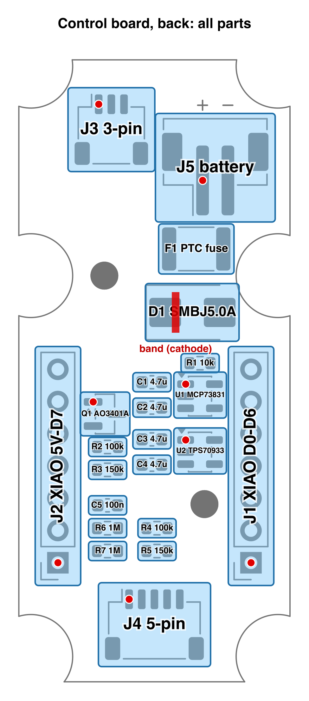

- **Orange:** the parts of the current step, with reference and value.
- **Grey:** the parts already soldered.
- **Red dot:** pin 1 of a polarised part, or of a connector.
- **Mirrored back view.** Images of a board's back are drawn as you see that side when you turn the board over. Text on the drawing is not mirrored.
- **Silkscreen.** The real board has outlines, pin-1 marks and the `+ −` at J5, but **no reference designators**. These images are the only map of which part goes where. Print them, or keep them open beside you.

The bare boards look like this; the printed text tells the sides apart.

| Control, back | Control, front ("ORR CONTROL V0.26") | Joystick, back ("ORR JOY REV C") | Joystick, front | USB-C, top |
|---|---|---|---|---|
| 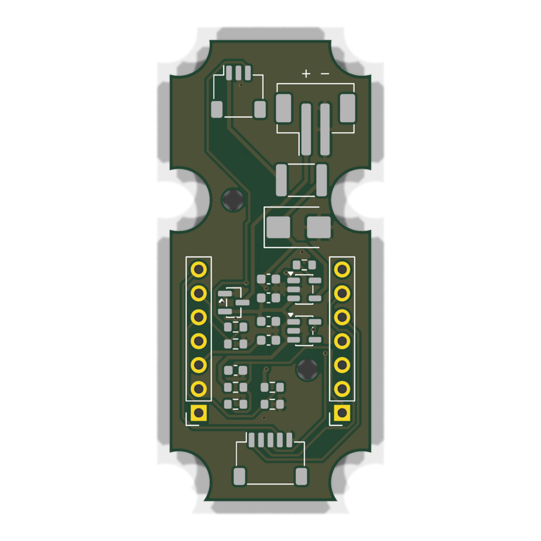 | 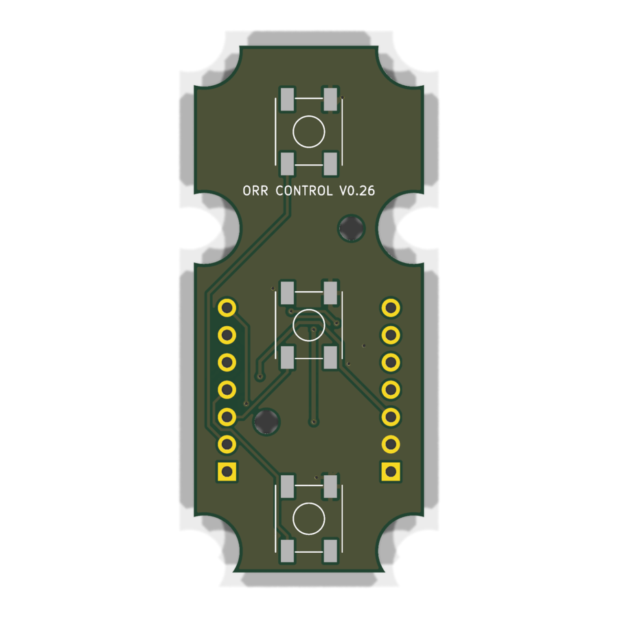 | 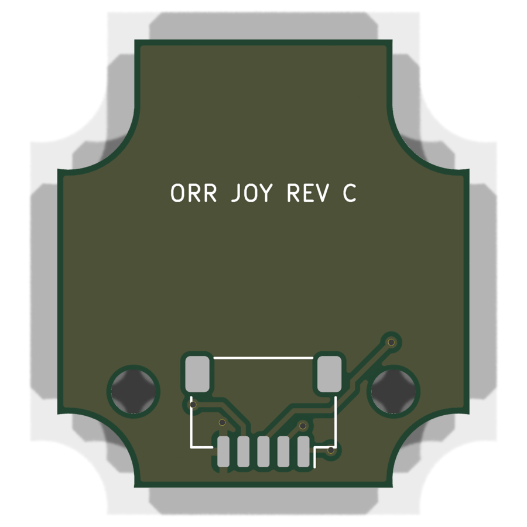 | 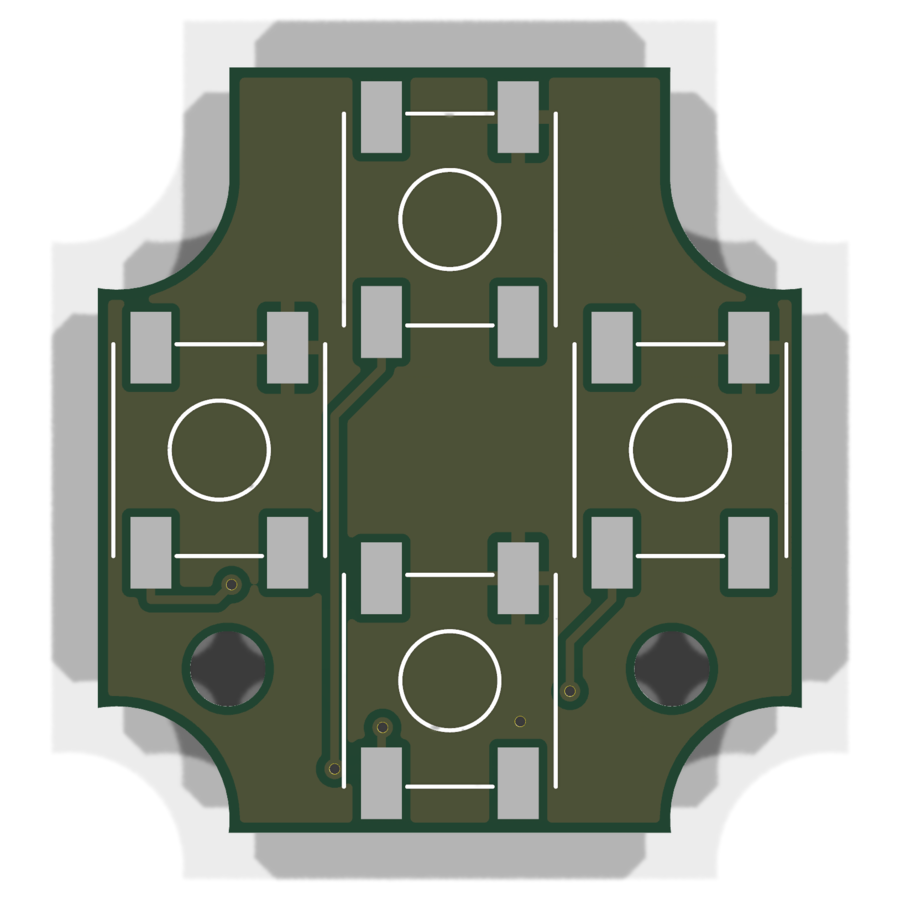 | 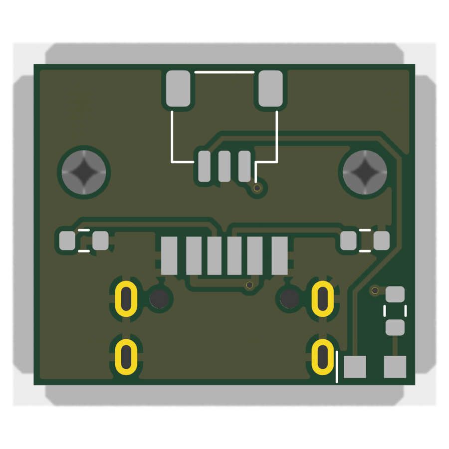 |

### Soldering method

- **Two-pad parts (0603, 1812, SMB).**
  1. Flux both pads.
  2. Put a small blob of solder on one pad.
  3. Hold the part flat with the tweezers, heat the blob and slide the part into it.
  4. Let go once the solder sets.
  5. Check that the part sits square and flat.
  6. Solder the other pad.
  7. Touch the first pad again with a little flux.
- **SOT-23 and SOT-23-5.** Tin one corner pad, tack the part on that pad, check all its legs sit on their pads, then solder the rest.
- **1.0 mm pitch sockets.**
  1. Tack one of the two large mounting tabs first.
  2. Check that the pins line up with their pads.
  3. Solder the other tab, then the pins with plenty of flux.
  4. Bridges between pins come off with braid.
- **Through-hole headers.** Heat the pin and the pad together for 2–3 s and feed the solder into the joint, not onto the iron. A good joint is a shiny cone.
- **After each board.**
  1. Scrub off the flux with isopropyl alcohol.
  2. Let the board dry.
  3. Inspect every joint under magnification: look for bridges, balls of solder, dull or cracked joints, and lifted legs.

### Order

1. **Joystick board first.** Its parts are the biggest, and its socket is practice for the 1 mm pitch.
2. **Control board.** On each side, the low parts go on first, so the board lies flat while you solder the next ones.
3. **USB-C board last.** Its receptacle and LED are the hardest parts.
4. **Tests.** Then the cables and the tests.
5. **Coating last.** Coat only once everything works: rework through the coating is harder.

## 1. Joystick board

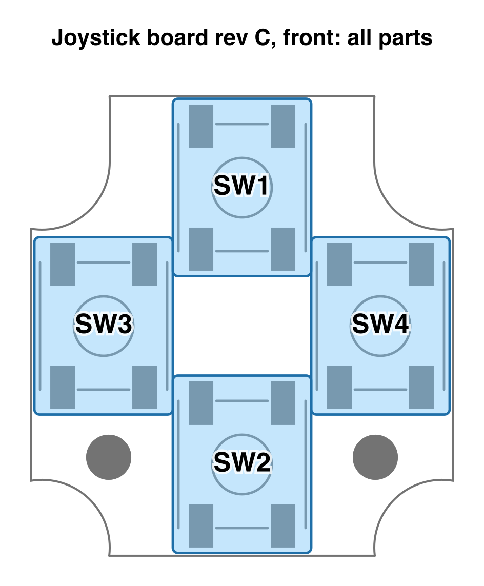

### Step J1: switches (front)

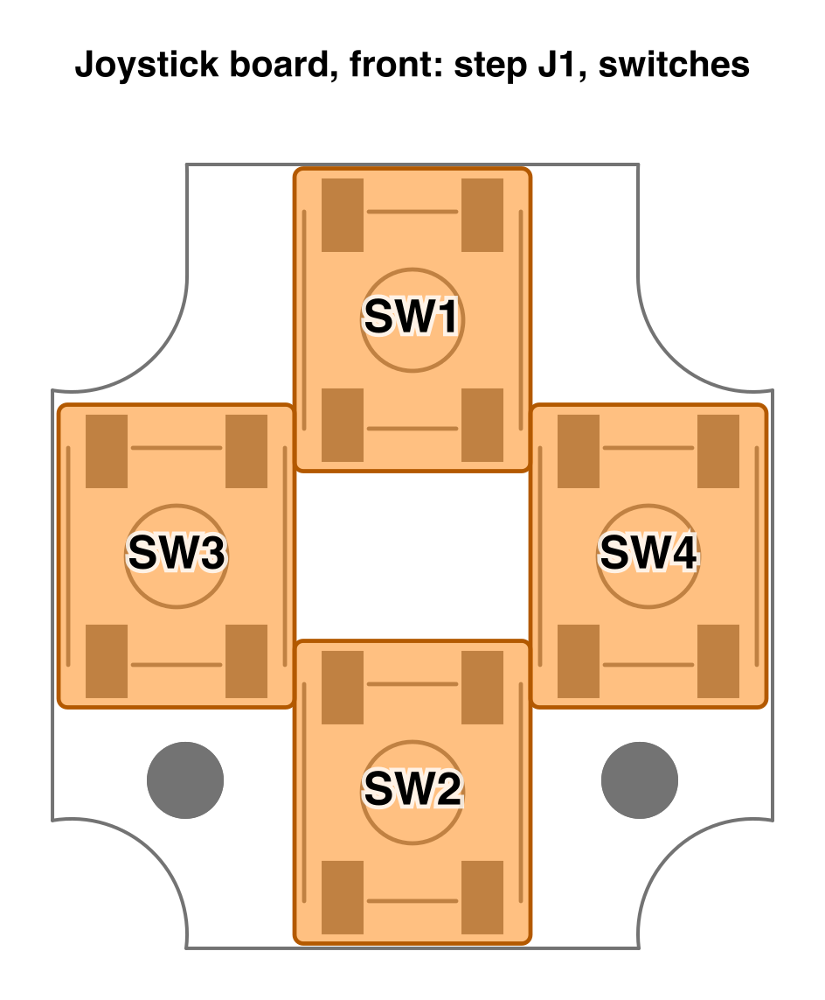

- **Fit SW1–SW4, the KSC221JLFS switches**, on the front, with the switch body square to the silkscreen outline. Each switch has four J-leads. The board uses two diagonal pads; the other two only hold the switch. So the switch works in any of its four turns.
- **J-leads.** They tuck under the body. About 1 mm of each pad shows past it.
- **How to solder:**
  1. Flux the four pads.
  2. Tin one pad lightly.
  3. Hold the switch down and heat that pad's free end until the lead sinks in.
  4. Solder the other three the same way. Heat the pad, not the switch body: it is sealed plastic.

### Step J2: socket (back)

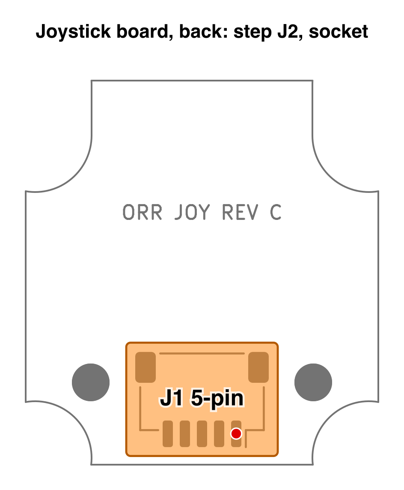

1. Turn the board over. It rests evenly on its four switches.
2. Fit J1, the 5-pin socket. It fits one way only: its five pins go on the row of five small pads, its two tabs on the large pads.
3. Tack a tab, check the pins, then solder the second tab and the five pins.

### Joystick checks

Probe J1 from its pin side, on the pads. Pin 1 is the red dot, pin 5 is GND.

- No switch pressed: no continuity between any pin and pin 5.
- Press each switch: pin 1 (SW1, UP), pin 2 (SW2, DOWN), pin 3 (SW3, LEFT) and pin 4 (SW4, RIGHT) each beep to pin 5.
- No two pins beep to each other.

## 2. Control board

 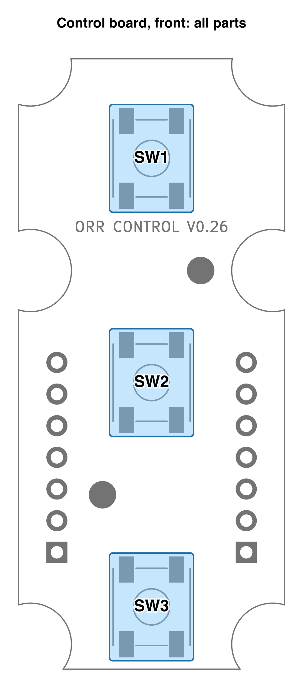

### Step C1: U1, U2, Q1 (back)

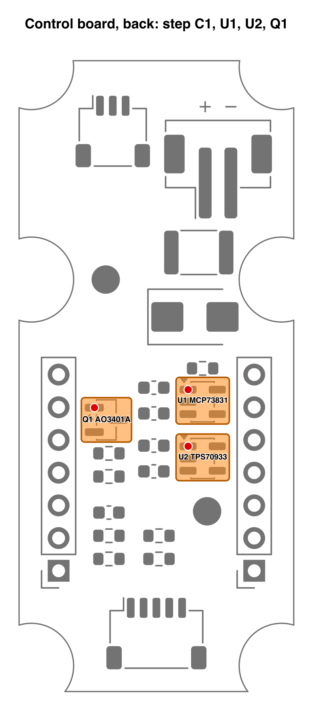

- **U1 and U2.** U1 is the MCP73831 (marked on the part, often with a short code). U2 is the TPS70933. Both come in SOT-23-5 and look alike, so keep them in their strips.
- **Q1** is the AO3401A in SOT-23.
- **Polarity.** These packages fit one way only: the side with three legs goes on the row of three pads. Pin 1 (red dot) matches the silkscreen dot or triangle.
- **Check:** the legs sit centred on their pads, and no leg bridges to the next.

### Step C2: resistors (back)

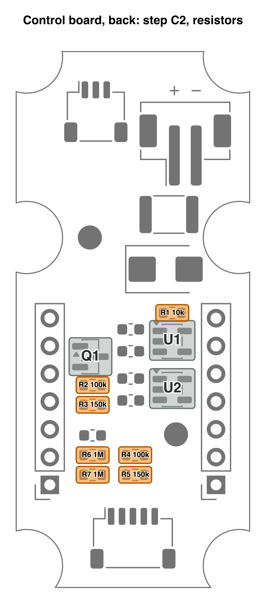

- Solder one value at a time, straight from its strip:
  - 10k: R1.
  - 100k: R2 and R4.
  - 150k: R3 and R5.
  - 1M: R6 and R7.
- Resistors have no polarity.
- Mixing up R2/R3 or R4/R5 swaps the halves of a divider. That puts too much voltage on a XIAO pin, so check each value before placing it.

### Step C3: capacitors (back)

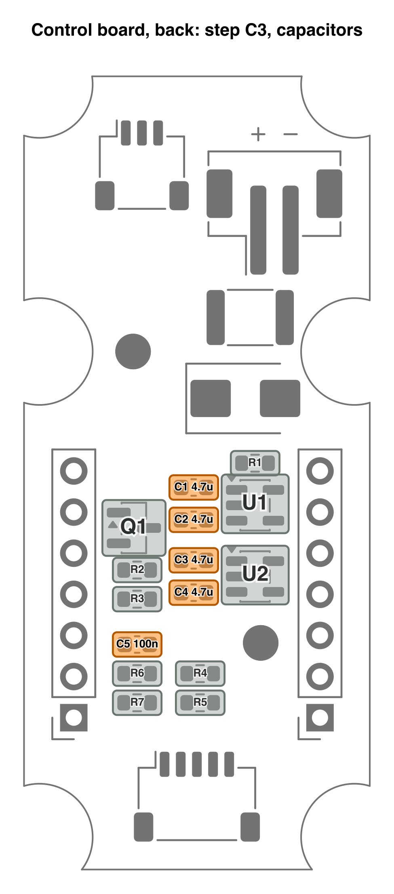

- 4.7 µF: C1–C4.
- 100 nF: C5.
- No polarity. Both values look the same, so do one value at a time.

### Step C4: F1 and D1 (back)

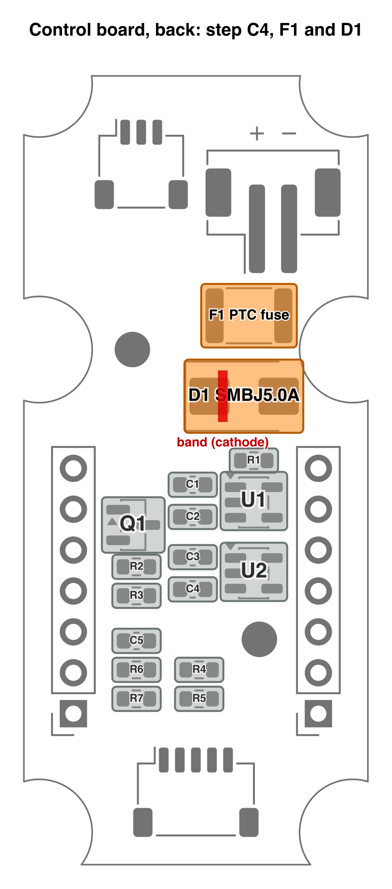

- **F1, the PTC fuse:** no polarity. It is big, so give each pad time to wet.
- **D1, the SMBJ5.0A:** **polarised.**
  - Its body carries a band at one end. The band (cathode) goes at the end marked in red: the left end, seen from the back as in the image.
  - The wrong way round, D1 shorts the 5 V input, and F1 trips as soon as a charger is plugged in.

### Step C5: switches (front)

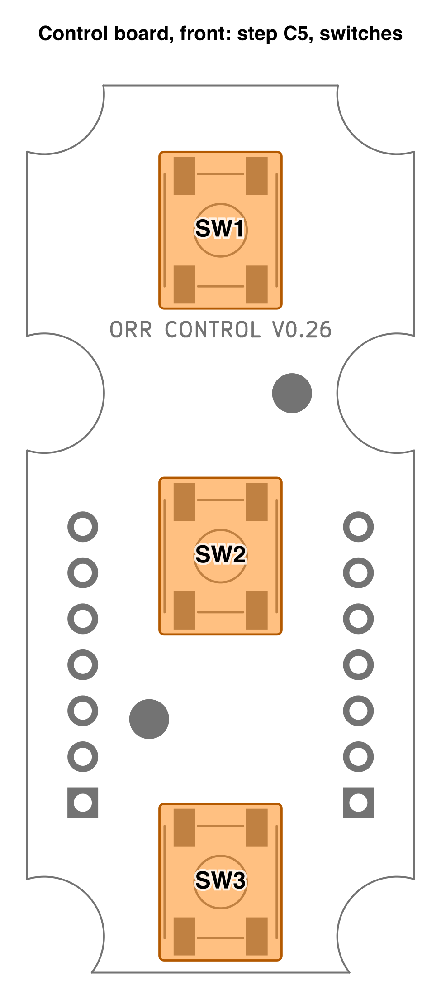

1. Turn the board over. The back parts are at most about 2.4 mm high (D1), so hold the board level with Blu-Tack or a holder.
2. Solder SW1–SW3 as in [step J1](#step-j1-switches-front).
3. SW1 is key A, SW2 key B, SW3 key C.

### Step C6: sockets (back)

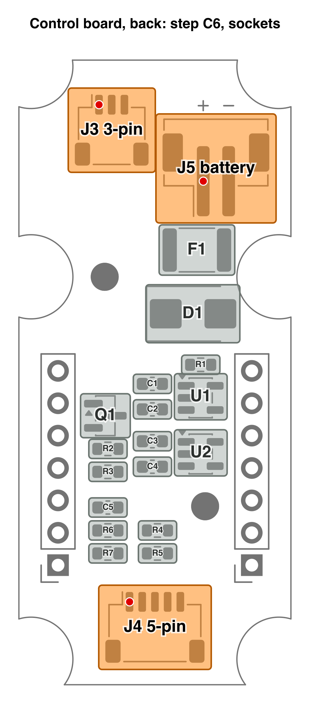

1. Turn the board back over. It now rests on its three switches.
2. Solder the sockets. Each fits one way only, with its pins on the row of small pads.
   - J3: 3-pin, USB-C board.
   - J4: 5-pin, joystick.
   - J5: JST PH 2-pin top entry, battery.
3. J5 is bigger, with 2 mm pitch. Its pin 1 is battery `+`, as the silkscreen `+ −` shows.

### Step C7: XIAO headers (inserted from the back, soldered on the front)

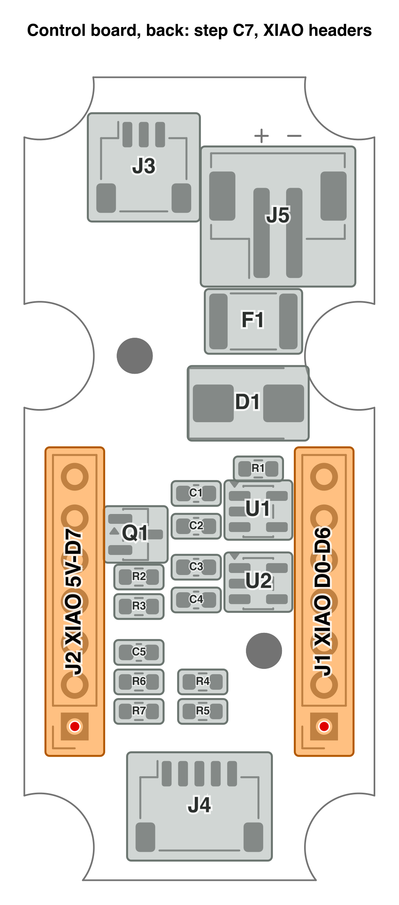

The two 1 × 7 female headers J1 and J2 go in from the back. Their pins come through to the front, where you solder them. Square pads mark pin 1, at the J4 end.

**Choose the header first.** The design uses the 5.7 mm high header (C55218877).
- **Try it first:** push the XIAO's pins into a loose 5.7 mm header. They should go in fully and hold the XIAO firmly.
- **8.5 mm header (C54876729):** use it only if the 5.7 mm one fails that test. The CAD (V0.32, `header_h` = 8.5) seats the XIAO 2.4 mm higher, toward the pouch. Its envelope still clears the pouch envelope, the housing and the battery cap (no overlap), with 4.5 mm left between the XIAO's back and the pouch instead of 6.9 mm. The foam pad on the XIAO then takes 4 layers instead of 6. The assembly path checks were not run again for it.

**Keep the headers straight: solder them with the XIAO plugged in.**
1. Plug the XIAO's pins into both headers, so the XIAO holds them parallel at the right spacing.
2. Push the headers through the board from the back, with the XIAO the right way round (see [the XIAO image](#6-xiao-firmware-and-function-test)): components facing you, USB-C at the J4 end.
3. Turn the assembly over and rest it on the XIAO.
4. Solder one pin at each end of each header.
5. Check that the headers sit flat on the board. If one does not, reheat a pin and press the header down.
6. Solder the other pins.
7. Unplug the XIAO. The header pins are short, so its components take little heat.

### Control board checks

Use the [header test points](#test-points). Push the male Dupont jumper into a socket and touch the probe to it. Measure on the meter's resistance range, with no XIAO and no battery fitted.

| Between | Expect | If not |
|---|---|---|
| J2 pin 3 (3V3) and J2 pin 2 (GND) | Not near 0 Ω; it may climb as C4 charges | Bridge round U2 or C4 |
| J3 pin 1 (5 V in) and J3 pin 2 (GND), on the J3 pads, diode test with red on pin 1 | No reading (OL) | About 0.6–0.8 V: D1 is the wrong way round. Near 0: a bridge round F1, D1, C1 or U1 |
| J5 `+` and `−` pads | Not near 0 Ω | Bridge round Q1, C2 or C3 |
| J2 pin 5 (VBUS sense) to GND | About 150 kΩ | R4/R5 swapped or missing |
| J2 pin 6 (CHG sense) to GND | About 150 kΩ | R2/R3 swapped or missing |
| J1 pin 2, 3, 4 (buttons) to GND | Open; 0 Ω while SW1, SW2, SW3 is pressed | Switch joint |
| Each header pin to its neighbours | No beep | Bridge on the front |

The 150 kΩ readings are estimates: the meter also sees the other parts on each node.

<a id="test-points"></a>
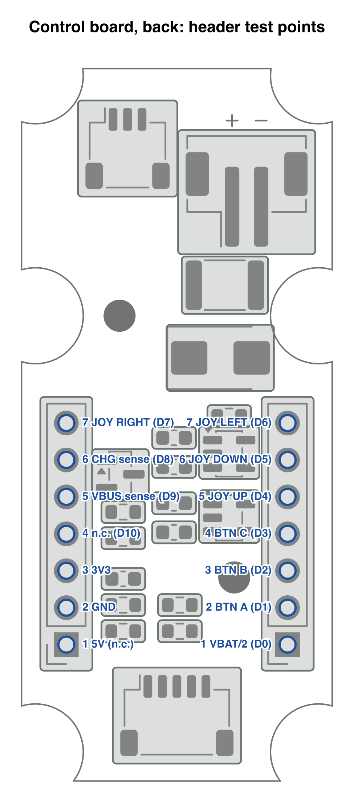

## 3. USB-C board

All its parts are on the top. The board is 1.2 mm thick.

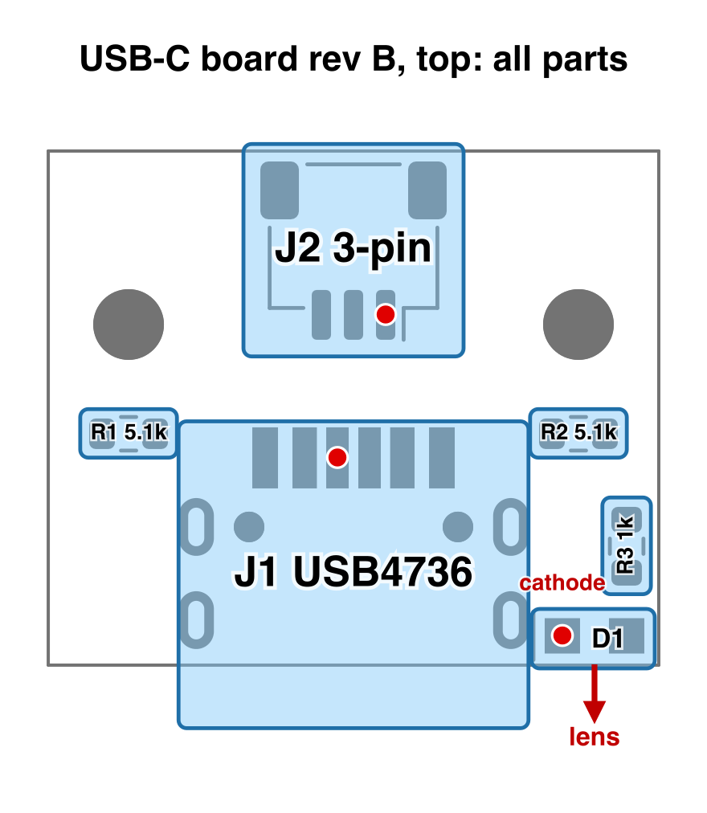

### Step U1: resistors

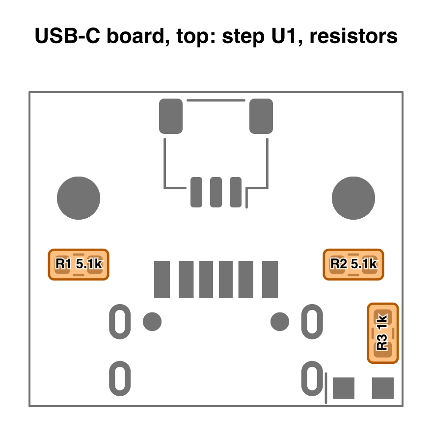

- 5.1k: R1 and R2, the USB-C CC pull-downs.
- 1k: R3, the LED resistor.

### Step U2: socket

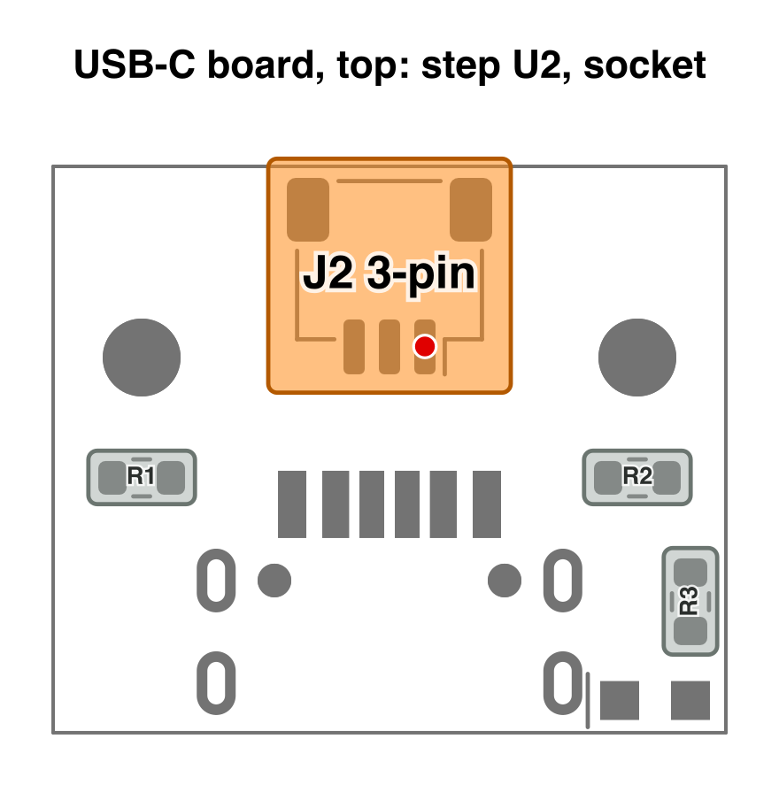

J2 is the 3-pin socket, as in [step C6](#step-c6-sockets-back).

### Step U3: USB-C receptacle

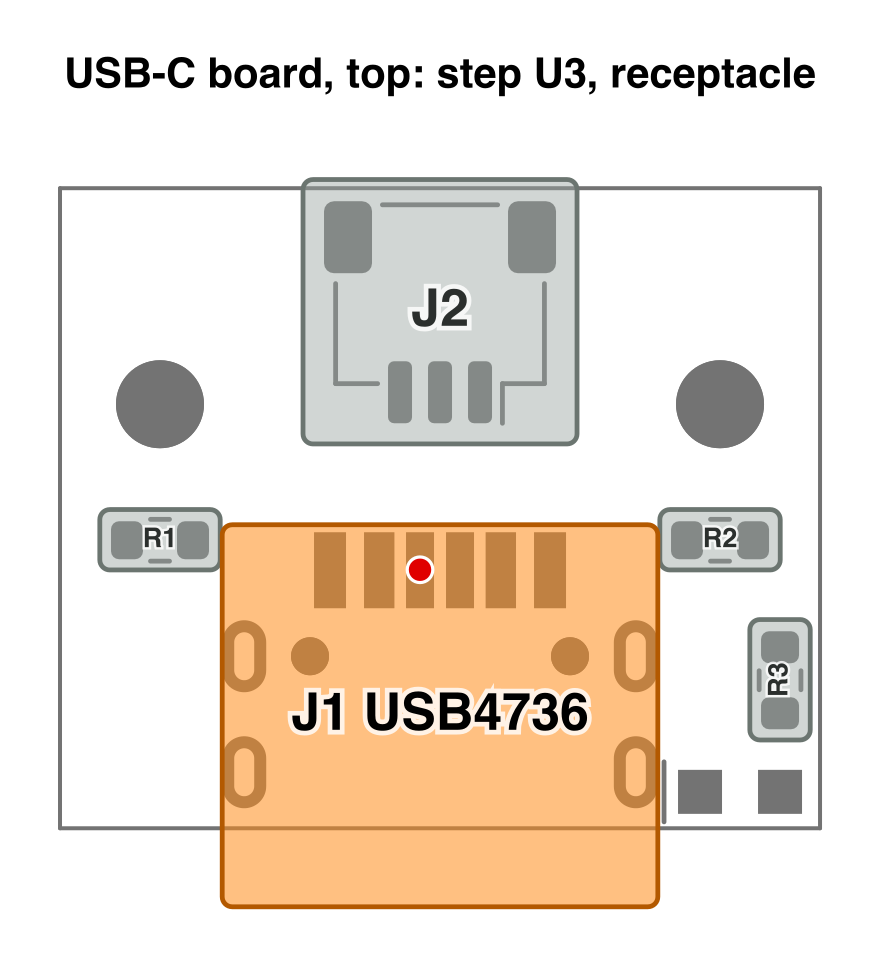

- **Seating.** J1 is the GCT USB4736-GF-A, without its gasket. Its two locating posts drop into the two small holes. Its nose sticks about 1.7 mm past the board edge: 1.5–1.9 mm on the first boards, because the milled outline varies by about ±0.2 mm. The drilled holes, not the edge, set where the receptacle sits.
- **Signal pads first.** Solder the six signal pads at the back of the receptacle while the posts hold it in place.
  - Use plenty of flux and a fine tip.
  - The gaps between pads are only about 0.3 mm. Check for bridges under magnification and clear them with braid.
- **Then the four shell tabs** in their plated slots, from either side. They sit on the ground pour and need heat: use the hottest or biggest tip, and give each one a few seconds.
- **Leave the gasket off.** The USBTJ-06 gasket, the potting and the LED window come in the [mechanical assembly](mechanical-concept.md#assembly), step 2.

### Step U4: charge LED

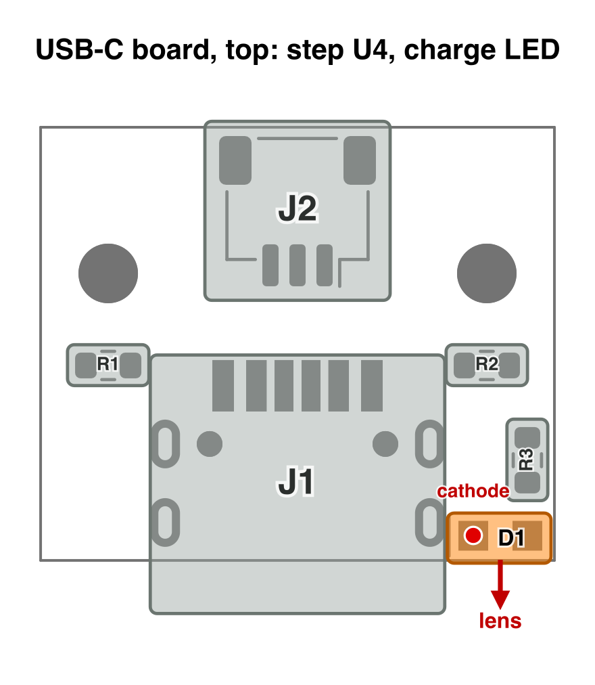

D1 is the LTST-S270KRKT, a 1.65 × 1.15 mm side-view LED. Its lens shines sideways, out of the board edge toward the rear wall, as the arrow shows.

**Check the polarity before soldering.**
1. Set the meter to diode test.
2. Touch the LED's two ends: with the red probe on the anode, it glows faintly and reads about 1.6–2 V.
3. The other end, the cathode, goes on pad 1 (red dot, next to the silkscreen bar).

The cathode mark on the part itself has not been checked against Lite-On's drawing. The meter test is the check that counts.

Solder it like a 0603, with little solder: the pads are small, and solder that climbs onto the lens dims it.

### USB-C board checks

| Between | Expect |
|---|---|
| J2 pin 1 (VBUS) and J2 pin 2 (GND) | Open |
| Across R1, then across R2 | About 5.1 kΩ |
| A CC pad (R1 or R2, receptacle side) to J2 pin 1 | Open (a bridge here would put 5 V on CC) |
| J2 pin 1 to J2 pin 3, diode test, red on pin 1 | The LED glows faintly, or the meter reads its forward voltage plus R3. The meter may show "OL" if its test voltage is too low for LED and 1 kΩ together. |

## 4. Cables

Both cables must be straight: pin 1 at one end goes to pin 1 at the other.

1. **Find pin 1.** Hold the two plugs side by side, latches up. Look through the housing windows.
2. **Probe each wire** with the sewing needle on the meter's continuity range: pin 1 to pin 1, and so on.
3. **No neighbours.** No contact beeps to the next one.

A cable listed as `reverse direction` joins pin 1 to the last pin. Do not use it.

The cables are checked again once fitted, in the next two sections.

## 5. Power tests, without the XIAO

No XIAO and no battery for the first test.

1. **Join the boards.** Plug the 3-pin cable into the USB-C board's J2 and the control board's J3, latches seated. Check with the meter that the cable is straight:
   - J2 pin 1 on the USB-C board beeps to J3 pin 1 on the control board, and pin 3 to pin 3. Probe the socket pins on their pads; pin 1 is the red dot in the images.
   - J2 pin 1 does not beep to J3 pin 3.
2. **Apply USB power.** Plug a 5 V USB-C charger into the receptacle. A USB-C to USB-C cable from a USB-C charger is the surest. A USB-A to USB-C cable also works, because the board has its own CC resistors.
3. **Measure, on the DC volts range, to J2 pin 2 (GND):**

| Point | Expect | Notes |
|---|---|---|
| J5 `+` pad | About 4.2 V | The charger's output with no cell. It may wander; that is expected with no cell. |
| J2 pin 3 (3V3) | 3.3 V | |
| J2 pin 5 (VBUS sense) | About 3.0 V | |
| Charge LED | Off, or flickering | With no cell, STAT is high impedance |

If F1 gets hot or the reading is 0 V, unplug at once and look for a short at D1, C1 or U1.

4. **Check the cell's plug.** Unplug the charger. With the meter on the cell's plug, find its `+` wire. The plug's `+` must meet J5's `+`.
   - Q1 protects the board from a reversed cell, but with USB plugged in a reversed cell slowly discharges (see the [control board README](../electronics/control-pcb/README.md#checks)).
5. **Fit the cell.** Plug the cell into J5 and measure again:
   - J2 pin 3: 3.3 V. If the cell is below about 3.6 V, expect a little less: the regulator drops out.
   - J1 pin 1 (VBAT/2): about half the cell voltage. A 10 MΩ meter reads about 5 % low on this 1 MΩ divider.
6. **Plug the charger in again.** The charge LED lights while the cell charges, and goes out when it is full.

Optional: measure the cell's current through a JST PH extension, with the meter in series on the mA range and the charger unplugged. With no XIAO it should read 0.00 mA (a few µA, below the meter's range). Anything over about 1 mA means a fault.

## 6. XIAO, firmware and function test

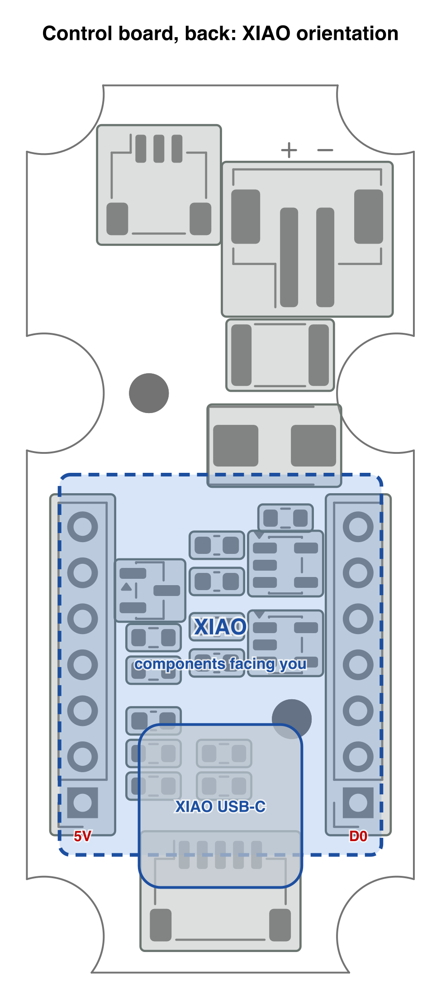

1. **Flash the firmware** with the XIAO off the board.
   - Set `BOARD_V026 = true` in [`open-rally-remote.ino`](../firmware/xiao-nrf52840/open-rally-remote.ino).
   - Build and upload as in the [firmware README](../firmware/xiao-nrf52840/README.md).
   - The bench firmware (`false`) uses a different pin map and drives D8, which on this board is the charger's status input.
2. **Plug the XIAO in.** Unplug the cell first. Plug the XIAO into the headers:
   - components facing away from the board;
   - USB-C at the J4 end;
   - D0 at J1 pin 1, 5V at J2 pin 1.
   Turned round, its 3V3 and GND pins meet the wrong signals.
3. **Plug the cell in.**
4. **Connect a computer.** Connect the XIAO's own USB-C to a computer and open the Serial Monitor at 115200 baud. Its regulator and the board's both feed 3V3; the board's TPS70933 blocks the reverse current.
5. **Buttons.** Press SW1, SW2 and SW3: the Serial Monitor names each control and its gesture.
6. **Joystick.**
   - Join the joystick board to J4 with the 5-pin cable.
   - Press each joystick switch: UP, DOWN, LEFT and RIGHT appear.
   - A reversed cable shows up here: only UP works, because the joystick board's ground then lands on the UP line.
7. **Battery and charger.** The `Battery:` line shows about the cell voltage, `USB` and `CHG`. Plug the charger into the USB-C board: `USB` and `CHG` change, and the LED lights.
8. **Phone.** Pair the phone and run the [first test](../firmware/xiao-nrf52840/README.md#first-test).

Without a computer, steps 5 to 7 can also be checked from the phone with a keyboard tester.

## 7. Conformal coating

Coat the three boards and the XIAO once every test passes.

1. **Unplug everything.** Remove the cell, the cables and the XIAO.
2. **Clean.** Clean again with isopropyl alcohol and let dry.
3. **Mask with tape.**
   - All JST sockets: J3, J4, J5 and both J2s, plus J1 on the joystick board.
   - The top openings of the XIAO headers.
   - The USB-C receptacle: opening and nose.
   - The tops (actuators) of the seven switches.
   - On the XIAO: its pins, its USB-C, its reset button and its RGB LED.
4. **Spray.** Spray thin coats of the acrylic coating on both sides of each board, at the distance the can gives. Two thin coats run less than one thick one.
5. **Cure.** Let each coat dry for as long as the can says. Remove the tape before the last coat cures hard.
6. **Inspect.** Look for gaps at a low angle under a lamp. If the can says the coating has a UV tracer, a UV torch shows the gaps better.

The coating stays off the pouch and the vent; they are not on the boards. The mechanical assembly then starts with the USB-C board in the housing ([step 2](mechanical-concept.md#assembly)).

## Open points

Each of these is checked on the first build. Record the result here.

- **KSC2 by hand.** Whether the KSC221JLFS J-leads can be soldered well with an iron. The pads show about 1 mm past the body. If not, a hot-air station or a hot plate is needed.
- **USB4736 by hand.** The signal pads' 0.3 mm gaps, and the heat the shell tabs need.
- **USB4736 position.** Once it is soldered, measure from the body's front face (where the gasket bears) to the centre of each M2 hole, with a Ø2 mm pin in the hole: 11.10 mm in the design. It sets the gasket squeeze; see the open unknowns in the [mechanical concept](mechanical-concept.md#open-unknowns-before-printing).
- **LED polarity mark.** The LTST-S270KRKT's cathode mark against the footprint: use the meter test above.
- **Header choice.** Whether the XIAO's 6.1 mm pins seat and hold in the 5.7 mm header. The 8.5 mm header clears in the CAD (checked 2026-10-20), but the assembly path checks were not run again for it.
- **Cables.** That the AliExpress `same direction` cables are straight and latch in the "1.0 WT" sockets.
- **Readings.** The expected voltages and resistances above come from the circuit and the datasheets, not from a board.
- **No cell.** The charger's behaviour with USB plugged in and no cell (LED and D8 flicker); see the [control board README](../electronics/control-pcb/README.md#checks).

## Regenerating the images

The step images, the maps and the bare-board renders come from the KiCad boards:

```sh
/Applications/KiCad/KiCad.app/Contents/Frameworks/Python.framework/Versions/Current/bin/python3 \
    electronics/tools/assembly_images.py
```

The script needs KiCad's `kicad-cli` and `rsvg-convert` and `magick` (Homebrew `librsvg` and `imagemagick`). The steps and their parts are the `STEPS` list at its top. It writes `docs/images/<board>-v0.32-asm-*.png` and `*-bare-*.png`.
