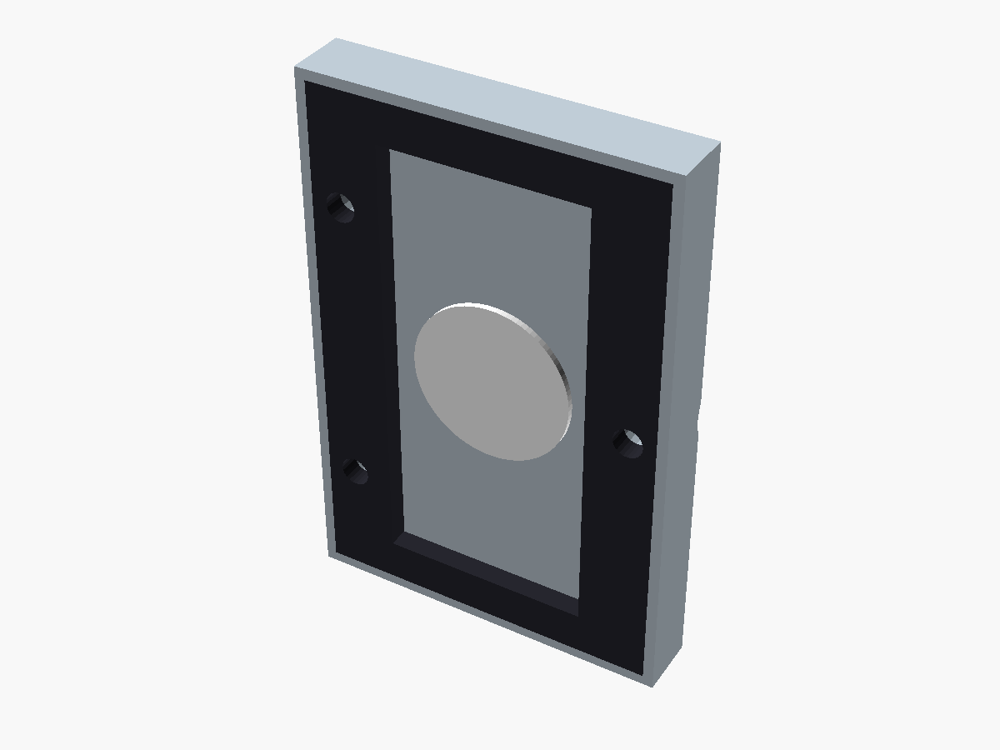
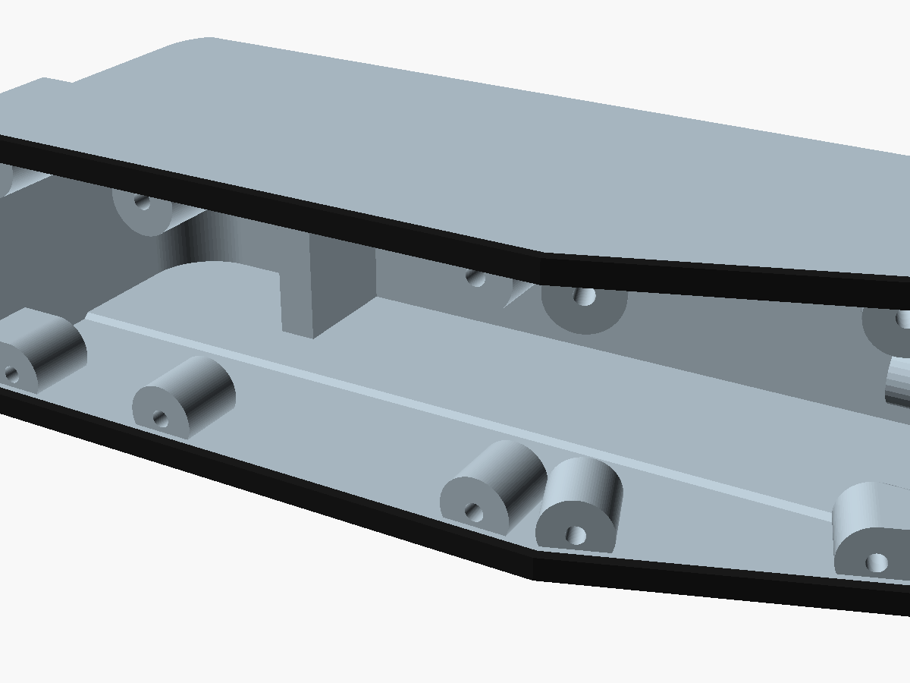
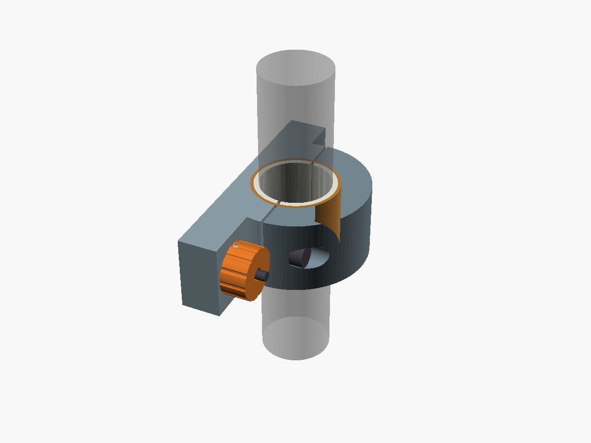
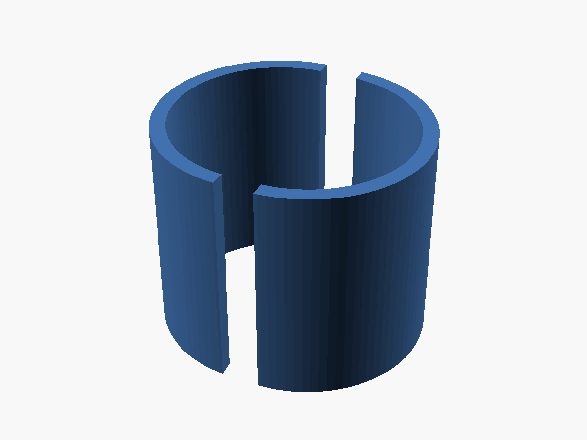
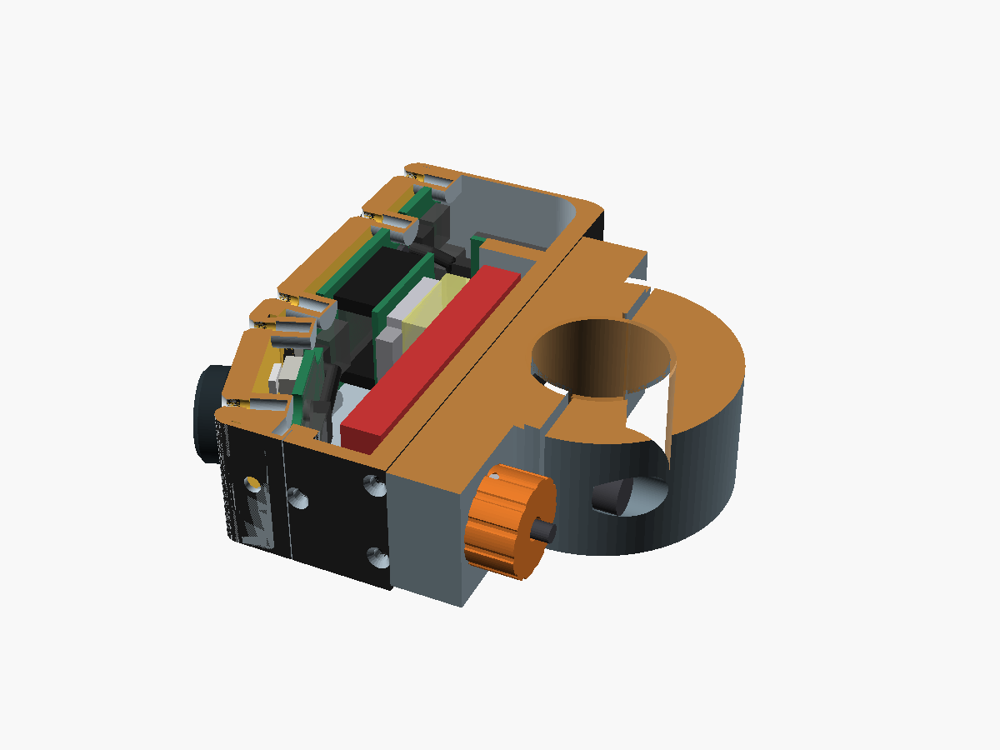
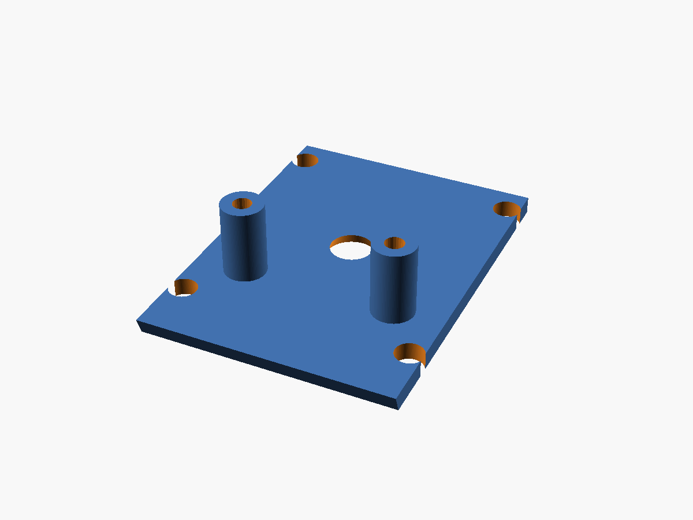
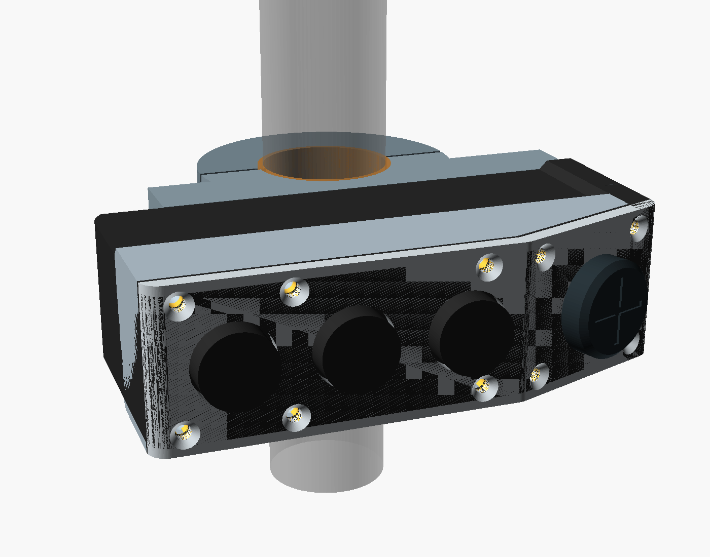
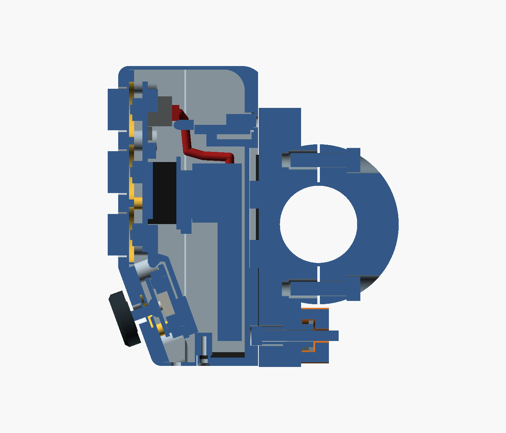
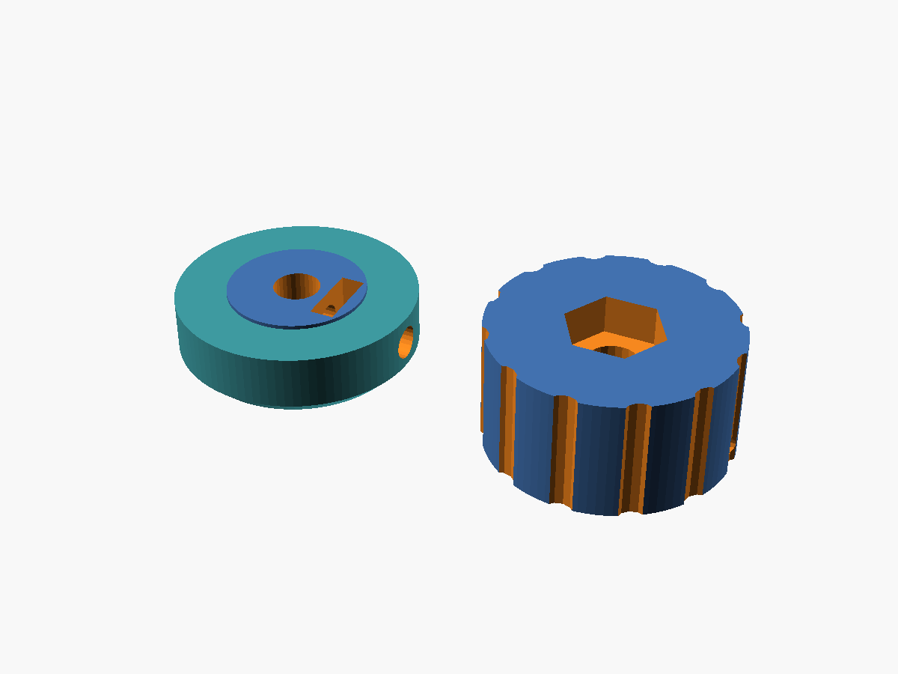

# CAD mecánico completo — Mando V0.33 sin soldadura

> Traducción al castellano de [mechanical-concept.md](mechanical-concept.md). La versión en inglés es la de referencia; si las dos difieren, vale la inglesa. Los textos alternativos de las imágenes siguen la versión inglesa.

La V0.33 engorda las paredes de 1 mm del mando a 2 mm: las paredes axiales de la parte estrecha y las dos paredes de los extremos. Crecen hacia fuera, así que el mando mide 25 mm a lo largo del manillar en vez de 23 mm y 2 mm más de alto, y la cavidad y todo lo que va dentro quedan como en la V0.32. La base también mide 25 mm. Las paredes más gruesas salen del [estudio de materiales](materials-study.es.md): las caídas son frecuentes en pistas, y las paredes de 1 mm con dos perímetros FDM pueden filtrar. El material de impresión aún no está elegido. Mira [Cambios desde la V0.32](#changes-from-v032).

La V0.32 reduce el número de piezas distintas que hay que comprar. El cierre lleva un tornillo M3 × 20 estándar fijado con epoxi, en vez de un M3 × 22 con contratuerca. Las tiras antivibración, y opcionalmente el forro de la abrazadera, se cortan de una cámara de bicicleta, y las almohadillas salen de la espuma del sellado. El pomo del joystick conserva su tuerca cuadrada: una tuerca hexagonal no cabe. Mira [Cambios de la V0.32 respecto a la V0.31](#v032-changes-from-v031-still-current).

La V0.31 sella la tapa de la batería igual que la V0.30 sella la tapa de controles: una junta troquelada de espuma de célula cerrada, cortada de la misma lámina de espuma y comprimida por un labio rígido de la tapa. Mira [Cambios de la V0.31 respecto a la V0.30](#v031-changes-from-v030-still-current).

La V0.30 cambia cómo sellan las dos caras de control frente a la lluvia y el barro. La lámina del teclado pasa a ser una membrana suelta, y una tira comprada de espuma de célula cerrada sobre el borde de la carcasa sella el perímetro ([especificación](superpowers/specs/2026-10-15-cover-seal-design.md)). Mira [Cambios de la V0.30 respecto a la V0.29](#v030-changes-from-v029-still-current).

La V0.29 elimina los insertos roscados por calor, así que el montaje no necesita ninguna herramienta caliente. Los tornillos se hacen su propia rosca en agujeros piloto, y donde un tornillo necesita rosca metálica, una tuerca va en un alojamiento impreso. Mira [Cambios de la V0.29 respecto a la V0.28](#v029-changes-from-v028-still-current).

La V0.28 hace universal la base y mueve la ventilación. Una sola base sirve para los dos diámetros de manillar: su agujero es siempre de 25,4 mm más el forro de TPU, y un manillar de 22,2 mm lleva un casquillo partido impreso. La ventilación pasa a la tapa de la batería, porque en la V0.27 su etiqueta chocaba con la tapa de controles y la placa del joystick. Mira [Cambios de la V0.28 respecto a la V0.27](#v028-changes-from-v027-still-current).

La V0.27 permite que la carcasa cierre sobre el conjunto, y que la tapa salga, en línea recta. En la V0.26, la [comprobación del recorrido de montaje](assembly-video-v0.26-checks.md) vio que los resaltes inferiores de la tapa chocaban en ese recorrido con la placa del joystick. La V0.27 solo cambia la placa del joystick (rev C) y los separadores de la placa base del joystick; mira [Cambios de la V0.27 respecto a la V0.26](#v027-changes-from-v026-still-current).

La V0.26 elimina la soldadura del montaje ([diseño](superpowers/specs/2026-10-14-no-solder-assembly-design.md)). Los botones pasan a ser tres pulsadores sellados en una placa de control montada, que se pulsan a través de un teclado de TPU de una pieza que también hace de junta. La XIAO, comprada con sus pines, va pinchada en zócalos hembra en la parte de atrás de esa placa, que también lleva el cargador y el regulador de 3,3 V. Las placas del joystick y del USB-C se conectan a ella con cables JST SH comprados, y la batería, colocada con la placa de protección hacia arriba, enchufa en ella su propio cable. Los cambios están en [Cambios de la V0.26 respecto a la V0.25](#v026-changes-from-v025-still-current).

La V0.25 quita los pines de la XIAO y monta una batería de 6 × 20 × 50 mm (602050, 600 mAh según el anuncio) en vez de la 602030. Ahora la batería entra desde abajo, por una tapa de batería aparte en el extremo inferior: un estudio de montaje mostró que ninguna batería de 20 mm de ancho, incluida la de la V0.24, pasa por la abertura delantera. Los cambios están en [Cambios desde la V0.24](#changes-from-v024).

La V0.24 hace el mando extraíble y con batería, siguiendo el [estudio de la batería](battery-study.md) y el issue #1. En cada moto queda una base sujeta; el mando se desliza sobre ella por una cola de milano interrumpida y lo sujeta un cierre con muelle. Lo alimenta una batería LiPo fija, y se carga fuera de la moto por un receptáculo USB-C sellado en su parte trasera, con un LED de carga al lado. Todo lo que está delante de la cara trasera del mando es el cuerpo de la V0.23, sin cambios. Los cambios están en [Cambios desde la V0.23](#v024-changes-from-v023-still-current).

La V0.23 llevó el joystick de la V0.22 a una placa de circuito real, diseñada en KiCad: la [placa del joystick](../electronics/joystick-pcb/README.md) lleva los cuatro interruptores y la protección de la entrada de 5 V. La V0.22 volvió a poner un joystick en la cara inferior, hecho con piezas baratas, y ensanchó el extremo de controles del cuerpo de 23 a 26 mm. La base y la parte trasera del cuerpo siguen teniendo 23 mm de ancho a lo largo del manillar.

El joystick es un pasador de acero con una bola impresa. La bola pivota contra un asiento en una placa del joystick impresa. Debajo de la bola, un disco en forma de cruz se apoya sobre cuatro pulsadores sellados C&K KSC2, cuyos muelles centran la palanca. Al inclinar la palanca se pulsa un interruptor; al empujarla hacia dentro se pulsan los cuatro, y el firmware lo lee como pulsación central. Las piezas cuestan unos pocos euros. El Ruffy MHS de la V0.20 costaba unas 149 £, y el APEM NV, la alternativa comercial más parecida encontrada, 143 $.

Las piezas impresas del mando son rebanadas de un solo sólido exterior: el contorno del cuerpo cortado en plano en la cara trasera, de 25 mm de ancho a lo largo del manillar (23 mm antes de la V0.33), más el extremo de controles de 26 mm. Desplazamientos del frente plegado cortan de él la tapa y la junta. La base son dos mitades separadas, partidas por el eje del manillar. Las incógnitas de proveedores y compras siguen abiertas y están al final; en el CAD están marcadas como `MEASURE`.

El mando se monta solo en el lado izquierdo del manillar, nunca en el derecho. El mando de intermitentes, que el frente plegado esquiva, está en la piña izquierda.

**Concepto paramétrico actual:** [complete-remote-v0.33.scad](../mechanical/cad/complete-remote-v0.33.scad)




















Las imágenes de abajo son de la V0.25 y anteriores; detrás de la cara superior, la V0.26 cambia como se ha descrito.


Los renders de abajo son de la V0.24; salvo el extremo inferior, el mando y la base no han cambiado.


El extremo de controles no ha cambiado desde la V0.23. Estos renders de la V0.23 todavía lo muestran:


Las dos imágenes de la V0.33 son renders del CAD hechos con Blender (mira [Renders fotográficos](#photo-renders)). Las demás son renders directos de OpenSCAD del fichero de la V0.25, la V0.24 o la V0.23. Las imágenes de la placa están en la [página de la placa del joystick](../electronics/joystick-pcb/README.md).

<a id="changes-from-v032"></a>
## Cambios desde la V0.32

### Paredes de 2 mm

En la V0.32 la parte estrecha del mando, hasta 38 mm del eje del manillar, tenía paredes axiales de 1 mm, y las dos paredes de los extremos medían 1 mm. Con una boquilla de 0,4 mm eso son dos perímetros FDM, que pueden filtrar (mira [Sellado](#sealing), punto 8). El [estudio de materiales](materials-study.es.md) vio además que las caídas en pistas son frecuentes, y la resistencia a flexión de una pared crece con el cuadrado de su espesor.

Los 23 mm de ancho venían del espacio libre en el manillar entre el puño y la piña que da el manual del NAVCOMM. El NAVCOMM es una referencia, no un requisito, y la piña normalmente se puede mover a lo largo del manillar.

La V0.33:
- **Paredes axiales.** `case_wall` pasa de 1 a 2 mm, hacia fuera: `axial_width` pasa de 23 a 25 mm. La cavidad sigue midiendo 21 mm de ancho, así que la batería, la XIAO y las placas no se mueven.
- **Paredes de los extremos.** Crecen 1 mm hacia fuera en cada extremo: el extremo de arriba sube a Y = 46,5 mm (`pod_top_y`) y el de abajo baja 1 mm (`lower_facet_length` = 30 + 1/cos 20°). El mando mide 88,2 mm de alto en vez de 86,2 mm. La cavidad no cambia: 54.540 mm³ detrás de la franja de la tapa en las dos versiones.
- **Extremo de controles.** Sigue midiendo 26 mm de ancho con paredes de 2 mm; el chaflán hasta la parte estrecha (`pod_step`) baja de 1,5 a 0,5 mm.
- **Base.** También mide 25 mm de ancho, porque la base y el mando comparten `axial_width`. La abrazadera gana 2 mm de contacto con el manillar. Los forros se cortan de 25 mm de ancho.
- **Tapa de la batería.** 3,0 mm de grosor bajo su espuma en vez de 2,0 mm, porque el extremo de abajo bajó y la cara de la carcasa sobre la tapa (`cap_y`) no se movió. Los tornillos M2 × 8 conservan 4,0 mm de rosca en la carcasa en vez de 5,0 mm, y el resalte delantero es 1 mm más corto.
- **Tira de espuma.** En las paredes de los extremos ahora apoya entera sobre la pared de 2 mm; de la V0.30 a la V0.32 el borde ahí se ensanchaba hacia dentro de 1 a 2 mm.
- **Masa.** La carcasa pasa de 16,4 a 20,9 cm³, unos 4,5 g en nylon; la tapa de la batería, de 0,9 a 1,3 cm³.
- **Tiras antivibración.** Con la ranura 1 mm más lejos de cada cara lateral, cada tira apoya más sobre la cara trasera: 218 mm³ de compresión en el CAD en vez de 196 mm³. La profundidad de compresión no cambia.

<a id="v032-changes-from-v031-still-current"></a>
## Cambios de la V0.32 respecto a la V0.31, aún vigentes

### Menos piezas que comprar

- **Tornillo del cierre.** La V0.31 pedía un M3 × 22, que no es un largo de la ISO 4762 (M3: 16, 20, 25, 30 mm). Un M3 × 20 (`lock_screw_length`) pasa 1,0 mm a través de la tuerca del alojamiento del pomo y acaba 0,8 mm dentro de la cara exterior del pomo (`lock_tip`), sin sitio para una contratuerca. Cuando la cabeza sobresale 2 mm, una gota de epoxi transparente en la rosca fija la tuerca. Así el ajuste queda permanente: para cambiar el muelle, hay que calentar o cortar la unión. La otra opción era un M3 × 25 con tuerca autoblocante de nailon. Esa tuerca mide 4 mm de alto, y un alojamiento para ella no dejaría pared sobre el agujero de 4 mm, así que iría sobre la cara, sobresaliendo 4 mm, con 1,8 mm de rosca por fuera.
- **Tiras antivibración.** Se cortan de una cámara de bicicleta. Mide la goma y ajusta `strip_t` antes de imprimir la parte delantera de la base. La profundidad del alojamiento la sigue (`strip_pocket` = `strip_t` − 0,48 − `strip_squeeze_set`), así que las tiras quedan siempre comprimidas 0,3 mm con los flancos asentados. Una cámara de 1,0 mm da un alojamiento de 0,2 mm; cabe una cámara de hasta 0,78 mm, sin alojamiento. En la V0.31 las tiras eran de TPU de 1,4 mm en alojamientos de 0,6 mm.
- **Forro de la abrazadera.** El forro es un medio anillo liso, así que la misma cámara puede sustituir al TPU impreso: dos piezas de 23 mm de ancho y unos 43 mm de largo (25 mm de ancho desde la V0.33). Ajusta `liner_radial` al grosor de la cámara antes de imprimir la base; el agujero lo sigue. Entre 0,8 y 1,2 mm, la plataforma conserva de 3,7 a 3,3 mm delante del agujero.
- **Almohadillas de espuma.** Las almohadillas de la tapa de la batería, de la pared trasera y de la XIAO salen de la espuma de célula cerrada de 1,5 mm del sellado, en capas. Los huecos hasta la batería en el CAD son de 5,7 mm desde la tapa, 1,3 mm desde la pared trasera y 7,4 mm desde los componentes de la XIAO. Eso da 4 capas en la tapa (6,0 mm), y 1 en la pared trasera con 6 en la XIAO (10,5 mm en un hueco de 8,7 mm, una compresión de alrededor del 17 %). Las almohadillas no están modeladas.
- **Tuerca del pomo del joystick: sin cambios.** Una tuerca hexagonal M2, que viene en los surtidos de tornillos M2, no cabe. Con una esquina hacia la parte de arriba del pomo, para que no gire en la ranura, necesita 4,62 mm más 0,2 mm de holgura y 0,5 mm de piel. El pomo tiene 4,8 mm entre la cara del cubo y la parte de arriba, así que la tuerca sobresaldría 0,6 mm del cubo hacia la tapa. Con una cara plana hacia arriba, la ranura tiene que medir 4,62 mm de ancho y la tuerca gira en ella. También se descartó un tornillo avellanado en lugar del prisionero: su cabeza se detiene a una profundidad fija, así que no se puede apretar contra el pasador.

<a id="v031-changes-from-v030-still-current"></a>
## Cambios de la V0.31 respecto a la V0.30, aún vigentes

### Sellado de la tapa de la batería

La junta plana de la tapa tenía el mismo problema que tuvo la tapa de controles: 0,8 mm de TPU apretados a 0,6 mm sobre apoyos de 2,5–3,8 mm necesitan unos 4 kN (estimación, como en la [V0.30](#v030-changes-from-v029-still-current)), y tres tornillos M2 dan unos pocos cientos de newtons. La tira de la V0.30 no cabe aquí: los tornillos están en los apoyos, a 0,7–0,9 mm de la abertura, así que una tira de 2 mm por dentro de ellos no tiene sitio, y una por fuera dejaría los agujeros de los tornillos dentro del sellado.

V0.31:
- **Junta de espuma.** Un marco de la misma espuma de célula cerrada que la tira de la tapa de controles, de 1,5 mm, cortado con el contorno de la junta anterior, llena los apoyos: 200 mm² en el CAD. A 20–70 kPa (valores de catálogo de espuma blanda de célula cerrada al 25–33 %) necesita de 4 a 14 N. Los tornillos la atraviesan, y sus agujeros de Ø1,4 mm los abrazan, así que los agujeros de los tornillos quedan sellados estén donde estén.
- **Labio.** Un labio rígido de 0,5 mm de ancho (`cap_lip_w`) recorre el borde exterior de la tapa y apoya en la cara de la carcasa. Detiene la tapa a 1,0 mm (`cap_gap` = `foam_comp`) de la carcasa, así que la espuma queda siempre comprimida un 33 %, por mucho que se aprieten los tornillos.
- **Tapa.** 2,0 mm de grosor bajo la espuma en vez de 2,4 mm. Los tornillos conservan 5,0 mm de rosca en la carcasa. La etiqueta de ventilación va en la cara de la tapa, en la abertura, fuera de la espuma.
- **Plantilla.** `print_cap_gasket` imprime ahora una plantilla de 0,8 mm para cortar alrededor el marco de espuma.

<a id="v030-changes-from-v029-still-current"></a>
## Cambios de la V0.30 respecto a la V0.29, aún vigentes

### Sellado de la tapa de controles

La lámina del teclado de la V0.29 era la junta: 0,8 mm impresos, apretados a 0,6 mm sobre la placa de botones, la placa del joystick y el borde. El CAD da 847 mm² de lámina apretada en la cara superior y 678 mm² en la inferior. Una lámina fina de TPU apretada entre caras rígidas no se puede extender hacia los lados: con tiras de unos 2,7 mm de ancho, el factor de forma es de alrededor de 1,7 y la lámina se comporta unas 4,5 veces más rígida que su módulo de Young (13 MPa para TPU 85A, según la relación de Gent, aproximada). Al 25 % de compresión son unos 15 MPa, unos 12 kN en la cara superior, frente a quizá 1 kN de seis tornillos M2 en PETG. La lámina se habría comprimido unas centésimas de milímetro, menos que la planitud de una impresión FDM. Un cordón impreso sobre la lámina necesitaría 3–5 N/mm, y la tapa entre los tornillos superiores, separados 30 mm, se doblaría más o menos lo mismo que se comprime el cordón.

La V0.30 sella frente a la lluvia, el barro y una manguera sin presión, más o menos IPX5/IPX6:

- **Lámina suelta.** La lámina conserva sus 0,8 mm y ya no se aprieta: las placas quedan a `sheet_clear` (0,1 mm) detrás de ella. Las teclas no cambian; su holgura en reposo sigue siendo de 0,3 mm con la lámina contra la tapa.
- **Tira de espuma.** Una tira de espuma de célula cerrada de 1,5 mm (`foam_t`), comprimida a 1,0 mm (`foam_comp`) y de 2 mm de ancho (`foam_w`), va sobre el borde de la carcasa bajo el borde de la lámina, alrededor de las dos caras y por el pliegue: 443 mm², unos 221 mm de tira, el 99,7 % sobre material de la carcasa. El borde baja a `rim_off` = 4,3 mm detrás de la cara de la tapa, y en las dos paredes de los extremos se ensancha hacia dentro de 1 a 2 mm. Con valores de catálogo de espuma blanda de célula cerrada (0,05–0,1 N/mm), la tira necesita menos de 30 N, y la tapa se dobla unos 0,015–0,07 mm entre los tornillos superiores, frente a 0,5 mm de recorrido de la espuma.
- **Topes.** Un anillo de Ø4 mm alrededor de cada tornillo de la tapa, en las caras delanteras de las placas, sobresale 0,15 mm y pellizca la lámina 0,05 mm: unos 8,5 N por tornillo (estimación, `pad_load`). Si se aprieta más, la lámina toca las placas 0,1 mm más adentro.
- **Agujeros de los tornillos.** Los agujeros de la lámina para los tornillos pasan de Ø2,4 a Ø1,4 mm para que abrace la caña del M2, como abraza el pasador del joystick. El agua puede seguir la rosca; la cabeza avellanada en la tapa es la primera barrera, y la prueba de estanqueidad decide.
- **Consecuencias.** Las placas, los interruptores, los resaltes, la placa de control y la XIAO se desplazan unos 0,3 mm hacia atrás: la XIAO queda a 7,0 mm de la envolvente de la batería (antes 7,2), y los separadores de la placa de control miden 2,2 mm (antes 2,3). El pivote del joystick también va hacia atrás, así que el agujero del pasador en el pomo mide 3,7 mm de profundidad en vez de 4,0 y el pasador de 3 × 12 mm sigue llegando. El extremo de la placa de botones junto al pliegue es 0,2 mm más corto.

<a id="v029-changes-from-v028-still-current"></a>
## Cambios de la V0.29 respecto a la V0.28, aún vigentes

### Sin insertos roscados por calor

El diseño mantenía los insertos roscados por calor con la esperanza de que el servicio de impresión los colocara. Ningún servicio encontrado coloca insertos M2: JLC3DP solo coloca de M3 a M5 y pide 3 mm de pared alrededor del agujero, y los demás no ofrecen la opción. Así que la V0.29 sustituye todos los insertos:

| Dónde | V0.28 | V0.29 |
|---|---|---|
| Tornillos de la tapa (10) | Insertos M2 en agujeros de Ø3,2 × 6 mm | Los tornillos M2 × 10 se hacen su propia rosca en pilotos de Ø1,6 × 6 mm (`cover_pilot_d`), como ya hacen los de la tapa de la batería |
| Abrazadera (2) | Insertos M4 en agujeros de Ø5,6 × 8,1 mm | Los tornillos M4 × 16 se hacen su propia rosca en pilotos de Ø3,4 × 8,1 mm (`base_pilot_d`). Una tuerca quedaría sobre la plataforma, debajo del mando. Un tornillo autorroscante para plásticos tiene una cabeza de unos 8 mm, demasiado grande para los avellanados de Ø7,6 mm |
| Pomo del joystick | Inserto M2 radial para el prisionero | Una tuerca cuadrada M2 (DIN 562, 4 × 1,2 mm) en una ranura abierta hacia la tapa (`knob_nut`), a 0,65 mm del agujero del pasador. La cruz grabada empieza a 4,9 mm del centro para no tocar la ranura |
| Pomo del cierre | Inserto M3 desde dentro de la copa | Una tuerca M3 en un alojamiento hexagonal en la cara exterior del pomo (`lock_nut`). La tensión del tornillo tira de la tuerca contra el fondo del alojamiento, y la contratuerca se bloquea contra ella. V0.32: sin contratuerca; el epoxi en la rosca fija la tuerca |



La cruz grabada del pomo del joystick se reduce a cuatro marcas de 0,6 mm en el borde. El coste: las roscas impresas en PETG se desgastan con cada apertura. La tapa y la abrazadera se abren poco; los tornillos de la tapa de la batería ya funcionaban así. Las medidas de los pilotos son estimaciones iniciales y hay que comprobarlas en la primera impresión.

### Resalte de la tapa de la batería

El resalte del tornillo delantero de la tapa es 0,3 mm más bajo, así que el J1 de la placa del joystick ya no lo toca ([comprobación de recorrido de la V0.28](assembly-video-v0.28-checks.md)). Sigue sobresaliendo 1,3 mm por encima de la punta del tornillo M2 × 8.

<a id="v028-changes-from-v027-still-current"></a>
## Cambios de la V0.28 respecto a la V0.27, aún vigentes

### Una base para todos los manillares

El agujero de la abrazadera es siempre de 25,4 mm más el forro de TPU de 1 mm (Ø27,4 mm). Un manillar de 25,4 mm (1 in) lleva solo el forro. Un manillar de 22,2 mm (7/8 in) lleva dos mitades de casquillo impresas en PETG, de 1,6 mm (`sleeve_t`), entre el manillar y el forro. Cada mitad se queda 0,5 mm corta del corte (`sleeve_gap`), así que las mitades se cierran sobre un manillar algo más fino en vez de tocarse borde con borde como un anillo rígido. El casquillo se imprime para el manillar medido: ajusta `bar_diameter` a la lectura del calibre en la zona de la abrazadera. Un manillar pintado midió 22,5 mm, 0,3 mm por encima de los 22,2 mm nominales; un casquillo de 22,2 solo apoyaría ahí por los bordes. Con 22,5 mm la pared mide 1,45 mm, y las comprobaciones de abajo pasan igual. Los manillares cónicos de 28,6 mm bajan a 22,2 mm en la zona de los mandos.

Se consideró y descartó un único forro de goma grueso (2,6 mm para un manillar de 22,2 mm): dejaría que el mando girara un poco con cada pulsación y perdería precarga con el tiempo. El casquillo rígido fija la medida; el forro fino da el agarre y absorbe la tolerancia. Los tornillos, los agujeros de los insertos y la plataforma ya estaban dimensionados para el agujero de 25,4 mm, así que no cambia nada más.

Estimación del par, a comprobar en la moto. Las tres entradas son supuestas, no medidas: una pulsación con guantes de 20 N en el botón A, a 33 mm del eje del manillar, da unos 0,7 N·m; dos tornillos M4 con una precarga de unos 500 N cada uno en insertos roscados por calor; y un coeficiente de rozamiento de 0,3 en la superficie más lisa (PETG sobre el manillar). Con eso, la abrazadera aguanta unos μ × 1000 N × 11,1 mm = 3,3 N·m, así que el margen es de alrededor de 4,7.

<a id="vent-in-the-battery-cap"></a>
### Ventilación en la tapa de la batería

En la V0.27 la etiqueta de ventilación de Ø10 mm estaba en la pared inferior de la carcasa, en X = −41 mm. Se metía 3,2 mm en la tapa, el teclado y la placa del joystick, y en esa pared solo quedan 7,3 mm libres entre ellos y el bloque delantero de la tapa de la batería. Ahora la ventilación atraviesa la tapa de la batería, centrada en su abertura (`vent_x` = −26,1 mm). La etiqueta va en la cara interior de la tapa, mirando hacia abajo. Takachi desaconseja las ventilaciones en caras superiores, donde la lluvia se acumula sobre el filtro. Ahora la etiqueta es una ventilación adhesiva de ePTFE de Ø7,6 mm (`vent_pad_d`, la medida del [VE8 de Takachi](https://takachi-enclosure.com/products/VE8)). Deja 1,1 mm hasta los bordes de la abertura, y la almohadilla de espuma de la tapa lleva un agujero alrededor de ella. La carcasa pierde su agujero de ventilación.

<a id="v027-changes-from-v026-still-current"></a>
## Cambios de la V0.27 respecto a la V0.26, aún vigentes

### Placa del joystick rev C

Los resaltes inferiores de la tapa están en la cara inferior, a 20° de los superiores. Sus columnas de Ø6 mm atraviesan unas muescas de la placa del joystick con 0,3 mm de holgura y llegan a la placa base del joystick. Cuando la carcasa se mueve a lo largo de X, como tiene que hacerlo por los resaltes superiores, la XIAO y la placa de control, cada resalte inferior también se desliza 0,34 mm hacia abajo de la cara por cada milímetro en X. En la V0.26 chocaba con la placa desde unos 10 mm antes (19 mm³ a 6,6 mm). Ninguna dirección recta funcionaba, y montar primero el grupo del joystick en la carcasa tampoco ([comprobación de recorrido de la V0.26](assembly-video-v0.26-checks.md)).

[Placa del joystick rev C](../electronics/joystick-pcb-rev-c/README.md):

- **Ranuras.** Las dos muescas hacia el pliegue se alargan 3 mm cara abajo como ranuras (`joy_pcb_slot`), en el sentido en que se deslizan los resaltes. Con 2 mm aún había solape (1,7 mm³). Con 3,5 mm la ranura quedaba a 0,17 mm de un pad de interruptor, por debajo de los 0,3 mm de holgura al borde de la placa; con 3 mm queda a 0,67 mm. Las muescas del lado contrario al pliegue siguen siendo redondas: ahí los resaltes se salen por el borde de la placa.
- **Tornillos.** Los dos tornillos de la placa y los separadores de la placa base pasan a la mitad inferior, en (∓6,5, −6,4) mm en el sistema del joystick (`joy_standoffs`). En la V0.26 un tornillo estaba en (−6,0, 6,4), en el camino de un resalte que se desliza, y en la mitad superior ya no queda sitio entre los interruptores y las ranuras. Las nuevas posiciones dejan los contornos de los separadores a 0,2 mm de los interruptores laterales y de J1. Están a 0,82 mm de los pads de los interruptores y a 0,37 mm de las muescas inferiores.
- **J1** se mueve 1 mm hacia la línea central (`joy_j1`), para pasar entre las dos cabezas de los tornillos (0,35 mm a cada lado).

Así la carcasa se mueve a lo largo de X desde 45 mm fuera hasta su asiento sin ningún solape de más de 0,01 mm³ (de 0 a 15 mm en pasos de 0,25 mm), salvo el contacto de 0,015 mm³ de J1 en el asiento que ya tenía la V0.26. La tapa sale igual. La [comprobación de recorrido de la V0.27](assembly-video-v0.27-checks.md) coincide.

**Coste.** Ahora los dos tornillos están en una línea por debajo del eje de la palanca, así que la mitad superior de la placa solo la sujeta la propia placa. El interruptor de arriba empuja sobre ella cuando la palanca se inclina hacia arriba. Tratada como un voladizo de FR4 de 20,6 mm de ancho y 1,6 mm, empotrado en la línea de los tornillos y cargado en el interruptor de arriba, a 13,2 mm, se dobla unos 0,011 mm con 2 N (E = 20 GPa), frente a la holgura en reposo de 0,05 mm (`joy_rest_gap`). Es una estimación a mano que deja fuera los separadores impresos; compruébalo en la primera impresión.

<a id="v026-changes-from-v025-still-current"></a>
## Cambios de la V0.26 respecto a la V0.25, aún vigentes

### Placa de control y teclado

- **Botones.** Tres pulsadores sellados C&K KSC221JLFS en la cara delantera de la [placa de control](../electronics/control-pcb/README.md), en Y = 33, 15 y −3 mm, sustituyen a los botones APEM, sus tuercas y sus cables.
- **Teclado.** La junta pasa a ser una pieza impresa de TPU: una lámina entera en las dos caras, con tres teclas de Ø12 mm que sobresalen 3 mm de la tapa por agujeros de Ø13 mm. Detrás de cada tecla, la lámina aprieta directamente el pulsador del interruptor, a 0,3 mm en reposo (`key_rest_gap`), lo que cubre unos 0,25 mm de tolerancia de impresión y de la lámina. La parte de atrás de la lámina es plana, así que se imprime con las teclas hacia arriba, sin soportes. Desaparecen la junta de apoyo en pared de la cara superior y el labio de la junta.
- **Placa de botones.** Una placa impresa de 1,5 mm detrás de la lámina superior, como la placa del joystick en la cara inferior. Los seis tornillos superiores de la tapa la aprietan contra la lámina. Unos agujeros de Ø15,8 mm alrededor de las teclas dejan flexar la lámina y alojan los cuerpos de los interruptores; dos separadores de 2,3 mm, a 3,95 mm a cada lado de la línea central entre las teclas, sostienen la placa de control.
- **Apilado** (desde la cara de la tapa): tapa 2,5, lámina 0,6, placa 1,5, pulsadores de los interruptores a 3,4, placa de control 6,9–8,5, zócalos de 5,7 mm y el separador de pines de 2,5 mm de la XIAO, placa de la XIAO a 16,7, sus componentes hasta 21,3 mm (X = −36,2 mm), a 7,2 mm de la envolvente de la batería. (V0.28 con la XIAO medida: en el peor caso la placa queda a 17,1 y sus componentes de 3,0 mm siguen acabando en 21,3; mira "Incógnitas abiertas".)
- **XIAO.** Comprada con pines (102010631) y pinchada en dos zócalos hembra 1 × 7 en la parte de atrás de la placa de control, con los componentes hacia la batería. Desaparecen los raíles de la carcasa y la entrada de la XIAO desde abajo. Una almohadilla de espuma entre la XIAO y la batería la mantiene en sus zócalos.
- **Tornillos de la tapa.** Los resaltes superiores empiezan detrás de la placa de botones, como los inferiores, y atraviesan muescas de la placa de control, así que la placa, la XIAO y la placa de botones salen con la tapa. Los diez tornillos de la tapa son M2 × 10. El tornillo superior de Y = 6 mm se movió a −6 mm, porque la XIAO no puede pasar resaltes en Y = 6 al salir; ahora la distancia entre los tornillos superiores de 24 y −6 mm es de 30 mm.

### Cables y batería

- **Placa del joystick rev B** ([placa](../electronics/joystick-pcb-rev-b/README.md)): el fusible PTC y el TVS pasan a la placa de control; un conector JST SH de 5 pines en la parte de atrás, por debajo del eje de la palanca, recibe un cable de 5 pines que rodea el borde superior de la placa hasta la placa de control.
- **Placa USB-C rev B** ([placa](../electronics/usbc-pcb-rev-b/README.md)): 16 mm de fondo en vez de 13,6 mm, agujeros a ±7 mm; un conector de 3 pines detrás del receptáculo. El LED de carga cuelga de VBUS y lo conmuta la salida STAT del cargador.
- **Batería.** Colocada con la placa de protección hacia arriba. Su propio cable JST PH sale del extremo superior por debajo del nervio de la placa USB-C y va hacia delante y hacia arriba hasta un conector de entrada superior en la placa de control: 27 mm en el CAD. Sin empalmes ni alargadores. Para cambiar la batería hay que quitar la tapa de controles además de la tapa de la batería. Se comprobó y descartó un diseño con alargador y una unión junto a la tapa: la unión (unos 16 × 6 × 4,5 mm) no cabe en los 4,2 mm que hay debajo de la batería, y no se encontró ningún alargador de 5–6 cm a la venta.

<a id="changes-from-v024"></a>
## Cambios de la V0.25 respecto a la V0.24, aún vigentes

Los raíles de la XIAO, los cables de la batería y la orientación de la batería de abajo se sustituyeron en la V0.26 (mira arriba).

### Por qué la batería pasó a una tapa inferior

La V0.24 dejaba que la batería entrara por delante con la tapa de controles quitada. Nunca se comprobó, y no funciona. Un barrido de la batería desde el frente hasta su sitio, hecho sobre las mallas con la celda 0,2 mm más grande que la nominal, muestra:
- El labio de la junta deja 16,4 mm a lo ancho de la abertura delantera a lo largo de la cara superior, menos que los 20 mm de la batería. De canto, la batería pasa el labio (0 mm³), pero al girarla en plano dentro siempre choca con los resaltes inferiores de los tornillos de la tapa (como mínimo 26 mm³ en la V0.24).
- En plano, por la abertura de la cara inferior (ahí no hay labio) a unos 23° y luego hacia atrás: 0,02 mm³ con los resaltes de la V0.24, y un camino libre con 0,4 mm por lado solo tras alargar la cara inferior 2 mm y bajar 2 mm el tornillo más bajo; pasan 6 de 112 variantes de recorrido. Con la batería de 50 mm también estorban los raíles de la XIAO (unos 470 mm³).
- Por el extremo inferior, recta hacia arriba a lo largo de +Y: sin solape con los raíles, los resaltes, el nervio del USB-C, la XIAO ni el joystick. Solo estorban la pared inferior y la esquina interior trasera inferior de R6 (95 mm³; 13 mm³ con R3, 0,7 con R1,5, 0,01 con R1).

Se compararon dos formas de cerrar el extremo inferior. Alargar la tapa de controles alrededor del extremo inferior exigiría que una sola tapa rígida apretara a la vez juntas orientadas a X y a Y: colocada a lo largo de X, no comprimiría nada la cara inferior, y colocada a 45° daría alrededor del 71 % en cada cara con otro tanto de deslizamiento. Además llegaría a la cara trasera junto al agujero del cierre. Una tapa aparte aprieta su propia junta plana a lo largo de Y, y una franja de carcasa entre las dos aberturas separa las dos juntas, sin unión en T. La V0.25 usa la tapa aparte.

### XIAO sin pines

- **Placa.** La XIAO sin pines (Seeed 102010448). Los cables de señal se sueldan por delante de sus pads, y los de la batería a los pads `BAT` de la parte de atrás. La parte de atrás reserva 1,0 mm para soldaduras y cables (`xiao_rear_h`) en vez del separador de 2,5 mm y los pines de 6 mm, entre los labios de los raíles.
- **Raíles.** La ranura pierde el sitio del separador y deja 0,3 mm a cada lado para el estaño de los pads del borde bajo los labios (`xiao_fillet`).
- **Placa del banco.** La XIAO con pines soldados se queda en la protoboard; el mando necesita una segunda, sin pines.

### Batería y tapa de la batería

- **Batería.** Una batería de 6 × 20 × 50 mm (602050; 600 mAh según el [anuncio](https://es.aliexpress.com/item/32878657347.html), sin verificar; 4,69 € allí el 13-10-2026, antes del envío). Envolvente X = −29 a −22, Y = −33,5 a 17,5 mm, detrás de la XIAO, a 2,4 mm entre sus soldaduras traseras y la celda. Caben celdas de hasta 54 mm de largo con la placa de protección (comprobado con 50, 52, 53 y 54 mm; 12 mm³ con 55). Con los pines de la V0.24 una celda de 50 mm se solaparía con ellos (101 mm³), y una de 8 mm de grosor no cabe.
- **Abertura.** La batería entra a lo largo de +Y por una abertura en el extremo inferior desde X = −31 mm (`cap_open_x0`) hasta la pared trasera de la cavidad, con todo el ancho de 21 mm de la cavidad. La esquina interior trasera inferior baja de R6 a R1 (`cavity_rear_bottom_corner`) y la exterior de R7 a R2 (`pod_rear_bottom_corner`), para que la celda pase y el borde trasero de la tapa no quede como un filo.
- **Tapa.** El cuerpo por debajo de Y = −37,7 mm (`cap_y`) desde X = −35 mm (`cap_front_x`) hacia atrás es una tapa impresa aparte, de 2,4 mm, sujeta con tres tornillos avellanados M2 × 8 a lo largo de Y en pilotos de Ø1,6 mm: uno en un resalte de Ø5 mm en el bloque delantero y dos en la pared trasera, a 7 mm a cada lado del centro, apartados del agujero del cierre. Los tornillos toman 5,0 mm de rosca en la carcasa.
- **Junta.** Una junta plana, de 0,8 mm impresa o cortada, apretada a 0,6 mm como la junta de la tapa de controles (`gasket_gap`). Sus apoyos: 3,8 mm en el bloque delantero, 3,8 mm en la pared trasera y 2,5 mm en cada lado.
- **Franja inferior más ancha.** Por debajo de Y = −36 mm (`cap_wide_y`) el cuerpo mide 26 mm de ancho, con un chaflán de 45° de vuelta a 23 mm, así que ahí las paredes laterales miden 2,5 mm y llevan la junta. Esta franja está a 44 mm o más del eje del manillar, como el extremo de controles de 26 mm; compruébalo con la piña en la moto.
- **Bloque delantero.** Un bloque que cruza la cavidad desde X = −35,5 hasta −31 mm lleva el apoyo delantero y el resalte del tornillo. Su cara −X hace de puente sobre el ancho de la cavidad al imprimir la carcasa, como la pared trasera.
- **Cierre.** La cara de la tapa está 2,8 mm por debajo del agujero del cierre.
- **Ventilación.** Pasa a X = −41 mm, delante de la tapa; la zona de su etiqueta de Ø10 mm queda libre del bloque y de los resaltes. (La V0.28 la mete en la tapa: el apilado de la cara inferior de la V0.26 se solapa con esa zona.)
- **Cables de la batería.** Los pads `BAT` miran a la batería una vez puesta la XIAO. Suelda dos cables a ellos antes de meter la XIAO, llévalos hacia abajo junto a la batería hasta la abertura y empálmalos ahí con los cables de la batería. El extremo de la batería con la placa de protección va hacia abajo; los cables y el empalme quedan en los 5 mm entre la celda y la tapa.
- **Sujeción de la batería.** Se desliza, así que no puede ir pegada con cinta adhesiva. Una almohadilla de espuma en la tapa la sostiene, y una tira de espuma en la pared trasera la aprieta hacia el lado de la XIAO.
- **Cambio de batería.** La tapa sale con el mando en el banco, sin abrir la tapa de controles.

<a id="v024-changes-from-v023-still-current"></a>
## Cambios de la V0.24 respecto a la V0.23, aún vigentes

La batería, la ventilación y la esquina trasera inferior de abajo volvieron a cambiar en la V0.25 (mira arriba).

### Base y mando

- **Base.** El anillo de la abrazadera se queda en el manillar: dos mitades partidas por el eje del manillar, dos tornillos M4 × 16, insertos M4 en la mitad delantera (V0.29: pilotos, sin insertos) y un forro de TPU de 1 mm. Su exterior crece de Ø44 a Ø46 mm, y los tornillos pasan de ±17 a ±18,5 mm, para que la misma disposición sirva con un agujero de 25,4 mm. Delante del manillar la base está cortada en plano en X = −17,2 mm (`platform_x`), 3,5 mm delante del agujero de 25,4 mm con su forro. Esa plataforma plana va de Y = −41 a +33,5 mm.
- **Diámetros de manillar.** Una base por diámetro: `bar_diameter` = 22,2 (7/8 in) o 25,4 (1 in). (V0.28: una base para los dos, con un casquillo para 22,2 mm.) Cambia el agujero; nada de lo que toca al mando. Los manillares cónicos de 28,6 mm bajan a 22,2 mm en la zona de los mandos.
- **Mando.** El cuerpo de la V0.23 sin el anillo ni los hombros, cortado en plano en X = −17,4 mm (`rear_x`). La pared trasera de la cavidad pasa de X = −22 a −21,2 mm, lo que da a los pines de la XIAO 2,2 mm en vez de 1,4 mm.

### Por qué una cola de milano deslizante y no una bayoneta alrededor del manillar

El [estudio de la batería](battery-study.md) propuso primero una bayoneta que girara alrededor del manillar. El modelado mostró que los tornillos de la abrazadera, a unos ±17 mm, están justo donde tendría que girar el asiento del mando: el mando solo podría girar unos ±25°, con orejetas cortas. Una cola de milano que se desliza a lo largo del eje largo del cuerpo esquiva los tornillos, no necesita un anillo alrededor del manillar dentro del mando y deja el cuerpo donde estaba.

### Cola de milano y colocación

- **Raíles.** Dos tramos de raíl de 8 mm en la plataforma, de Y = −12,5 a −4,5 y de 4,5 a 12,5 mm, con un hueco de 9 mm. Cada uno mide 10 mm de ancho en la plataforma y 15 mm arriba, con 2,5 mm de alto y flancos a 45°.
- **Ranura.** En la cara trasera del mando, la cola de milano agrandada 0,2 mm (`dt_c`). Dos tramos de labio de 7 mm sujetan los raíles. Entre los labios y más allá de ellos, la abertura es tan ancha como la cabeza de los raíles.
- **Colocación.**
  1. Tira del pomo del cierre.
  2. Sujeta el mando 9 mm (`slide`) por debajo de su posición de trabajo y apriétalo contra la plataforma; los raíles pasan por las aberturas anchas.
  3. Deslízalo hacia arriba (+Y) hasta que el raíl inferior llegue al extremo cerrado de la ranura. El cierre cae en su agujero.
- **Retirada.** Tira del pomo, desliza el mando 9 mm hacia abajo y sácalo.
- **Esfuerzos.**
  - Las pulsaciones de los botones empujan el mando contra la plataforma.
  - Un empuje del joystick tiene una componente hacia arriba (sen 20° del empuje, por la cara inferior a 20°), que lleva el mando contra el tope.
  - Los tirones que lo separan de la plataforma cargan los labios de la cola de milano.
  - Solo cargan el cierre las fuerzas que deslizan el mando hacia abajo: inclinar el joystick hacia abajo, los golpes y la gravedad, según cómo esté montado.
- **Antivibración.** Dos tiras de goma de 4 × 50 mm van en alojamientos de la plataforma a cada lado de los raíles y sobresalen 0,8 mm (V0.32: cortadas de una cámara, con la profundidad del alojamiento fijada por el grosor de la cámara). Empujan el mando hacia fuera de la plataforma hasta que asientan los flancos de la cola de milano, con la cara trasera a 0,48 mm de la plataforma, lo que deja las tiras comprimidas unos 0,3 mm. Una pulsación firme mueve el mando hacia la plataforma hasta 0,48 mm. Hay que probar si eso da sensación de holgura en los botones.

### Botones

Sustituidos en la V0.26 por el teclado y la placa de control (mira arriba).

- **APEM ISR3SAD200.** Pulsador sellado IP67: pulsador redondo negro y curvo, normalmente abierto, terminales para soldar, contactos dorados, embellecedor estándar de Ø17,5 mm con junta plana, casquillo M12 × 0,75 y tuerca hexagonal de 14 mm entre caras. La hoja de datos da 4 ± 3 N, 1,7 mm de recorrido, 10 g de vibración y 100 g de choque.
- **Hueco.** Ø13,6 mm con la cara plana antigiro de APEM, de 12,9 mm, en vez del hueco redondo con la parte de arriba a 45°.
- **Disposición.** Los embellecedores necesitan un asiento plano en la cara superior, así que los botones suben 1 mm a Y = 33, 15 y −3 mm, la parte de arriba del cuerpo pasa de 44 a 45,5 mm, y los tornillos de la tapa de la cara superior a 40,5, 24 y 6 mm. Cada embellecedor queda a 0,75 mm del pliegue y del radio de la esquina superior. El paso sigue siendo de 18 mm; APEM recomienda 20 mm.
- **Tuercas.** Una tuerca hexagonal puede quedar en cualquier ángulo, así que el CAD comprueba un círculo de Ø16,2 mm (sus esquinas) detrás de cada botón: libre de la carcasa, de la junta, del joystick y de las demás tuercas, con el labio de la junta de 2,8 mm en vez de 3 mm. Entre esquinas de tuercas hay 1,8 mm con un paso de 18 mm, así que las tuercas necesitan llave fija, no de vaso.

### Cierre

- Un tornillo M3 × 20 ISO 4762 (V0.24–V0.31: M3 × 22) es el pasador del cierre: su cabeza de Ø5,5 × 3 mm corre en un alojamiento de Ø6 mm en la plataforma, en Y = −32 mm, por debajo del anillo de la abrazadera y apartado del tornillo inferior.
- Un muelle de compresión de acero inoxidable de 0,5 × 5 × 10 mm (alambre × diámetro exterior × longitud libre) bajo la cabeza la empuja 2 mm fuera de la plataforma, con unos 3,4 N (estimados, no medidos), dentro de un agujero de Ø5,8 mm en la cara trasera del mando. Es un tope positivo, no un retén: el mando no puede bajar hasta que se tira de la cabeza hacia dentro.
- La caña atraviesa la base hacia atrás hasta un pomo impreso de Ø16 × 8 mm con un inserto M3 (V0.29: una tuerca M3 en un alojamiento), bloqueado con una tuerca. El pomo apoya en la parte de atrás del bloque de la plataforma (X = −5 mm) y fija cuánto sobresale la cabeza.
- **Cuarto de vuelta.** El pomo es una copa sobre un resalte de Ø9 × 3,5 mm en la parte de atrás del bloque. Dos pasadores de acero de Ø1,5 × 4 mm atraviesan la pared de la copa y corren en ranuras en L del resalte. Cerrado, los pasadores están en la parte circunferencial de las ranuras y no se puede tirar del pomo; al girarlo 90° llegan a la parte axial, y entonces sale 2 mm. El CAD comprueba el pomo cerrado, girado 45° y 90°, y tirado, sin solapes, y que no se puede tirar de él cerrado ni a medio girar.
- **Vibración.** La vibración por sí sola no debería meter la cabeza: las piezas móviles pesan unos 2,5 g, así que para vencer el muelle de 3,4 N hacen falta unos 140 g a lo largo del eje del pasador (estimación). El cuarto de vuelta es por si una rama o una correa tira del pomo.
- Girar el pomo 90° y tirar 2 mm deja la cabeza enrasada. Cuando se aprieta el mando en la posición de entrada, su cara trasera mete la cabeza; la cabeza sale de golpe cuando el agujero llega encima.
- Cerrado, solo 1 mm de la cabeza queda en su alojamiento. La caña, guiada a lo largo de 5 mm en la base, aguanta el momento.

### Batería, carga y ventilación

- **Batería LiPo.** Sustituida en la V0.25. Una batería fija en la parte trasera inferior de la cavidad, por debajo de la XIAO y detrás de la zona del conector USB-C: envolvente X = −29 a −22, Y = −33,5 a −2,5 mm, 21 mm a lo largo del manillar. Cabe una batería de 6 × 20 × 30 mm (602030, unos 300 mAh según los anuncios, sin verificar) con 0,5 mm alrededor. En la V0.23 ese espacio estaba libre salvo por el paso del cable; la búsqueda anterior de encaje había excluido todo lo que estaba por debajo del pliegue. La batería va sujeta con cinta de espuma y cableada a los pads `BAT` de la XIAO.
- **Carga por USB-C.** Un receptáculo USB-C GCT USB4736-GF-A solo de carga (6 contactos) en la cara trasera, IP67 con su junta de silicona USBTJ-06 (las dos en el kit USB4736-GF-A-KIT), centrado en Y = 29,5 mm con su lado largo a lo largo del manillar. Está por encima de la ranura, así que en la moto lo tapa la plataforma (hasta Y = +33,5 mm); cualquier cable USB-C carga el mando fuera de la moto, y no hace falta base de carga. El receptáculo va en una pequeña placa con las dos resistencias CC de 5,1 kΩ a masa, sin las cuales un cargador USB-C no da 5 V. VBUS y GND van a la entrada de 5 V de la placa del joystick, a través de su fusible PTC y su diodo TVS. Este puerto solo carga: el USB-C propio de la XIAO se queda para programarla. El CAD sigue el plano de GCT (USB4736, revisión A, 9 de abril de 2025, vía SnapEDA): la pared se adelgaza por dentro hasta el panel de 1,80 mm de GCT, con una ranura de 9,14 × 3,36 mm (R1,43) y un alojamiento para la junta de 11,00 × 5,90 mm (R1,60) de 0,60 mm de profundidad. La junta USBTJ-06 de 0,90 mm queda apretada a unos 0,53 mm (41 %; GCT pide del 35 al 45 %). La boca de 1,20 mm del receptáculo queda en la ranura, 0,53 mm por detrás de la cara trasera. Va soldado a la [placa de carga USB-C](../electronics/usbc-pcb/README.md), una placa de 19 × 13,6 × 1,2 mm apoyada en plano sobre un nervio que cruza la cavidad y sujeta con dos tornillos de cabeza abombada M2 × 4 que se hacen su propia rosca; los tornillos fijan dónde aprieta el receptáculo su junta. Es la única pieza encontrada que está sellada y conserva las líneas CC; los USB-C estancos que se venden en Amazon o no tienen pines CC (así que los cargadores USB-C no dan corriente) o son demasiado grandes para la cara trasera de 23 mm. Lo venden DigiKey, Mouser, Farnell y TME, no Amazon. Antes, en esta rama, la carga era por dos contactos de latón y una base de carga; el USB-C los sustituyó porque no necesita base, tiene posición única y es un estándar.
- **LED de carga.** Un LED rojo de vista lateral (Lite-On LTST-S270KRKT) en la misma placa, en su borde delantero, 7,5 mm hacia el lado +Z del eje del receptáculo, alumbra por un agujero de Ø1,6 mm del panel (`usbc_led_*`). El agujero está en el eje del emisor, 0,30 mm por encima de la placa, a 1,2 mm del alojamiento de la junta y a 0,5 mm del sobremoldeado de 12,4 mm de un conector, así que se sigue viendo con el cable puesto. Se rellena con epoxi transparente de dos componentes, enrasado por fuera. El firmware lo enciende mientras la celda carga y lo apaga al terminar; mira el [estudio de la batería](battery-study.md#firmware). En la moto lo tapa la plataforma. La placa pasó de 14 a 19 mm de ancho para llevarlo, y deja 1,0 mm hasta cada pared axial. No hay interruptor de encendido: el mando se duerme (System OFF) tras 6 h sin entradas o al mantener A, B y C 3 s, y cualquier botón lo despierta.
- **Sin prensaestopas.** Desaparecen el cable de la moto, el prensaestopas y su contratuerca.
- **Ventilación.** Pasa de la pared axial a la pared del extremo inferior en X = −32 mm, donde estaba el prensaestopas, para que no la tape la batería. La V0.25 la mueve a X = −41 mm, delante de la tapa de la batería.

### Interruptores del joystick

- **Pieza.** Ahora la placa del joystick usa el C&K KSC221JLFS (LCSC C221726). El KSC222JLFS (C221728) estaba agotado en LCSC el 13-10-2026. Los dos tienen 2 ± 0,5 N de fuerza, el mismo cuerpo y la misma huella de patas en J, así que el diseño de la placa no cambia. El KSC221J tiene contactos de plata estándar en vez de plata de larga duración: 500.000 maniobras en vez de 1.000.000.
- **Pomo.** El KSC221J puede recorrer hasta 0,65 mm en vez de 0,5 mm, así que la holgura de empuje del pomo crece de 0,7 a 0,9 mm (`knob_gap`) y el pomo sobresale 5,7 mm en vez de 5,5 (`knob_proud`). El pomo conserva 0,8 mm sobre el pasador. El inserto radial baja a 3,2 mm por debajo de la parte de arriba del pomo (`knob_insert_z`, antes 2,9 mm), entre la cara inferior del borde y la cruz grabada.
- **Comprobaciones.** Una dirección se activa con 5,9° de inclinación como mucho (antes 4,7°); el tope del pomo sigue en 8,2°. El pomo inclinado hasta el tope en cuatro direcciones y en una diagonal, y empujado hasta el tope, no toca la tapa, la carcasa, la placa ni las cabezas de los tornillos. El único solape, 0,04 mm³, es la bola facetada en su asiento.

## Cambios de la V0.23 respecto a la V0.22, aún vigentes

La huella de LCSC del KSC222JLFS (C221728) pone sus pads 0,95 mm fuera del cuerpo del interruptor, en dos lados opuestos. El diseño de la V0.22 no lo había tenido en cuenta.
- **Orientación de los interruptores.** Los cuatro interruptores giran 90°. Las filas de pads de los interruptores de arriba y abajo van a lo largo de la cara; las de los dos del eje del manillar, a lo ancho. Así los pads más cercanos de interruptores vecinos quedan a 1,55 mm.
- **Separadores.** Pasan de (∓5,6, ±5,4) a (∓6,0, ±6,4) mm en el sistema del joystick, a 0,55 mm de los pads de los interruptores.
- **Contorno de la placa.** Un rectángulo de 20,6 × 22,4 mm con una muesca de 3,3 mm de radio alrededor de cada resalte inferior de los tornillos de la tapa. Los extremos de los resaltes llegan 0,25 mm más allá de la cara delantera de la placa, así que la placa tiene que esquivarlos. El CAD y la placa de KiCad usan los mismos números.
- **Zona trasera.** 1,0 mm detrás de toda la placa para soldaduras, vías y cabezas de tornillo, y 3,0 mm en la mitad superior y en las dos franjas laterales para el diodo TVS (2,45 mm como máximo), el fusible PTC y los cables soldados. La parte central inferior se queda en 1,0 mm porque un conector USB-C en la XIAO pasa muy cerca por detrás con la tapa quitada.
- **Tornillos de la placa.** M2 × 8 de cabeza abombada, como mucho de Ø3,5 × 1,1 mm. Una cabeza alomada (1,6 mm) tocaría la envolvente de 12 mm del sobremoldeado del USB-C con la tapa quitada.
- **Entrada de alimentación.** La entrada de 5 V va a la placa del joystick, a través de un fusible PTC y un diodo TVS, y la placa alimenta el pin 5V de la XIAO. En la V0.24 esa entrada viene del receptáculo USB-C de carga en vez del cable de la moto.
- **Firmware.** La especificación describe ahora el acorde de los cuatro interruptores como pulsación central; D7 no se usa. El sketch de diagnóstico implementa el acorde. (Un interruptor central aparte en D7 siguió como opción de montaje para la protoboard hasta el firmware 0.11.1.)

## Cambios de la V0.22 respecto a la V0.21, aún vigentes

La V0.21 sustituyó el joystick por cuatro teclas de Ø7 mm. Esa vía se descartó por tres razones:
- Las teclas de Ø7 mm con 1,6 mm entre ellas son demasiado pequeñas para usarlas con guantes; una guía de referencia pide al menos Ø10 mm para la yema del dedo sin guante.
- En la cara inferior a 20°, las teclas planas se ven mal, y el pulgar tiene que pulsarlas desde abajo.
- Un joystick sobresale y se empuja de lado, así que funciona en esa cara.

La V0.22 conserva de la V0.21 la junta de lámina y la placa que la aprieta, y sustituye las teclas por un joystick.

- **Mecanismo del joystick.** En el sistema del joystick, de fuera hacia dentro:
  - Un pomo de Ø16 mm sobresale 5,7 mm. Un cubo de Ø9,2 mm en su cara inferior queda 0,9 mm por encima de la tapa; su borde, 1,15 mm. (5,5 y 0,7 mm antes del cambio de interruptores de la V0.24.)
  - La palanca es un pasador de acero de Ø3 × 12 mm (ISO 8734). Atraviesa un agujero de Ø5,6 mm de la tapa, y la junta de lámina lo abraza por un agujero de Ø2,4 mm. El acero es más resistente que una palanca impresa de Ø3 mm, y su superficie lisa sella mejor contra la lámina.
  - Una bola impresa de Ø6 mm apoya contra el borde trasero de un agujero de Ø3,6 mm de la placa del joystick de 1,5 mm. Ese borde es el pivote, 7,0 mm detrás de la cara exterior. El pasador entra a presión en un taladro que atraviesa la bola y el disco.
  - Un disco en cruz de 1,2 mm de grosor bajo la bola queda 0,05 mm por encima de los pulsadores de cuatro interruptores KSC2. Los interruptores están a 6,75 mm del eje, dos a lo largo de la cara (arriba, hacia el botón C, y abajo) y dos a lo largo del manillar.
  - La placa de circuito se atornilla a dos separadores de la placa del joystick. Su cara delantera está 10,85 mm detrás de la cara exterior; la zona trasera acaba en 13,45 mm, o en 15,45 mm donde están las piezas traseras (V0.23). El cuerpo del MHS llegaba a 16 mm.
  - La bola y el disco son una sola pieza impresa. El pomo entra en el pasador desde fuera tras el montaje, y lo aprieta un prisionero M2 × 4 en un inserto M2 radial roscado por calor (V0.29: en una tuerca cuadrada M2). Sale con una llave Allen; no hay nada pegado.
- **Tacto y límites.**
  - Una dirección se activa con 5,9° de inclinación como mucho. En ese punto, la parte de arriba del pomo se ha movido como mucho 1,3 mm.
  - El borde del pomo toca la tapa a 8,2° de inclinación, y el cubo a 0,9 mm de empuje. Eso está más allá del peor caso de los interruptores, 0,70 mm (0,05 mm de holgura en reposo más el recorrido máximo de 0,65 mm del KSC221J), así que todos los interruptores se han activado antes de que el pomo haga tope.
  - Con interruptores más cerca del recorrido nominal de 0,35 mm, el disco llega al fondo del recorrido del interruptor antes del tope del pomo, y una pulsación fuerte carga los interruptores. La hoja de datos no da sobrerrecorrido ni fuerza máxima para el pulsador blando; comprueba en el banco si se llega al tope del pomo y si habría que cerrar la holgura.
  - El disco tiene sitio para inclinarse 9,5° antes de tocar la placa.
  - Los propios muelles de los interruptores centran la palanca y mantienen la bola en su asiento. No hay muelle aparte.
- **Pulsación central.** Al empujar la palanca hacia dentro se pulsan los cuatro interruptores. El firmware lee ese acorde como pulsación central (tres o más interruptores dentro de una ventana corta) y, si no, informa de las direcciones mantenidas. Un quinto interruptor tendría que ir en el eje, donde están la bola y el disco.
- **Extremo de controles más ancho.** Para X por debajo de −38 mm, que cubre la tapa, los botones y el joystick, el cuerpo mide 26 mm de ancho con paredes axiales de 2 mm, y deja una cavidad de 22 mm. Un chaflán de 45° de 1,5 mm por lado (`pod_step`) lo une con la parte de 23 mm; en el chaflán las paredes miden al menos 1,1 mm, y el chaflán mira hacia arriba al imprimir la carcasa. El anillo de la abrazadera, los hombros y la zona de la XIAO conservan los 23 mm con paredes de 1 mm. Los 23 mm salen del espacio libre mínimo en el manillar entre el puño y la piña que da el manual del NAVCOMM. Se aplica a lo que va sobre el manillar, no al extremo de controles, a 40–60 mm del eje del manillar. Las paredes de 2 mm dan cuatro perímetros en vez de dos, lo que sella e imprime mejor. Los tornillos de la tapa siguen a 3,25 mm de las caras exteriores, así que sus resaltes entran 1 mm menos en la cavidad.
- **Placa del joystick.** Es la placa del teclado de la V0.21 con un agujero de asiento, un rebaje de 0,6 mm delante para que la lámina siga a la palanca y separadores de 6,25 mm para la placa de circuito. Los cuatro tornillos inferiores de la tapa (M2 × 10) siguen apretándola junto con la lámina.

### Cambios de la V0.21, aún vigentes

- **Junta de lámina en la cara inferior.** En la cara inferior la junta es una lámina entera entre la tapa y la placa. Sella la unión de la tapa y la abertura del joystick. La cara superior conserva su apoyo en pared.
- **Tornillos inferiores de la tapa.** M2 × 10 a través de la placa, 5,4 mm dentro de los insertos (V0.29: dentro de los pilotos); sus resaltes empiezan detrás de la placa. Los seis tornillos de la cara superior siguen siendo M2 × 8.

### Cambios de la V0.20, aún vigentes

- **Frente plegado.** La línea de pliegue está 12,5 mm por debajo del eje del manillar, entre el botón C y el joystick. La cara inferior mide 30 mm y gira 20° hacia el manillar (`fold_angle`), así que su extremo inferior queda 10,3 mm más cerca del manillar. Eso despeja el camino del pulgar hasta el mando de intermitentes, que la cara recta de la V0.19 estorbaba. El eje del joystick está 14,5 mm por debajo del pliegue.
- **Por qué 20° y no 30°.** A 30° la pared del extremo se queda demasiado corta para la contratuerca del prensaestopas junto a los resaltes de los tornillos de la esquina. Los valores de 30° están anotados junto a `fold_angle` en el CAD.
- **Longitud del cuerpo.** En la V0.24 los botones están en Y = 33, 15, −3 mm y el cuerpo va de Y = −40,7 a 45,5 mm (86,2 mm), 1,5 mm más largo que en la V0.23 (32, 14, −4; 44 mm), para que quepan los embellecedores reales de APEM. La distancia del eje al botón C es de 57,5 mm en perpendicular al manillar.
- **Junta de la tapa.** 0,6 mm comprimida: impresa de 0,8 mm en un TPU blando, o cortada de lámina de silicona o EPDM de 0,8–1 mm usando el modelo plano como plantilla. En la cara superior, el apoyo de la carcasa es la pared más un labio de 3 mm por dentro de las dos paredes axiales, y un apoyo de Ø6 mm alrededor de cada tornillo.
- **Tornillos de la tapa.** Diez tornillos avellanados M2 en parejas en cinco posiciones. La mayor separación a lo largo del perímetro es de 21,8 mm.
- **Impresión de la tapa.** La tapa se imprime sobre su cara axial, porque boca abajo el pliegue necesitaría soportes.
- **Prensaestopas.** Quitado en la V0.24; estaba en la pared del extremo inferior, en X = −32 mm.
- **Ventilación.** En la V0.24, un agujero de Ø3 mm en la pared del extremo inferior, en X = −32 mm, lleva por dentro una etiqueta de ventilación adhesiva de ePTFE.
- **XIAO.** En Y = 10 mm, para que un conector USB-C esquive los resaltes inferiores de los tornillos con la tapa quitada.

<a id="interior-space-check"></a>
## Comprobación del espacio interior

La consola de OpenSCAD da estos valores; las comprobaciones booleanas de abajo se hicieron sobre las mallas renderizadas. Las comprobaciones de la V0.24 cubren la base, la cola de milano, el cierre, la batería y el receptáculo USB-C. Las del extremo de controles se hicieron con la V0.23 y no se repitieron: delante de la cara trasera del mando no cambió nada salvo la pared trasera, que se alejó 0,8 mm de los controles.

V0.26 (los cables se modelan como haces de Ø2,5 mm, y los conectores como cajas según sus planos):

| Comprobación | Resultado |
|---|---|
| Placa de control, sus interruptores, piezas traseras y conectores, XIAO y zócalos frente a carcasa, tapa, junta, joystick, placa USB-C, envolvente de la batería y tornillos de la tapa | Sin solape; la placa apoya en los separadores de la placa de botones |
| Placa de botones frente a carcasa, tapa y placa del joystick; teclas frente a tapa y placa; interruptores frente a placa | Sin solape, o solo contacto |
| Resaltes de los tornillos de la tapa frente a la placa de control | Sin solape: la placa tiene muescas alrededor de ellos |
| Placa de control, XIAO, placa de botones y teclas sacadas con la tapa, de 1 a 20 mm a lo largo de −X | Sin solape |
| Placa del joystick y su placa base sacadas con la tapa, a lo largo de −X (añadida por la [comprobación de recorrido de montaje](assembly-video-v0.26-checks.md)) | Solape con los resaltes inferiores de la tapa desde unos 10 mm fuera (19 mm³ a 6,6 mm); no se encontró camino recto. Corregido en la V0.27 |
| Componentes de la XIAO hasta la envolvente de la batería | 7,2 mm |
| Cables y conectores del joystick, del USB-C y de la batería frente a carcasa, placas, junta, tapa, XIAO, placa USB-C, batería y entre ellos | Sin solape; cada conector entra 0,05 mm en el contorno de su propio zócalo, el conector del joystick apoya en la cara trasera de su placa, y el cable de la batería empieza dentro de la holgura de la batería a propósito |
| Placa USB-C (16 mm de fondo) frente a carcasa, apilado de control y batería | Sin solape; apoya en su nervio |
| Cable de la batería, del conector J5 al extremo superior de la batería | 27 mm |

V0.27 (placa del joystick rev C; el resto como en la V0.26):

| Comprobación | Resultado |
|---|---|
| Carcasa movida a lo largo de X sobre el apilado, de 0 a 45 mm (pasos de 0,25 mm hasta 15 mm), frente a la placa del joystick y su placa base, la placa de botones, la placa de control, la XIAO, el teclado, la tapa, la palanca, la almohadilla de espuma y el cable del joystick | Ningún solape de más de 0,01 mm³, salvo el contacto de J1 en el asiento (0,015 mm³, como en la V0.26) |
| Placa del joystick frente a los resaltes inferiores de la tapa, en el asiento | Sin solape |
| Cabezas de los tornillos de la placa frente a J1 | Sin solape; 0,35 mm a cada lado |
| Separadores de la placa base frente a cuerpos y pads de los interruptores; separadores y cabezas frente al borde de la placa | 1,35 mm hasta los cuerpos, 0,82 mm hasta los pads, al menos 0,3 mm dentro del borde |
| Palanca y pomo inclinados hasta el tope, en cuatro direcciones y cuatro diagonales | Los mismos solapes que en la V0.26 (placa base 0,051 mm³, tapa y carcasa 0,43 mm³, placa del joystick 15,8 mm³) |
| Cable y conector del joystick frente a la placa, J1 y el resto | Igual que en la V0.26 |
| Placa del joystick rev C, ERC y DRC con paridad con el esquema | 0 errores, 0 pads sin conectar |

V0.28 (base y ventilación; el resto como en la V0.27):

| Comprobación | Resultado |
|---|---|
| Mitades del casquillo frente a manillar (22,2 y 22,5 mm), forro, parte delantera de la base, tapa de la base y tornillos | Solo contacto (0,00 mm³) con el manillar y el forro; sin solape con la base |
| Forro frente a la base, con manillares de 22,2 y 25,4 mm | Solo contacto |
| Mando frente a la base, cerrado | Solo las tiras antivibración, comprimidas a propósito (202 mm³, como en la V0.27) |
| Etiqueta de ventilación (Ø7,6 mm) frente a batería, junta de la tapa, carcasa y todo el apilado | Sin solape; 1 mm o más hasta la abertura de la junta |
| Agujero de ventilación frente a los tornillos de la tapa y sus avellanados | Sin solape |
| Comprobación de recorrido de montaje, en los dos órdenes de los pasos 8 y 9 | Solo el contacto de J1 en el asiento (0,015 mm³) |

V0.30 (sellado de la tapa de controles; `mechanical/cad/tools/test_seal.py` ejecuta las seis primeras filas):

| Comprobación | Resultado |
|---|---|
| Lámina suelta frente a las placas y la carcasa, también con la lámina de 0,1 mm | Solo toca los topes |
| Carcasa por delante de `rim_off` | Nada |
| Tira de espuma sobre el borde | El 99,7 % de su superficie sobre material de la carcasa |
| Tira de espuma frente a placas, placa de control, placa del joystick, XIAO, resaltes, tapa y lámina | Sin solape; contacto con la lámina |
| Bordes ensanchados de los extremos frente a placas, placas de circuito, XIAO y placa USB-C | Sin solape |
| Topes frente a la espuma y a los agujeros del alma de las teclas; agujeros de la lámina frente a una sonda de Ø1,35 mm | Sin solape |
| Comprobación de recorrido de montaje, en los dos órdenes | Sin colisiones; el pellizco de los topes sobre la lámina (2,98 mm³) es un contacto a propósito |

V0.33 (`mechanical/cad/tools/test_v033.py` hace las seis primeras filas):

| Comprobación | Resultado |
|---|---|
| Espesor de pared, ancho, alto | Paredes de 2,0 mm; 25 mm a lo largo del manillar; 2 mm más alto que la V0.32 |
| Cavidad | 21 mm de ancho y los mismos extremos que la V0.32; 54.540 mm³ detrás de la franja de la tapa, como la V0.32 |
| Placas, XIAO, placas impresas, placa USB-C, envolvente de la batería frente a carcasa y tapa de la batería | Sin solape |
| Rosca de los tornillos de la tapa de la batería en la carcasa | 4,0 mm |
| Tira de espuma sobre el borde | Al menos el 98 % de su área sobre material de la carcasa |
| Mando frente a base, bloqueado | Solo las tiras antivibración, comprimidas por diseño (218 mm³) |
| Mando en la posición de entrada (pegado, a 1 y a 1,5 mm de la plataforma) y a lo largo del deslizamiento (2, 4,5 y 7 mm) | Sin solape con la base ni con el cierre enrasado |
| Tapa de la batería, tapa de controles y teclado frente a la carcasa | Solo contacto |
| Cada pieza impresa | Un sólido cerrado |
| Comprobación de recorrido de montaje, en los dos órdenes | Sin colisiones ([informe](assembly-video-v0.33-checks.md)) |

V0.32 (`test_v032.py`):

| Comprobación | Resultado |
|---|---|
| Tornillo del cierre | M3 × 20, un largo estándar; 1,0 mm más allá de la tuerca, con la punta 0,8 mm dentro de la cara del pomo |
| Compresión de las tiras con una cámara de 0,8, 1,0 y 1,2 mm | 0,3 mm en cada caso; el alojamiento es de 0 mm con 0,8 mm |
| Abrazadera con un forro de 0,8 y de 1,2 mm | Pasan todas las comprobaciones de la base; pared de la plataforma de 3,7 y 3,3 mm |
| Tuerca cuadrada en el pomo | Dentro del pomo, nada por debajo de la cara del cubo; sin solape con el pomo |
| Tuerca hexagonal en el pomo | No cabe: hacen falta 5,32 mm y hay 4,8 mm |
| Comprobación de recorrido de montaje | No repetida: la V0.32 no cambia ninguna pieza del mando |

V0.31 (tapa de la batería; `test_seal.py`, clase `CapSeal`):

| Comprobación | Resultado |
|---|---|
| Tapa frente a la carcasa | Solo contacto; el labio toca la cara de la carcasa |
| Junta de espuma frente a la tapa y la carcasa | Solo contacto; 200 mm² de espuma |
| Junta de espuma frente a los tornillos | Los abraza (agujeros de Ø1,4 mm) |
| Rosca de los tornillos en la carcasa | 5,0 mm, como antes |
| Etiqueta de ventilación frente a la espuma y la carcasa | Sin solape; va sobre la tapa |
| Comprobación de recorrido de montaje, en los dos órdenes | Sin colisiones |
| Comprobaciones de apilado, retirada (de 2 a 20 mm) e inclinación del joystick de la época de la V0.26 | Como en la V0.29; el contacto del borde del pomo con la tapa en el tope crece de 0,43 a 0,47 mm³ |

V0.25:

| Comprobación | Resultado |
|---|---|
| Batería (envolvente de 6 × 20 × 50 mm) frente a carcasa, tapa de la batería y su junta, XIAO, receptáculo y conector USB-C, joystick, conector USB-C de la XIAO y etiqueta de ventilación | Sin solape |
| Batería deslizada recta hacia arriba desde debajo de la abertura de la tapa hasta su sitio | Sin solape con la carcasa |
| Envolvente de la XIAO (zona trasera de soldaduras de 1,0 mm) frente a la carcasa | Sin solape en su sitio, ni a 11 y 22 mm a lo largo de su recorrido de entrada |
| XIAO metida desde abajo: hacia arriba por la abertura de la tapa 7,5 mm detrás de los raíles hasta un extremo inferior en Y = −28 mm, hacia delante 7,5 mm y hacia arriba 27,5 mm (pasos de 0,5–1 mm) | Sin solape; 2,0 mm por delante y 2,2 mm por detrás en la abertura. Con el extremo inferior en −31,5 mm chocaría con el bloque delantero de la tapa (28 mm³) |
| XIAO metida por delante: de canto (60–90°), girada en plano en X = −40 mm, hacia atrás hasta los raíles y deslizada 22 mm hacia arriba | Sin solape (0,0007 mm³ en el giro, por el facetado); en plano chocaría con los labios (128 mm³) |
| Soldaduras traseras de la XIAO hasta la celda de la batería | 2,4 mm |
| Tapa de la batería frente a la carcasa; junta de la tapa frente a la tapa y la carcasa | Solo contacto |
| Mando con tapa frente a la parte delantera de la base, la tapa de la base y el cierre (cerrado) | Sin solape; las tiras de TPU se solapan a propósito, como en la V0.24 |
| Mando con tapa en la posición de entrada | Sin solape con la base |
| Carcasa frente a tapa, junta y placa del joystick | Solo contacto, como en la V0.24 |
| Zona de la etiqueta de ventilación frente a la carcasa | Sin solape |
| Cara de la tapa hasta el agujero del cierre; grosor de la tapa; rosca de los tornillos en la carcasa | 2,8 mm; 2,4 mm; 5,0 mm |

V0.24:

| Comprobación | Resultado |
|---|---|
| Mando frente a la parte delantera de la base, la tapa de la base, los forros, los tornillos y el cierre (cerrado) | Sin solape |
| Mando en la posición de entrada, apretado (cierre empujado a ras) | Sin solape con la base |
| Mando en la posición de entrada, 1 y 1,5 mm antes de llegar a la plataforma | Sin solape: los raíles pasan por las aberturas anchas |
| Mando a mitad del deslizamiento (a 2, 4,5 y 7 mm del tope) | Sin solape con la base ni con el cierre a ras |
| Tiras de TPU frente al mando | Solape a propósito: las tiras están comprimidas |
| Pomo del cierre frente a la base y los tornillos, cerrado y tirado | Solo contacto, donde apoya en el bloque de la plataforma |
| Envolvente de la batería frente a carcasa, XIAO, conector USB-C (sin tapa), joystick, resaltes de la tapa, receptáculo y placa USB-C, etiqueta de ventilación | Sin solape |
| Receptáculo USB-C, junta, placa (19 mm de ancho), LED de carga, su zona de cables y cabezas de tornillo frente a carcasa, XIAO, sus raíles, resaltes de la tapa, tapa, junta, botones y tuercas, joystick, conector USB-C de la XIAO, base y cierre | Sin solape; la junta solo toca su apoyo |
| Ventana del LED de carga | Ø1,6 mm a través del panel; a 1,2 mm del alojamiento de la junta y a 0,5 mm del sobremoldeado de 12,4 mm del conector; el LED se ve a través de ella (render de la vista trasera) |
| Conector de cable USB-C (sobremoldeado de 12,4 × 6,5 mm) frente a la carcasa, con el mando fuera de la base | Sin solape |
| Nervio de la placa USB-C frente a la XIAO, sus raíles y su recorrido de entrada, la batería, los botones y el conector USB-C (sin tapa) | Sin solape |
| Envolvente de la XIAO frente a la carcasa | Sin solape en su sitio, ni a 11 y 22 mm a lo largo de su recorrido de entrada |
| Puntas de los pines de la XIAO hasta la pared trasera de la cavidad | 2,2 mm |
| Fondo de la ranura hasta la cavidad; fondo del agujero del cierre hasta la cavidad | 1,3 mm; 1,6 mm |
| Plataforma delante del agujero de 25,4 mm con su forro | 3,5 mm |
| Agujero del tornillo M4 hasta el agujero de 25,4 mm; agujero del inserto hasta el exterior de la base | 2,65 mm; 1,7 mm |
| Variante de base de 25,4 mm: mando frente a la base | Sin solape |
| Carcasa, parte delantera de la base y tapa de la base | Cada una es un sólido cerrado |

V0.23, extremo de controles, sin cambios:

| Comprobación | Resultado |
|---|---|
| Cuerpos de los botones frente a carcasa, tapa y junta | Sin solape |
| Interruptores del joystick, pads y placa con su zona trasera frente a carcasa, tapa, junta y palanca | Sin solape |
| Interruptores y placa del joystick frente a la placa base del joystick | Solo contacto (la placa sobre los separadores) |
| Palanca y pomo frente a tapa, placa base y carcasa en reposo | Sin solape; la bola toca su asiento |
| Palanca frente a la junta | Solape de 1,5 mm³ a propósito: el agujero de Ø2,4 mm de la lámina se estira sobre la palanca de Ø3 mm |
| Palanca y pomo inclinados hasta el tope (8,2°), en cuatro direcciones y una diagonal | Libres de la placa base, la tapa y la carcasa; el disco solo toca los pulsadores de los interruptores, y el borde solo toca la tapa |
| Pomo (también inclinado) frente a los embellecedores y caperuzas de los botones | Sin solape |
| Pasador frente a la bola y el disco | Solape de 0,67 mm³ a propósito: ajuste a presión en el taladro de Ø2,95 mm |
| Palanca y pomo empujados hasta el tope (0,9 mm) | Libres de la placa base, la tapa y la carcasa |
| Placa base del joystick frente a la carcasa y la tapa | Sin solape; contacto con los resaltes acortados |
| Zona trasera de la placa y cabezas de tornillo frente al conector USB-C (sin tapa) | Solo contacto (0,00 mm³) en la cabeza del tornillo inferior |
| Tornillos de la tapa frente al joystick, los botones y la XIAO; avellanados frente al pomo | Sin solape |
| Espacio para cables entre la parte trasera de los botones y la cara de componentes de la XIAO | 5,5 mm |
| Tapa frente a la carcasa; junta frente a la tapa y la carcasa | Solo contacto, sin solape |

Los puntos más justos son ahora:
- la holgura de 0,2 mm de la cola de milano (`dt_c`). Las tolerancias de impresión deciden si el mando entra libre o baila; las tiras absorben algo de juego, pero puede que la primera impresión obligue a ajustar `dt_c`;
- el 1 mm de la cabeza del cierre que queda en su alojamiento cuando está cerrado;
- la cabeza del tornillo inferior de la placa frente a la envolvente del conector USB-C con la tapa quitada (contacto). Con un conector de más de 12 mm, saca primero la placa base del joystick; queda suelta una vez quitada la tapa;
- los 0,55 mm entre los separadores de la placa y los pads de los interruptores, y los 0,3 mm entre las muescas de la placa y los resaltes inferiores de los tornillos de la tapa;
- el apilado que fija la holgura de 0,05 mm en reposo bajo el disco: la altura de los interruptores, la placa impresa, la bola y el disco, y los separadores. Si la palanca baila o un interruptor queda pulsado en reposo, suplementa o lija bajo los separadores de la placa.

<a id="sealing"></a>
## Sellado

La V0.24 busca resistir la lluvia y las salpicaduras, no un grado IP. No se ha probado.

1. **Botones.** APEM ISR3SAD200, sellado de panel frontal IP67 (IEC 60529) con la junta plana bajo el embellecedor. El embellecedor de Ø17,5 mm y su junta van sobre la cara superior plana, a 0,75 mm del pliegue y del radio de la esquina superior.
2. **Joystick.** El agujero de la tapa está abierto al exterior. Ahí sella la junta de lámina: está apretada alrededor de todo el agujero y abraza la palanca. Una lámina de TPU impresa que flexa con cada movimiento de la palanca puede romperse o fluir; una lámina de silicona colada duraría más.
3. **Unión de la tapa de controles.** V0.30: una tira de espuma de célula cerrada sobre el borde de la carcasa, bajo el borde de la lámina suelta del teclado, alrededor de las dos caras; la lámina abraza la caña de cada tornillo de la tapa. (Antes de la V0.30 se apretaba toda la lámina sobre toda la cara, cosa que los tornillos M2 no pueden hacer; mira [Cambios de la V0.30 respecto a la V0.29](#v030-changes-from-v029-still-current).)
4. **USB-C.** El GCT USB4736 tiene grado IP67 con su junta USBTJ-06 comprimida sobre el apoyo adelgazado; GCT dice que la junta se pone después de soldar el receptáculo. Rellena con epoxi la parte de atrás del receptáculo y su placa como segunda barrera. La ventana del LED de carga a su lado es un agujero de Ø1,6 mm rellenado a ras con epoxi transparente de dos componentes. En la moto la plataforma tapa los dos. La ranura y el agujero del cierre son ciegos y no se abren a la cavidad.
5. **Ventilación.** Una etiqueta de ventilación adhesiva de ePTFE sobre el agujero de Ø3 mm de la tapa de la batería, por dentro (V0.28; antes, en la pared del extremo inferior). Sin ella, los ciclos de temperatura bombean aire húmedo dentro de una caja sellada, y el agua se condensa dentro. Monta la base para que la ventilación mire hacia abajo o de lado, no hacia las salpicaduras.
6. **Tapa de la batería.** V0.31: una junta troquelada de espuma de célula cerrada sobre los apoyos (3,8 mm delante y detrás, 2,5 mm a los lados), comprimida a 1,0 mm por un labio rígido de la tapa; los tornillos atraviesan la espuma. Una franja de carcasa de 3,8 mm la separa del sellado de la tapa de controles. La tapa mira hacia abajo y le llegan las salpicaduras de la rueda; esta unión no se ha probado.
7. **Electrónica.** Cubre la XIAO, la placa del joystick y todas las soldaduras con barniz de protección (acrílico o de silicona). Mantenlo fuera del conector USB-C, de los pulsadores de los interruptores, de la batería y de la membrana de ventilación.
8. **Paredes impresas.** V0.33: todas las paredes de la carcasa miden al menos 2 mm, cuatro perímetros con una boquilla de 0,4 mm (en la V0.32 y antes: 1 mm en la parte estrecha y en los extremos, dos perímetros). En FDM, pide un relleno del 100 % o al menos cinco perímetros, para que las paredes sean macizas. El nylon MJF se vende como estanco sin tratamiento; no está comprobado para estas paredes. La prueba de estanqueidad decide.

<a id="printing"></a>
## Impresión

| Pieza | Modo | Orientación | Grupo de material |
|---|---|---|---|
| Carcasa | `print_housing` | Cara superior sobre la cama | Mando, rígido |
| Parte delantera de la base | `print_base_front` | Cara axial sobre la cama | Base, rígido |
| Tapa de la base | `print_base_cap` | Cara axial sobre la cama | Base, rígido |
| Pomo del cierre | `print_lock_knob` | Cara plana sobre la cama | Base, rígido |
| Tapa de controles | `print_cover` | Cara axial sobre la cama | Mando, rígido |
| Placa del joystick | `print_joy_plate` | Lado de la lámina sobre la cama | Mando, rígido |
| Bola y disco | `print_ball_disc` | Disco sobre la cama | Mando, rígido |
| Pomo | `print_knob` | Cara de arriba sobre la cama | Mando, rígido |
| Teclado y junta | `print_gasket` | En plano, lámina de 0,8 mm sobre su lado de la carcasa, teclas hacia arriba | Teclado, TPU blando (85A o más blando); no se corta de lámina, por las teclas |
| Placa de botones | `print_button_plate` | Lado de la lámina sobre la cama, separadores hacia arriba | Mando, rígido |
| Tapa de la batería | `print_battery_cap` | Cara exterior sobre la cama | Mando, rígido |
| Plantilla de la junta de la tapa (V0.31) | `print_cap_gasket` | En plano, 0,8 mm | Cualquier plástico; una plantilla para cortar la junta de espuma. Una plantilla de papel sirve igual: imprime `mechanical/cad/tools/cap-gasket-template.scad` al 100 % |
| Forros ×2 | `liner_main`, `liner_cap` | Cara axial sobre la cama | TPU 95A, o cortados de la cámara (V0.32), de 25 × 43 mm (V0.33), con `liner_radial` ajustado a su grosor |
| Mitades del casquillo ×2 (solo manillar de 22,2 mm) | `print_sleeve` | Cara del extremo sobre la cama | Base, rígido |
| Tiras antivibración ×2 | no se imprimen (V0.32) | 4 × 50 mm, de grosor `strip_t` | Cortadas de una cámara de bicicleta |

Los materiales aún no están elegidos. El [estudio de materiales](materials-study.es.md) los compara para cada grupo: las piezas rígidas del mando (PA11 por MJF o ASA por FDM), las de la base (PA12 por MJF) y el teclado (TPU cerca de 85A). También recoge los presupuestos de impresión conseguidos hasta ahora.

Ninguna pieza necesita soportes.
- **Carcasa:** las paredes son verticales, la cara inferior es un borde abierto al aire, los resaltes inferiores de los tornillos se inclinan 20°, y la pared trasera de la cavidad y el bloque delantero de la tapa de la batería hacen un puente de 21 mm. La ranura queda arriba: sus labios se estrechan hacia arriba a 45°, y el agujero del cierre y la ranura del USB-C se abren hacia arriba; el apoyo de la junta es un rebaje poco profundo en la pared trasera del puente. Se apoya en su fino borde delantero, así que usa un brim.
- **Parte delantera de la base:** los flancos de los raíles están a 45° de la cama. El alojamiento del cierre y los agujeros de los tornillos van en horizontal y son lo bastante pequeños para hacer puente.
- **Tapa de controles:** el agujero de Ø5 mm de la palanca es lo bastante pequeño para hacer puente. Se apoya en un borde de 2,5 mm, así que usa un brim.
- **Bola y disco:** la bola sobre el disco se estrecha hacia arriba. Prueba el ajuste a presión del pasador en el taladro de Ø2,95 mm (`pin_bore`) antes de montar.
- **Pomo:** el agujero radial del prisionero es horizontal y lo bastante pequeño para hacer puente; la ranura de la tuerca se abre hacia arriba.
- **Tapa de la batería:** los avellanados se abren hacia la cama a 45°.
- **Pilotos de los tornillos:** usa relleno del 100 % o al menos cuatro perímetros alrededor de los pilotos M4 de la parte delantera de la base y de los pilotos M2 de los resaltes, donde los tornillos se hacen la rosca.
- **Lámina del teclado:** desde la V0.30 no sella por compresión, así que la dureza fija el tacto de las teclas y cómo abraza la lámina la palanca y los tornillos. Sigue siendo preferible un TPU más blando (85–88A). Si cortas la lámina, perfora el agujero de Ø2,4 mm de la palanca y los de Ø1,4 mm de los tornillos.

<a id="assembly"></a>
## Montaje

Mando (V0.33, igual que la V0.31 y la V0.32; nada que soldar, ninguna herramienta caliente):
1. Repasa los diez agujeros piloto de Ø1,6 mm de los resaltes de la carcasa con una broca de 1,6 mm sujeta a mano; los agujeros impresos salen más estrechos.
2. Coloca la placa USB-C rev B: pon la junta del receptáculo, mete la placa 1,5 mm por encima de su nervio pasando los resaltes superiores de la tapa, bájala sobre el nervio 8 mm antes de la pared trasera y deslízala por el nervio hasta que la boca entre en la ranura y la junta asiente en su alojamiento. Fíjala con dos tornillos de cabeza abombada M2 × 4, que se hacen su propia rosca en los pilotos de Ø1,6 mm. Rellena con epoxi la parte de atrás del receptáculo, sin meterlo en la abertura ni en el conector. Rellena desde fuera la ventana del LED con el mismo epoxi transparente. Conecta el cable de 3 pines a su conector.
3. Joystick: mete la palanca por detrás a través de la placa del joystick, para que la bola asiente en su sitio. Atornilla la placa del joystick rev C a los separadores de la placa con dos tornillos de cabeza abombada M2 × 8; el disco apoya en los interruptores. Conecta el cable de 5 pines a su conector.
4. Atornilla la placa de control a los separadores de la placa de botones con dos tornillos de cabeza abombada M2 × 4, con los interruptores hacia la placa. Pincha la XIAO en sus zócalos, con los componentes hacia fuera de la placa y el USB-C hacia el extremo del joystick.
5. Pon la tapa boca abajo y el teclado encima, con las teclas en los agujeros de la tapa y doblado por la línea de pliegue. Pasa la palanca por el agujero de la lámina y el de la tapa, y apoya la placa del joystick sobre la lámina de la cara inferior. Apoya la placa de botones con la placa de control sobre la lámina de la cara superior.
6. Conecta el cable del joystick a J4 y el cable del USB-C (que viene de la carcasa) a J3 de la placa de control. Pega una almohadilla de seis capas de la espuma del sellado sobre los componentes de la XIAO.
7. Pega la tira de espuma sobre el borde de la carcasa alrededor de las dos caras, con uniones a tope en las esquinas de los extremos, y una capa de la misma espuma en la pared trasera, donde apoya la batería.
8. Baja la carcasa sobre el apilado, guiando los cables; sus paredes colocan las placas. Dale la vuelta y pon los diez tornillos M2 × 10; se hacen su propia rosca, así que atorníllalos despacio la primera vez. Aprieta por igual, en cruz.
9. Mete la batería hacia arriba por la abertura inferior, primero la placa de protección y el cable. Con la tapa de controles quitada, conecta su cable a J5 de la placa de control, y cierra la tapa como en el paso 8. Comprueba la polaridad antes de conectar el cargador.
10. Pega la etiqueta de ventilación en la cara interior de la tapa de la batería, sobre su agujero, y una almohadilla de cuatro capas de la espuma del sellado con un agujero alrededor de la etiqueta. Pega la junta de espuma de la tapa por dentro del labio, y pon la tapa con tres tornillos avellanados M2 × 8; el labio toca la carcasa cuando están apretados.
11. Mete la tuerca cuadrada M2 en la ranura bajo el pomo y empieza a roscar en ella el prisionero M2 × 4 desde el borde. Mete el pomo en el pasador con un suplemento de 0,9 mm entre el cubo y la tapa, y aprieta el prisionero M2 × 4.

El orden de los pasos 8 y 9 está abierto: la batería puede entrar antes de cerrar la tapa si su cable es lo bastante largo para llegar a J5 con el apilado junto a la carcasa.

Base:
1. Repasa los dos agujeros piloto de Ø3,4 mm de la cara de corte de la parte delantera de la base con una broca de 3,4 mm sujeta a mano.
2. Mete a presión los dos pasadores de Ø1,5 × 4 mm en el pomo del cierre, y una tuerca M3 en el alojamiento hexagonal de su cara exterior. Mete el muelle del cierre en su alojamiento y pasa el tornillo M3 × 20 a través de él desde el lado de la plataforma. Pon el pomo sobre el resalte con los pasadores en las ranuras axiales, enróscalo en la caña hasta que la cabeza sobresalga 2 mm con el pomo apoyado en el bloque, y gíralo a la posición de cerrado. Comprueba el tirón y la liberación, y luego pon una gota de epoxi transparente en la rosca junto a la tuerca y deja que cure.
3. Corta las dos tiras de la cámara y pégalas en sus alojamientos.
4. En un manillar de 22,2 mm, pon primero las dos mitades del casquillo alrededor del manillar. Pon las mitades del forro, coloca la base en el manillar con la plataforma donde debe quedar el mando, pon la tapa por detrás, ajusta el ángulo y aprieta por igual los dos tornillos M4 × 16.

Colocación: tira del pomo del cierre, aprieta el mando contra la plataforma 9 mm por debajo de su posición de trabajo y deslízalo hacia arriba hasta que haga tope y el cierre encaje. La retirada es al revés.

Para programarlo por USB, saca el mando de la base y quítale la tapa de controles. Quita primero el pomo aflojando su prisionero. La placa de control, la XIAO y la placa de botones salen con la tapa, unidas aún a la carcasa por los cables, y el USB-C de la XIAO queda libre. En la V0.26 el USB-C de la XIAO y el puerto de carga son alimentaciones separadas; el regulador de la placa de control bloquea la corriente que viene del regulador de la XIAO. Cada apertura afecta a la junta, así que las actualizaciones del firmware por BLE (que funcionan en el banco) siguen siendo el camino normal.

<a id="assembly-video"></a>
## Vídeo de montaje

[`complete-remote-v0.33-assembly.mp4`](videos/complete-remote-v0.33-assembly.mp4) muestra los pasos 1 a 11 del mando de arriba, un capítulo por paso (56 s; QuickTime y VLC muestran los capítulos). Es para revisar el diseño, no una guía de montaje. Las piezas que chocan en su recorrido se ven en rojo. Los cables no están animados: cada uno aparece en su sitio cuando sus dos extremos están colocados. El vídeo sigue el orden documentado de los pasos 8 y 9.

[`assembly-video-v0.33-checks.md`](assembly-video-v0.33-checks.md) es la comprobación de recorrido que hay detrás. En la V0.33 no encuentra ninguna colisión, como en la [V0.31](assembly-video-v0.31-checks.md). Cada movimiento se comprueba en cinco posiciones contra las piezas ya colocadas, y también cada pareja de piezas en la posición final. Se comprueban los dos órdenes de los pasos 8 y 9. Resultados:

- La carcasa cierra sobre el apilado a lo largo de X (desde la V0.27; en la [V0.26](assembly-video-v0.26-checks.md) chocaba con la placa del joystick).
- La etiqueta de ventilación, en la tapa de la batería desde la V0.28, no toca nada ([V0.27](assembly-video-v0.27-checks.md): chocaba con el apilado de la cara inferior).
- La placa USB-C llega a su nervio por un camino por encima de los resaltes superiores (paso 2 del montaje).

Los vídeos de la [V0.26](videos/complete-remote-v0.26-assembly.mp4), la [V0.27](videos/complete-remote-v0.27-assembly.mp4) y la [V0.28](videos/complete-remote-v0.28-assembly.mp4) se conservan como registro de sus colisiones.

Para regenerarlo, desde la raíz del repositorio (OpenSCAD 2026.x, Python 3, ffmpeg; unos 4 min en un Mac de 11 núcleos):

```sh
python3 mechanical/cad/tools/assembly_video.py check    # report and build/collisions.json
python3 mechanical/cad/tools/assembly_video.py frames   # or --step N for one step
python3 mechanical/cad/tools/assembly_video.py video
python3 -m unittest mechanical/cad/tools/test_assembly_video.py
```

La V0.32 no cambió ninguna pieza del mando y no tiene vídeo propio.

La secuencia, los desplazamientos de cada etapa y las cámaras están en `mechanical/cad/assembly-video-v0.33.scad`. La herramienta usa la versión más reciente; `ORR_VERSION=0.26` a `0.31` elige un fichero anterior, pero sus rótulos necesitan la lista de montaje de esa versión, que ahora está en el historial de git. Los rótulos de los pasos salen de los pasos de montaje de la versión en inglés de este documento, así que vuelve a ejecutar `video` después de editarlos.

<a id="photo-renders"></a>
## Renders fotográficos

Los dos renders fotográficos de la V0.33 salen de Blender (Cycles), no de OpenSCAD. `mechanical/cad/tools/photo_render.py` exporta las piezas a STL con OpenSCAD y lanza Blender sobre ellas, con el mando en nylon teñido de negro, la base en nylon gris, un teclado de TPU, tornillos de acero inoxidable y un manillar de aluminio. Los materiales son una suposición del aspecto; el material de impresión no está elegido. No se dibuja el puño, porque el lado del puño no está modelado. Desde la raíz del repositorio (Blender 5.x; unos minutos en un Mac de 11 núcleos):

```sh
python3 mechanical/cad/tools/photo_render.py
```

Las imágenes salen en `mechanical/cad/build/photo/`; cópialas a mano a `docs/images/`.

<a id="hardware"></a>
## Tornillería y piezas

Todas las piezas del mando y de la base, con dónde comprarlas, están en la [lista de materiales](bom.md).

Las patas en J del KSC2 quedan debajo del cuerpo del interruptor. La huella de LCSC usada en la placa se extiende 0,95 mm más allá del cuerpo, así que una punta de soldador fina o el aire caliente llegan a las soldaduras; encargar la placa montada es la opción más fácil. La versión con patas en ala de gaviota (`G`) tiene otra huella y no sirve para esta placa.

<a id="navcomm-reference"></a>
## Referencia: NAVCOMM

La [página del producto NAVCOMM](https://hesaparts.com/product/navcomm/) es la referencia declarada del proyecto. Su [manual de usuario oficial](https://hesaparts.com/wp-content/uploads/2025/02/EN/NAVCOMM%20USER%20MANUAL.pdf) indica un manillar de 22 mm, al menos 23 mm de espacio entre el puño y la piña de la moto, que la unidad gira para adaptarse al alcance del piloto, y la fijación con dos tornillos M4 y una brida. La disposición de controles es un botón de función, dos botones de función/zoom y un joystick de cuatro direcciones abajo.

La V0.8 sigue esas pautas de función y de tamaño con una geometría propia. El CAD usó 23 mm como ancho objetivo a lo largo del manillar hasta la V0.32, el hueco mínimo de instalación del manual; la V0.33 usa 25 mm, porque el NAVCOMM es una referencia, no un requisito; el manual no publica el ancho total del propio NAVCOMM. Dos tornillos M4 paralelos, uno a cada lado del manillar, cierran la tapa trasera de la abrazadera; diez tornillos M2 sujetan la tapa de controles. El panel lateral mantiene las pulsaciones perpendiculares al manillar y puede girar alrededor del manillar antes de apretar.

<a id="sourced-dimensions-and-design-targets"></a>
## Medidas de fuentes y objetivos de diseño

| Elemento | Valor en el CAD | Base |
|---|---:|---|
| Contorno de la placa XIAO nRF52840 | 21 × 17,8 mm | Medidas publicadas por Seeed Studio |
| Hueco de panel del APEM ISR3SAD200 | Ø13,6 mm con una cara plana antigiro de 12,9 mm | Hoja de datos de la serie IS de APEM (16/08/2024); la cara plana está en la parte de arriba de la tapa al imprimir, donde hace puente |
| Cabeza y tuerca del APEM ISR3SAD200 | Pulsador de Ø12 mm, embellecedor de Ø17,5 mm, 5,0 mm sobre el panel; casquillo M12 × 0,75, 13 mm detrás del panel; tuerca hexagonal de 14 mm entre caras | Hoja de datos de la serie IS de APEM; el embellecedor reducido de Ø15 mm (opción 234) no se encontró en distribuidores |
| Interruptor KSC2 | KSC221JLFS: cuerpo de 6,2 (+0,3) × 6,2 (+0,3) mm, 3,5 mm hasta la parte de arriba del pulsador, pulsador de Ø2,9 mm; 2 ± 0,5 N, recorrido de 0,35 +0,3/−0,1 mm, 500.000 maniobras | Hoja de datos KSC de C&K (B-52, 1 de marzo de 2017); modelado a 6,5 mm |
| Manillar | Ø22,2 mm (7/8 in) o Ø25,4 mm (1 in) | Una base para los dos (V0.28); un manillar de 22,2 mm lleva el casquillo impreso. Mide la sección real |
| Abrazadera de la base | Diámetro exterior de Ø46 mm, agujero de Ø27,4 mm para cualquier manillar (V0.28; antes, Ø24,2 mm para uno de 22,2 mm), plataforma plana en X = −17,2 mm de Y = −41 a +33,5 mm | Partida en dos mitades por el diámetro con una holgura de apriete de 0,8 mm; resistencia sin validar |
| Cara trasera del mando | Plana en X = −17,4 mm | A 0,2 mm de la plataforma |
| Cola de milano | Raíles de 10 mm de ancho en la plataforma, 15 mm arriba, 2,5 mm de alto, flancos a 45°; dos tramos de 8 mm con un hueco de 9 mm; labios de 7 mm; holgura de 0,2 mm; deslizamiento de 9 mm | Las dos piezas se imprimen sin soportes; holgura a ajustar en la primera impresión |
| Cierre | Cabeza de un M3 × 20 ISO 4762 (V0.32) (Ø5,5 × 3 mm) que sobresale 2 mm, en un alojamiento de Ø6 mm en Y = −32 mm; agujero de Ø5,8 mm en el mando; muelle de 0,5 × 5 × 10 mm; pomo de cuarto de vuelta de Ø16 × 8 mm sobre un resalte de Ø9 × 3,5 mm, dos pasadores de Ø1,5 × 4 mm | Medida de la cabeza ISO 4762; fuerza del muelle estimada |
| Receptáculo USB-C | GCT USB4736-GF-A; eje de la carcasa en Y = 29,5 mm en la cara trasera, lado largo a lo largo del manillar; panel de 1,80 mm, ranura de 9,14 × 3,36 mm, alojamiento de la junta de 11,00 × 5,90 × 0,60 mm; junta USBTJ-06 de 10,64 × 4,86 × 0,90 mm; cuerpo de 9,99 de ancho, 4,61 mm sobre su placa, 8,60 mm de largo | Plano de GCT USB4736 rev. A (9 de abril de 2025) |
| Batería LiPo | 6,1 × 19,7 × 46,8 mm con 0,5 mm de holgura, X = −29,1 a −22, Y = −33,5 a 14,3 mm (V0.31) | Medida en una celda 602045, 600 mAh según su etiqueta (15-10-2026): el extremo de la placa de protección mide 5,6 mm de largo y 4,1 mm de grosor; el cable de 43,5 mm sale por una esquina de ese extremo. Caben celdas de hasta 6 × 20 × 54 mm |
| Tapa de la batería | El cuerpo por debajo de Y = −37,7 mm desde X = −35 mm hacia atrás, 3,0 mm de grosor (V0.33); abertura de X = −31 a −21,2 mm, 21 mm de ancho; tres tornillos avellanados M2 × 8, 4,0 mm de rosca; junta de espuma de 1,0 mm (V0.31) | Estudio de montaje (V0.25); 2,8 mm por debajo del agujero del cierre |
| Esquinas delanteras del cuerpo | Radio de 3 mm | Deja una cara de tapa plana para los tornillos M2 |
| Frente plegado | Cara superior perpendicular al eje del cuerpo; cara inferior girada 20° hacia el manillar, pliegue 12,5 mm por debajo del eje del manillar | Despeja el camino del pulgar al mando de intermitentes; el ángulo es un parámetro |
| Esquinas de la cavidad del cuerpo | 2 mm delante, 6 mm detrás | Hacia dentro de las esquinas exteriores lo que mide la pared, 2 mm desde la V0.33 |
| Forro de la abrazadera | Forro radial de TPU de 1 mm, o cámara de bicicleta (V0.32) | Objetivo paramétrico; ajusta `liner_radial` a la cámara medida, o al manillar y al proceso de impresión |
| Envolvente del mando | 40,1 × 88,2 mm en el plano de la abrazadera (X = −57,5 a −17,4 mm); 25 mm a lo largo del manillar en la parte trasera, 26 mm en el extremo de controles (V0.33) | 23 mm hasta la V0.32, según el hueco de instalación del manual del NAVCOMM, que es solo una referencia |
| Dirección de los botones | Ejes de los botones perpendiculares al eje del manillar | Requisito de disposición |
| Pared de la caja / tapa | 2,0 mm en todas partes (V0.33; antes 1,0 mm en la parte estrecha y en los extremos) / tapa de 2,5 mm | Tapa dentro del rango de panel de los APEM IS |
| Disposición de los controles | Botones en Y = 33, 15, −3 mm (paso de 18 mm) en la cara superior; eje del joystick 14,5 mm por debajo del pliegue en la cara inferior, a 24 mm del botón C medidos sobre la superficie | APEM recomienda 20 mm entre botones IS; 18 mm dejan 0,5 mm entre embellecedores y 1,8 mm entre esquinas de tuercas, así que las tuercas necesitan llave fija. A valorar en la primera impresión |
| Tornillos de la abrazadera | Dos tornillos M4 × 16 ISO 4762 paralelos a ±18,5 mm del eje del manillar; avellanados de Ø7,6 mm a 8 mm de la cara de corte; pilotos de Ø3,4 × 8,1 mm, en los que los tornillos se hacen su propia rosca (V0.29) | 7,6 mm de apriete, 7,6 mm de rosca, 2,65 mm de pared hasta el agujero de 25,4 mm; confirmar con los tornillos y los insertos comprados |
| Tornillos de la tapa | Seis M2 × 8 (cara superior) y cuatro M2 × 10 (cara inferior, a través de la placa del joystick) avellanados ISO 10642; pilotos de Ø1,6 × 6 mm en resaltes de Ø6 mm, en los que los tornillos se hacen su propia rosca (V0.29) | Separados 16,5–21,8 mm a lo largo del perímetro para comprimir la junta; confirmar con los insertos comprados |
| Junta de la tapa | 0,6 mm comprimida (0,8 mm impresa o cortada) | Cara superior: 1 mm en las paredes, 3,8 mm con el labio (4 mm antes de la V0.24; las tuercas APEM necesitan sitio), Ø6 mm alrededor de cada tornillo. Cara inferior: lámina entera sobre la placa del joystick, con un agujero de Ø2,4 mm estirado sobre la palanca |
| Ancho del cuerpo | 25 mm a lo largo del manillar en la base y en la parte trasera del cuerpo (V0.33); 26 mm para X < −38 mm | 25 mm para tener paredes de 2 mm alrededor de la cavidad de 21 mm; los 23 mm del manual del NAVCOMM son una referencia, y la piña se puede mover. El extremo de controles está a 40–60 mm del eje del manillar |
| Joystick | Pomo de Ø16 mm que sobresale 5,7 mm, cubo a 0,9 mm y borde a 1,15 mm sobre la tapa; pasador de acero de Ø3 × 12 mm; bola de Ø6 mm sobre un borde de asiento de Ø3,6 mm, pivote 7,0 mm detrás de la cara; disco en cruz de 1,2 mm a 0,05 mm sobre cuatro KSC2 a 6,75 mm | Se activa con ≤ 5,9° de inclinación; tope del pomo a 8,2° o 0,9 mm de empuje; el disco tiene sitio para 9,5° |
| Placa del joystick | 1,5 mm, detrás de la lámina; agujero de asiento de Ø3,6 mm que se abre a Ø4,8 mm por delante; rebaje de la lámina de Ø10 × 0,6 mm; dos separadores de Ø3,6 mm y 6,25 mm de alto, en (∓6,0, ±6,4) mm desde el eje de la palanca | Impresa; apretada por los cuatro tornillos inferiores de la tapa |
| Placa de circuito del joystick | 20,6 × 22,4 mm con cuatro muescas de R3,3 mm para los resaltes; cara delantera 10,85 mm detrás de la cara exterior, 1,6 mm de grosor; zona trasera de 1,0 mm, 3,0 mm en la mitad superior y las franjas laterales | Diseño de KiCad en electronics/joystick-pcb; huella de los interruptores de LCSC C221728, la misma disposición de patas en J de C&K que el KSC221J (C221726) |
| Ventilación | Agujero de Ø3 mm a través de la tapa de la batería en X = −26,1 mm, etiqueta de Ø7,6 mm en su cara interior (V0.28) | Para una ventilación adhesiva de ePTFE como la Takachi VE8; comprueba el tamaño del agujero con la ventilación elegida |
| Placa de la XIAO / zona trasera de soldaduras | 1,2 / 1,0 mm | Sin pines en la V0.25; mide la placa comprada y las soldaduras |

Seeed da para la placa XIAO 21 × 17,8 mm y ofrece un [plano DXF 2D](https://wiki.seeedstudio.com/XIAO_BLE/). La variante comprada trae los pines soldados; la V0.22 mantiene la placa paralela a la tapa de controles, detrás de los cuerpos de los controles, con los pines apuntando en sentido contrario a los controles. El separador de 2,5 mm y los pines de 6 mm son márgenes, no medidas del proveedor. El [anuncio de Kiwi](https://www.kiwi-electronics.com/en/seeed-studio-xiao-nrf52840-pre-soldered-20402) confirma que los pines vienen soldados. Comprueba las holguras reales de los pines, el USB-C, la antena y los componentes con la cavidad impresa antes de darla por buena.

La hoja de datos de la serie KSC de C&K ([copia en LCSC](https://wmsc.lcsc.com/wmsc/upload/file/pdf/v2/lcsc/1809211731_C-K-KSC221JLFS_C221726.pdf), páginas B-49 a B-52) da el cuerpo de 6,2 × 6,2 mm con +0,3 mm de tolerancia, la altura de 3,5 mm del pulsador blando, un pulsador de Ø2,9 mm, el grado IP67 y, para cada tipo, la fuerza, la vida y el recorrido: KSC201 1,6 N, 5.000.000 maniobras, 0,3 ± 0,2 mm; KSC221 2 N, 500.000, 0,35 +0,3/−0,1 mm; KSC222 2 N, 1.000.000, 0,35 ± 0,15 mm; KSC241 y KSC251 3,5 y 5,5 N, 300.000, 0,5 ± 0,2 mm. El tope del pomo a 0,9 mm de empuje cubre todos los tipos de hasta 0,85 mm de recorrido máximo, así que todos estos. El joystick Ruffy MHS de la V0.20 costaba unas 149 £ por unidad en Farnell UK, y el APEM NV de 5 direcciones (NVH1D1C1CP2S), 143,34 $ en Mouser.

La [página de la serie IS](https://www.apem.com/panel-switches/pushbutton-switches/is) de APEM da el hueco de panel de Ø13,6 mm, 13 mm de fondo detrás del panel, un rango de panel de 1,5–4 mm y la opción de embellecedor reducido de 15 mm. Hay que confirmar la disponibilidad de los códigos de pedido y el plano exacto de la variante de embellecedor reducido antes de elegir el interruptor de producción.

<a id="open-unknowns-before-printing"></a>
## Incógnitas abiertas antes de imprimir

Estos son los únicos puntos que impiden una primera impresión con confianza. Cada uno es un parámetro del CAD.

- **Teclado:** la pulsación y el recorrido de un KSC2 detrás de una lámina de TPU, con guantes (0,3 mm de holgura en reposo más 0,35–0,65 mm de recorrido, frente a 1,7 mm de los botones APEM); si la lámina impresa sella alrededor de las teclas y en el pliegue; si la holgura en reposo de 0,3 mm necesita suplementos.
- **Tornillos superiores de la tapa:** la distancia entre los tornillos de Y = 24 y −6 mm es de 30 mm. Con la tira de espuma de la V0.30, la tapa se dobla ahí unos 0,015–0,07 mm según la estimación, frente a 0,5 mm de recorrido de la espuma; la prueba de estanqueidad lo confirma.
- **Tira de espuma (V0.30):** su fuerza de compresión real y su recuperación después de abrir la tapa, las dos uniones a tope en las esquinas de los extremos, y si el adhesivo aguanta sobre la superficie impresa (rugosa en el nylon MJF).
- **Joystick:** mide la altura de los KSC2 y la placa, la bola y el disco impresos; junto con los separadores fijan la holgura en reposo de 0,05 mm (`joy_rest_gap`). Hay que comprobar con guantes el tacto (5,9° hasta activarse, 2 N por dirección, unos 8 N para el acorde central) y el pomo de Ø16 mm.
- **XIAO:** medida en una XIAO nRF52840 con pines soldados (15-10-2026): placa de 1,2 mm, componentes de 3,0 mm, separador de pines de 2,5 mm, pines de 6,1 mm por debajo de él, USB-C 1,8 mm más allá del borde de la placa, filas de pines centradas en la placa. La profundidad del zócalo hembra de 5,7 mm (C55218877) no está publicada, así que el modelo supone el peor caso: el pin de 6,1 mm llega al fondo y la XIAO queda 0,4 mm por encima de su separador. Sus componentes acaban entonces donde acababan con la suposición de 3,4 mm, a 7,2 mm de la envolvente de la batería; las comprobaciones de apilado, retirada y recorrido dan los mismos resultados. Sigue abierto: la altura real de asiento, y si la almohadilla de espuma mantiene la XIAO en sus zócalos con vibración. Si los pines de la XIAO no sujetan en el zócalo de 5,7 mm, la alternativa de 8,5 mm (C54876729) también cabe en el CAD (`header_h` = 8,5, comprobado el 20-10-2026): la XIAO queda 2,4 mm más alta, a 4,5 mm de la envolvente de la batería en vez de 6,9 mm, y su almohadilla de espuma lleva 4 capas en vez de 6. Las comprobaciones de recorrido de montaje no se repitieron con ella.
- **Cables:** dónde va la longitud sobrante de los cables de 10 cm (los recorridos necesitan unos 3 y 4 cm); si los cables comprados son rectos (pin 1 con pin 1); si los conectores compatibles con SH enganchan las clavijas de Pololu.
- **Cable de la batería:** tiene que salir del extremo de la placa de protección y llegar unos 29 mm hasta J5 (V0.31, con la celda medida de 46,8 mm). El cable de 43,5 mm de la celda medida sale por una esquina; colocada con esa esquina del lado de J5 (Z baja), sobran unos 15 mm de cable, que hay que meter por encima de la celda.
- **Pilotos de los tornillos (V0.29):** Ø1,6 mm para los tornillos M2 y Ø3,4 mm para los tornillos M4 de la abrazadera son estimaciones iniciales para PETG; el material elegido puede necesitar otras medidas. Comprueba en la primera impresión que los tornillos hacen una rosca que aguanta, y cuántas aperturas resiste.
- **Prueba de estanqueidad:** prueba la estanqueidad del primer mando montado antes de meter la electrónica, por ejemplo bajo unos centímetros de agua durante 30 minutos con papel de cocina seco dentro. Comprueba a la vez la junta del teclado, la junta de la tapa de la batería, el receptáculo USB-C y la ventilación.
- **Manillar, casquillo y forro:** el diámetro del manillar medido con calibre en la zona de la abrazadera, en dos direcciones, que fija el agujero del casquillo; la holgura de apriete de 0,8 mm ajustada al forro de TPU impreso; y si la abrazadera aguanta una pulsación fuerte con guantes sin girar (estimación de 3,3 N·m frente a 0,7 N·m).
- **Cola de milano:** la holgura de 0,2 mm (`dt_c`) frente a la impresora, el grosor de la cámara para las tiras (V0.32; mídelo y ajusta `strip_t`), y si el epoxi transparente sujeta la goma butílica en los alojamientos impresos (la goma se pega mal; líjala antes). Si los 0,48 mm que el mando puede moverse hacia la plataforma dan sensación de holgura en los botones.
- **Cierre:** si el epoxi en la rosca del M3 (V0.32) mantiene el ajuste al girar el pomo en cada colocación; la fuerza del tirón, y si basta con 1 mm de cabeza en el alojamiento. El muelle de 0,5 × 5 × 10 mm de la [lista de materiales](bom.md) encaja: su diámetro exterior de 5 mm en el alojamiento de Ø6 mm, y su diámetro interior de 4 mm sobre la caña de Ø3 mm. Sigue abierto: su longitud comprimido del todo, que tiene que ser menor que los 4,0 mm de `lock_spring_solid` (como mucho unas 7 espiras de alambre de 0,5 mm), o la cabeza no entra del todo y el cierre no suelta; cuenta las espiras del muelle comprado.
- **Batería:** la celda 602045 medida cabe (6,1 × 19,7 × 46,8 mm, mira "Medidas de fuentes"). Sigue abierto: su capacidad real, su corriente de carga máxima frente a los 100 mA de la placa de control (R1 del MCP73831), y la polaridad. Su clavija, mirada desde el lado que encaja con la pestaña hacia arriba, tiene el rojo a la derecha; SparkFun documenta esa convención como pin 1 = +, que coincide con J5 (pin 1 BAT, pin 2 GND), pero no se ha comprobado con el plano de JST. Compruébalo con un multímetro antes de enchufarla; Q1 protege la placa si va al revés.
- **Tapa de la batería:** si la junta de espuma (V0.31) sella sobre los apoyos laterales de 2,5 mm y se recupera tras cambiar la batería, si los tornillos M2 aguantan con 4,0 mm de rosca en pilotos de Ø1,6 mm tras unos cuantos cambios de batería (V0.33), y si la franja inferior de 26 mm esquiva la piña en la moto.
- **Placa USB-C:** la huella del USB4736 dibujada a mano coincide ahora con la disposición recomendada por GCT ([comprobación](../electronics/usbc-pcb-rev-b/README.md#receptacle-footprint); los pads de señal se movieron 0,10 mm). El receptáculo se suelda a mano en todas las opciones de pedido (JLCPCB no pudo conseguirlo), así que la huella que usa JLCPCB para la pieza no importa. Comprueba los pilotos de Ø1,6 mm de los tornillos con los tornillos elegidos; en la V0.26 los agujeros están a ±7 mm. Cómo llega la placa a su nervio no se resolvió en la V0.24 ni en la V0.25. Para la V0.26 la comprobación de recorrido de montaje encontró un camino libre: llevada 1,5 mm por encima del nervio pasando los resaltes superiores de la tapa en Y = 24, bajada sobre el nervio 8 mm antes de la pared trasera y deslizada hasta dentro. El margen es pequeño (1 mm por encima del nervio aún da 0,2 mm³ de solape), así que compruébalo en la primera impresión ([comprobación de recorrido de montaje](assembly-video-v0.28-checks.md)).
- **Compresión de la junta del USB-C:** la junta USBTJ-06 se comprime entre el fondo del alojamiento y la cara frontal del cuerpo del receptáculo (plano de GCT, hoja 2), y los dos tornillos M2 fijan esa distancia. GCT pide 0,315–0,405 mm (35–45 % de 0,90 mm), una ventana de 0,09 mm. En contra están unos ±0,3 mm de tolerancia de impresión (mira el [estudio de materiales](materials-study.es.md#tolerances)) y las tolerancias del propio receptáculo (3,10 ± 0,15 mm de la boca a las patas de la carcasa, ±0,25 mm en general). Unos pilotos fijos no pueden garantizar la ventana. Los suplementos rígidos bajo la junta no sirven: cada uno añade una unión rígida contra rígida que no sella. Opciones: anillos de lámina de silicona como suplementos blandos, una placa que desliza sobre el nervio y se aprieta con tuercas, o un cordón de silicona neutra (RTV) por fuera de la junta con una prueba de estanqueidad. Sin decidir: primero se mide la placa soldada (de la cara del cuerpo al centro de los agujeros M2, con un pasador de Ø2 mm en cada agujero; 11,10 mm en el diseño).
- **Borde de la placa USB-C (V0.33):** el borde queda 0,43 mm detrás de la cara interior del panel. En las primeras placas de JLCPCB el mismo receptáculo sobresalía 1,5–1,9 mm del borde (1,70 en el diseño), así que el contorno fresado varía unos ±0,2 mm. En el CAD la placa toca la pared cuando está 0,43–0,45 mm por delante de su posición de diseño. Un rebaje frente al borde absorbería la tolerancia de la placa y la de impresión; espera a la decisión sobre la junta.
- **Grosor de la espuma (V0.33):** las juntas de espuma cuentan con una lámina de 1,5 mm comprimida a 1,0 mm (`foam_comp`, 33 %). La lámina de la [lista de materiales](bom.es.md#hardware) mide unos 1,15 mm, lo que deja 0,15 mm de compresión (13 %), menos que la tolerancia de impresión. Previsto para V0.34, junto con el cambio de la junta USB-C: dos capas de la lámina (unos 2,3 mm) comprimidas a un `foam_comp` de unos 1,5 mm (35 %). Con ±0,3 mm en las piezas impresas (mira el [estudio de materiales](materials-study.es.md#tolerances)), dos capas quedan entre el 22 y el 48 % de compresión; una capa a 0,77 mm iría del 7 al 59 %. A comprobar en el CAD de V0.34: una tira de 2 mm de ancho y 2,3 mm de alto puede volcarse al apretarla, así que ensancha `foam_w` a unos 3 mm si el borde lo permite; el labio de la tapa de la batería sube a juego. El adhesivo de la segunda capa debe pegar en toda la primera, o el agua pasa entre las capas. No se ha medido lo firme que es la espuma; comprueba la tapa y la tapa de la batería en la prueba de inmersión.
- **Sujeción de la placa del joystick (V0.27):** ahora los dos tornillos de la placa están en la mitad inferior. Una estimación a mano da 0,011 mm de flexión bajo el interruptor de arriba con 2 N, frente a la holgura en reposo de 0,05 mm; comprueba en la primera impresión que la dirección de arriba se activa como las demás y que la placa no cabecea.
- **LED de carga:** si el LED se ve lo bastante a través de la ventana de Ø1,6 mm rellena (`usbc_led_hole_d`), y si hay que repasar el agujero impreso a su medida.
- **Ventilación:** la etiqueta está dimensionada para una ventilación de Ø7,6 mm de la clase Takachi VE8, en la tapa de la batería, sobre un agujero de Ø3 mm. Una etiqueta de Ø8 mm con una zona transpirable de Ø4 mm, vendida en paquetes de 100 (mira la [lista de materiales](bom.md#hardware)), también cabe sin tocar la junta de la tapa ni la carcasa (comprobación en el CAD, 20-10-2026), con 0,9 mm hasta los bordes de la abertura. Sigue abierto: si sella; su grado IP67 lo dice el vendedor. La prueba de estanqueidad lo comprueba.
- **Lámina del teclado:** el tacto de las teclas con la lámina suelta, cuánto dura una lámina de TPU impresa flexando con la palanca, y si sella alrededor de las roscas de los tornillos.
- **Material de impresión:** sin elegir. El [estudio de materiales](materials-study.es.md) compara PA11 por MJF y ASA por FDM para el mando, PA12 por MJF para la base y TPU cerca de 85A para el teclado, con presupuestos de servicios de impresión de la UE.
- **Ancho (V0.33):** el mando y la base miden 25 mm a lo largo del manillar. Comprueba en cada moto que la piña se puede mover para dejar 25 mm, o más con el paramanos.
- **Ángulo del pliegue:** se eligieron 20° para esquivar el mando de intermitentes. El prensaestopas que impedía los 30° desapareció en la V0.24, pero los 30° no se han vuelto a comprobar, y ninguno de los dos ángulos se ha comprobado en una moto.

Este concepto no aborda: el grado IP, los impactos, las vibraciones ni la resistencia a la fatiga. El estudio de materiales solo valora los impactos sobre el papel. Necesitan pruebas físicas, también una prueba de caída.

## Versiones anteriores

Las versiones V0.1–V0.32 siguen disponibles para comparar. La V0.32 y las anteriores tienen paredes de 1 mm en la parte estrecha y en los extremos. La junta de la tapa de la batería de la V0.30 no se puede apretar lo suficiente con sus tornillos. La lámina del teclado de la V0.29 no se puede apretar lo suficiente con sus tornillos para sellar. La V0.28 necesita insertos roscados por calor, y el resalte de su tapa de la batería toca el J1 de la placa del joystick. La etiqueta de ventilación de la V0.27 choca con la tapa de controles y la placa del joystick; monta la V0.28. La V0.26 no se debe montar: su carcasa no puede cerrar sobre la placa del joystick (mira [Cambios de la V0.27 respecto a la V0.26](#v027-changes-from-v026-still-current)). La V0.23 es la versión fija, alimentada por cable: su anillo de abrazadera y sus hombros forman parte de la carcasa. Los separadores de la placa de la V0.22 se solaparían con los pads de la huella real del KSC2; monta la V0.23 o posterior. La V0.24 coloca una batería 602030 que no se puede meter por la abertura delantera (mira [Cambios desde la V0.24](#changes-from-v024)); monta la V0.25. La V0.21 no se debe montar: sus teclas de Ø7 mm son demasiado pequeñas para usarlas con guantes y cuesta pulsarlas en la cara plegada. La V0.20 usa el joystick de panel Ruffy MHS, que cuesta unas 149 £ y ocupa todo el ancho de 23 mm del cuerpo. La V0.19 tiene una cara de controles recta que estorba al mando de intermitentes, y no tiene junta. La V0.18 se puede instalar, pero su tapa no coincide con la carcasa y no tiene tapa, placa ni montaje para el prensaestopas. La V0.17 no se debe imprimir: su cuerpo de 250 grados no puede pasar el manillar. Las V0.13–V0.16 son intentos superados de la silueta con hombros y no se deben imprimir. La V0.13 dejaba huecos en los hombros. La V0.14 perdía casi todo el cuerpo por un polígono mal cerrado. En la V0.15 y la V0.16 el mismo polígono trazaba el arco de la abrazadera como contorno interior, así que faltaba el anillo fijo de 250 grados y solo la tapa desmontable rodeaba el manillar.
