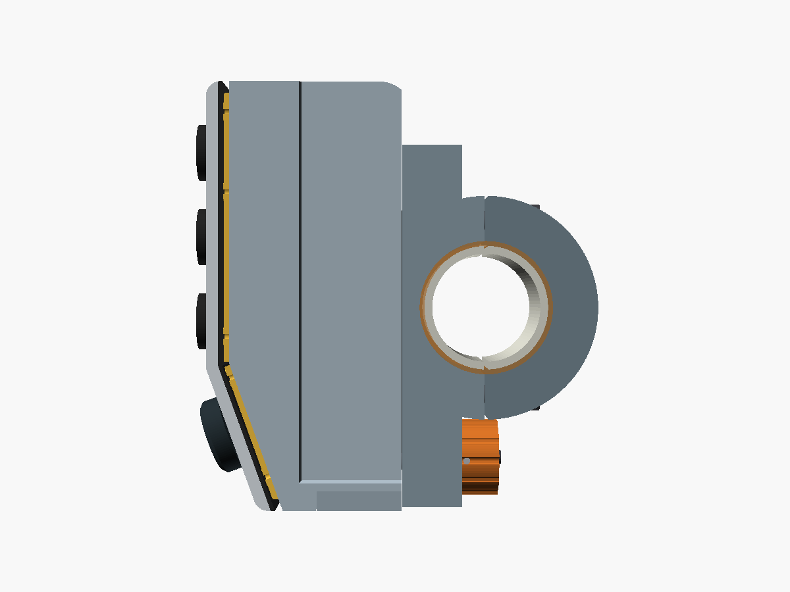
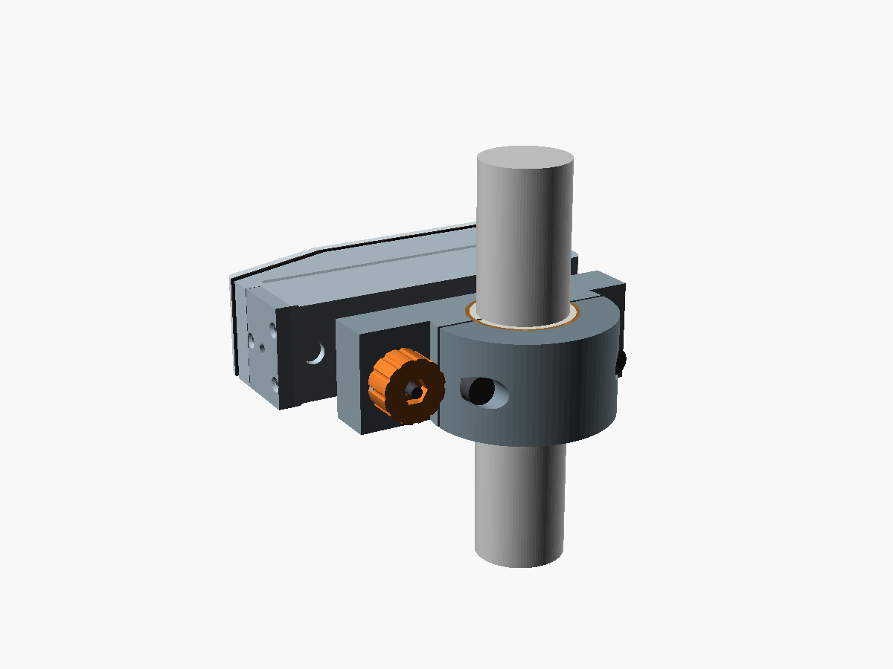

# Manual de usuario — firmware 0.13.0

> Traducción al castellano de [user-manual.md](user-manual.md). La versión en inglés es la de referencia; si las dos difieren, vale la inglesa.

Este manual es para el piloto: cómo usar el mando una vez montado. Para construir uno, ver la [guía de construcción](build-guide.es.md).

**Estado:** el firmware es de banco. Su README dice que no sirve para usarlo mientras se conduce. Los tiempos de abajo son valores de prototipo y pueden cambiar. Todavía no se ha usado ningún mando completo en una moto. Este manual sigue la versión de firmware de su título.

## Índice

1. [Controles](#controls)
2. [En la moto](#on-the-bike)
3. [Carga](#charging)
4. [Emparejar](#pairing)
5. [Encender y apagar](#switching-on-and-off)
6. [Perfiles](#profiles)
7. [Qué hace cada control](#what-each-control-does)
8. [Configurar las apps](#setting-up-the-apps)
9. [Actualizar el firmware](#firmware-updates)
10. [Cuidados](#care)
11. [Problemas](#problems)
12. [Límites conocidos](#known-limits)

## Controles

- **Botones A, B y C**, de arriba abajo, en la cara superior.
- **Joystick** en la cara inferior. Se inclina arriba, abajo, a la izquierda o a la derecha.
- **Centro del joystick:** empuja la palanca recta hacia dentro.

Un botón distingue tres gestos: pulsación corta, pulsación larga (mantenida 0,6 s; 2 s para las puestas a cero de TerraPirata) y doble pulsación (dos pulsaciones en menos de 0,3 s). Cada perfil usa solo algunos.

## En la moto

**Para ponerlo:**
1. Tira del pomo del cierre, bajo la base, y mantenlo.
2. Apoya el mando en la plataforma, 9 mm por debajo de su posición de uso.
3. Deslízalo hacia arriba hasta que haga tope.
4. Suelta el pomo. El cierre hace clic.

**Para quitarlo:** tira del pomo del cierre, desliza el mando hacia abajo y sácalo.

## Carga

1. Quita el mando de la base. El puerto de carga está en su cara trasera, bajo la plataforma.
2. Enchufa cualquier cargador y cable USB-C.
3. El LED rojo junto al puerto se enciende mientras la batería carga y se apaga cuando está llena.

Una carga completa tarda unas 3–4 horas, según una estimación (no medida). El mando funciona mientras carga. Con el USB enchufado no se apaga.

El mando envía su nivel de batería por Bluetooth. Algunos teléfonos lo muestran en los ajustes de Bluetooth; una app que lea el nivel de batería Bluetooth también lo muestra. No se ha comprobado qué teléfonos lo muestran. Cuando la batería baja mucho, el mando se apaga solo.

## Emparejar

1. Despierta el mando: pulsa cualquier botón.
2. En menos de 2 minutos, abre los ajustes de Bluetooth del teléfono y empareja **Open Rally Remote**. Se empareja como un teclado. Pasados 2 minutos los teléfonos nuevos ya no ven el mando; apágalo y enciéndelo otra vez para emparejar.
3. Abre la app. Cada perfil sirve para una app; ver [Perfiles](#profiles).

Después, el teléfono se reconecta solo, alrededor de 1 s después de que el mando despierte.

## Encender y apagar

- **Encender:** pulsa cualquier botón o inclina el joystick. Esa pulsación solo despierta el mando; no se envía a la app.
- **Apagar:** mantén A, B y C juntos 3 s y suéltalos. El mando se duerme.
- **Apagado automático:** tras 6 horas sin pulsar nada.
- **Batería baja:** el mando se apaga solo.
- **Con el USB enchufado** el mando no se apaga nunca.

## Perfiles

El mando tiene tres perfiles. Guarda el elegido al apagarse. El primer arranque usa TerraPirata.

| Botón | Perfil | Para |
|---|---|---|
| A | TerraPirata | TerraPirata Rally Roadbooks |
| B | Teclado | DMD² y otras apps que dejan asignar teclas |
| C | Gestos | OsmAnd |

**Para elegir un perfil:**
1. Mantén el centro del joystick 5 s y suéltalo.
2. En los 5 s siguientes, pulsa y suelta A, B o C.
3. El mando se reinicia en ese perfil. El teléfono se reconecta sin volver a emparejar.

Si no pulsas nada, o pulsas dos botones a la vez, no cambia nada. Elegir el perfil que ya está activo tampoco cambia nada. Mientras eliges, no se envía ninguna tecla a la app.

## Qué hace cada control

Pulsación corta / larga / doble. Un guion es que no hace nada.

| Control | TerraPirata | Teclado | Gestos (OsmAnd) |
|---|---|---|---|
| A | — / poner a cero el parcial (2 s; confirmar en la pantalla) / — | mantiene `A` | orientación del mapa / navegación / siguiente perfil de OsmAnd |
| B | — / poner a cero el total (2 s) / — | mantiene `B` | alejar / búsqueda / — |
| C | bloquear o desbloquear la pantalla / — / — | mantiene `C` | acercar / bloqueo de pantalla / — |
| Joystick arriba, abajo | desplazar el roadbook | flechas | mover el mapa |
| Joystick izquierda, derecha | parcial − / + | flechas | mover el mapa |
| Centro del joystick | — | `D` en pulsación corta o doble | mi posición |

- **TerraPirata:** las pulsaciones cortas de A y B no hacen nada, así que una pulsación sin querer no pone nada a cero. La puesta a cero del parcial abre el diálogo de TerraPirata; toca la pantalla para aceptarlo.
- **Teclado:** cada botón mantiene su tecla mientras lo pulsas. La app mide ella misma las pulsaciones cortas y largas.
- **Gestos:** una pulsación de A espera 0,3 s por si llega una segunda. B y C actúan al momento.

Las teclas detrás de cada acción están en el [mapa de controles](control-mapping.es.md).

## Configurar las apps

- **TerraPirata:** no hay que configurar nada. Probado en Android; iOS sin probar.
- **OsmAnd:** en cada perfil de OsmAnd que uses en la moto, abre *Dispositivos de entrada externos*:
  - Android: *Menú → Configurar perfil → Ajustes generales → Otros → Dispositivos de entrada externos*.
  - iOS: *Menú → Ajustes → Perfiles de la app → Ajustes generales → Dispositivos de entrada externos*.

  Elige el tipo "Teclado" que trae OsmAnd, y funciona todo salvo el bloqueo de pantalla. Para tener también el bloqueo, crea un tipo propio y asigna cada tecla de la [tabla de OsmAnd](control-mapping.es.md#osmand-android-e-ios), y `x` a "Bloqueo de la pantalla táctil". iOS sin probar.
- **DMD²:** usa el perfil de teclado y asigna las teclas en los ajustes de mando genérico (Generic Remote) de DMD². DMD² puede pedir una licencia para ello. Las asignaciones aún no se han probado.

## Actualizar el firmware

Las actualizaciones se hacen por Bluetooth desde un teléfono Android con nRF Connect for Mobile. No hace falta abrir el mando. Usa el teléfono emparejado con el mando y enchufa antes el mando a un cargador USB: sin las dos cosas, el mando rechaza la actualización. Los pasos están en el [README del firmware](../firmware/xiao-nrf52840/README.es.md#actualizacion-ble). Las versiones nuevas se publicarán como [releases de GitHub](../firmware/xiao-nrf52840/README.es.md#releases); todavía no hay ninguna.

## Cuidados

- **No abras el mando** si no hace falta. Cada apertura afecta a las juntas.
- **Agua:** el mando está sellado contra la lluvia. No uses una hidrolimpiadora con él. Su protección no está probada.
- **Limpieza:** un trapo húmedo. Mantén los disolventes y el combustible lejos de las teclas.
- **Puerto de carga:** déjalo secar antes de cargar. En la moto lo tapa la base.
- **Batería:**
  - Guarda el mando con la batería a la mitad, más o menos, si no vas a salir en meses.
  - No lo dejes en un coche cerrado al sol.
  - Si la caja se hincha o se calienta, deja de usarlo.

## Problemas

| Problema | Prueba |
|---|---|
| El teléfono no conecta | Pulsa un botón para despertar el mando. Si sigue sin conectar, borra **Open Rally Remote** de los dispositivos Bluetooth del teléfono, apaga y enciende el mando, y empareja otra vez en menos de 2 minutos. |
| Una pulsación no hace nada | Revisa el perfil: elígelo otra vez (ver [Perfiles](#profiles)). Revisa los ajustes de teclas de la app. |
| El mando no despierta | Cárgalo. |
| Un teléfono nuevo no ve el mando, o se desconecta tras emparejar | Apaga y enciende el mando, y empareja en menos de 2 minutos. |
| nRF Connect no puede iniciar una actualización | Enchufa el mando a un cargador USB y usa el teléfono emparejado con él. |
| Tras una actualización cancelada el mando no reconecta | Fuerza la detención de nRF Connect en el teléfono y despierta el mando. |
| El LED rojo sigue encendido muchas horas | Puede que el cargador no termine la carga (un punto abierto del diseño). Desenchufa el cargador. |

## Límites conocidos

- **Sin luz de estado durante el uso.** La única luz de estado del mando está dentro de la caja. La batería baja y el apagado no se ven. Mira el nivel de batería en el teléfono. Se propone una luz de estado en el LED de carga para una revisión futura de las placas; necesita placas nuevas.
- **Actualizaciones sin firma.** Solo el teléfono emparejado, con el mando alimentado por USB, puede iniciar una actualización. Una vez iniciada, el mando acepta cualquier archivo de firmware.
- **Firmware de banco**, sin probar conduciendo.
