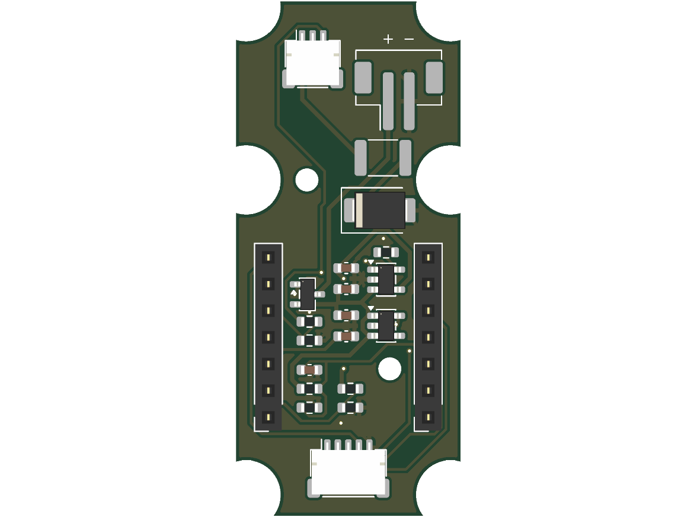

# Control Board (V0.26)

The control board sits behind the upper facet of the V0.26 remote. Its front carries the three button switches; its back carries the XIAO nRF52840 in two female headers, the LiPo charger, the 3.3 V regulator and the connectors for the joystick board, the USB-C charging board and the battery. It is ordered assembled, so the builder does not solder. The design is in the [no-solder assembly spec](../../docs/superpowers/specs/2026-10-14-no-solder-assembly-design.md).

## Parts

Checked in the JLCPCB parts library on 2026-10-14. Stock and prices change; check again before ordering. "Extended" parts add JLCPCB's extended-part fee per unique part.

| Function | Part | LCSC | Library | Stock | Notes |
|---|---|---|---|---|---|
| Button switches ×3 | C&K KSC221JLFS | C221726 | Extended | 17,354 | Same switch as the joystick board |
| LiPo charger | Microchip MCP73831T-2ACI/OT, SOT-23-5 | C424093 | Extended | 11,479 | 4.20 V. Charge current 1000 V / R_PROG: 10 kΩ gives 100 mA. STAT is low while charging, high when done, high-impedance with no input |
| 3.3 V regulator | TI TPS70933DBVR, SOT-23-5 | C89347 | Extended | 45,791 | 1 µA quiescent, 2.7–30 V input, reverse current protection ([TI](https://www.ti.com/product/TPS709)), 300 mV typical dropout |
| Battery reverse-polarity protection | AO3401A P-MOSFET, SOT-23 | C15127 | Basic | 605,007 | In the battery line, conducting both ways when the cell is the right way round |
| 5 V input fuse | Bourns MF-MSMF050-2, 1812 PTC | C17313 | — | — | As on the V0.23 joystick board |
| 5 V input TVS | Littelfuse SMBJ5.0A | C83333 | Extended | 45,298 | 65 µA leakage at 5 V; the other SMBJ5.0A listed, C78423, leaks 800 µA (both checked 2026-10-15) |
| Joystick socket (5-pin) | JST SH-compatible "1.0-5P WT", side entry, SMD | C2906271 | Extended | 14,999 | Genuine SM05B-SRSS-TB: C136657, 158 in stock |
| USB-C board socket (3-pin) | JST SH-compatible "1.0-3P WT", side entry, SMD | C2906269 | Extended | 13,209 | Genuine SM03B-SRSS-TB: none in stock |
| Battery socket (2-pin) | JST B2B-PH-SM4-TB(LF)(SN), top entry, SMD | C160352 | Extended | 89,576 | Side entry (S2B-PH-SM4-TB, C295747) was dropped: its plug had no room toward the wall |
| XIAO headers ×2 | 2.54 mm 1×7 female, 5.7 mm high, through hole | C55218877 | Extended | 644 | Standard 8.5 mm alternative: C54876729, 2,409 in stock |

The XIAO nRF52840 is in the JLCPCB library (C37327670 and others) with no stock, so the XIAO is bought separately with pins and plugged in. The PTC and TVS stock was not rechecked.

### USB-C charging receptacle

The GCT USB4736-GF-A is listed in the JLCPCB library only through global sourcing (C9900206672), with no JLCPCB stock on 2026-10-14. JLCPCB buys such parts from a distributor for the order. No other sealed receptacle that keeps the CC pins was found in the library.

### Cables

Retail, pre-crimped at both ends. Amazon listings were not found through web search; that does not mean there are none.

| Cable | Source found | Length |
|---|---|---|
| JST SH-style 5-pin, female–female, 1 mm | [Pololu 5-pin JST SH-style cables](https://www.pololu.com/category/350/5-pin-jst-sh-style-cables) | 10 cm shortest |
| JST SH-style 3-pin, female–female, 1 mm | Pololu's 3-pin range (not checked) | 10 cm shortest |
| JST PH 2-pin extension, male–female | [BerryBase](https://www.berrybase.de/en/extension-cable-2-pin-jst-ph-2.0mm-male-female-awg24-50cm) | 50 cm; shorter not found |

The routes need about 3 cm (joystick) and 4 cm (USB-C). The spare length of a 10 cm cable has to be stowed inside; the CAD checks this. The "1.0 WT" sockets are sold as JST SH compatible; check that a Pololu plug latches in one before ordering the board.

### XIAO pins

The board position depends on the pre-soldered XIAO's header: the plastic spacer height and the pin length below it. Neither is published by Seeed; measure them on the bench XIAO. A pin longer than the 5.7 mm socket is deep holds the XIAO higher than the spacer would.

## Circuit decisions

- **STAT to the XIAO.** The MCP73831's STAT is a three-state push-pull output: low while charging, high (about VDD − 0.4 V, so about 4.6 V from USB-C) when charging ends, high impedance with no input. D8 reads it through a 100 kΩ / 150 kΩ divider: at most about 2.8 V. The charge LED on the USB-C board hangs from VBUS to STAT through its resistor, so it lights only while STAT is low (charging).
- **VBUS to the XIAO.** D9 reads VBUS through a 100 kΩ / 150 kΩ divider: 3.0 V at 5.0 V, 3.15 V at 5.25 V. (Until the 2026-10-15 review it was 100k/200k, 3.3–3.5 V: with a low cell the XIAO's 3V3 rail sits near 3.0 V, and the nRF52840's pin limit is VDD + 0.3 V.)
- **Battery voltage.** A0 reads the cell through a 1 MΩ / 1 MΩ divider with 100 nF to ground: 2.1 V at 4.2 V, about 2 µA drawn from the cell.
- **Different socket sizes.** The joystick socket has 5 pins, the USB-C one 3 and the battery one is a 2-pin PH: no cable fits the wrong socket.

## Review

An independent review on 2026-10-15 (a fresh Claude session reading the files and the TI SBVS186H, Microchip DS20001984H and AOS AO3401A datasheets) found no critical defect. It changed R3/R5 to 150k, C3/C4 to 4.7 µF (the TPS709 needs 1.5 µF effective at its output) and D1 to the low-leakage SMBJ5.0A, and raised the open points listed under Checks. Not verified by it: the XIAO regulator's reverse leakage and its 3V3-rail capacitance, the System OFF current, the KSC2 internal contact pairs, and the LED's cathode pad against the Lite-On drawing.

## Board

A 21.4 × 49 mm, 1.6 mm two-layer board, notched round the six upper cover-screw bosses so it lifts out with the cover (see `ctrl_pcb_*` in `mechanical/cad/complete-remote-v0.26.scad`). Board x is the CAD's Z − 11.5, board y is 16.5 − Y.

- **Front** (toward the cover): SW1–SW3 under keys A, B and C, at Y = 33, 15 and −3. Each switch uses a diagonal pad pair, as on the joystick board.
- **Back:** the two XIAO headers (pin 1 at the XIAO's USB-C end, D0–D6 on the −Z side), the charger, the regulator, Q1 and the dividers under the XIAO, J3 (USB-C board, side entry, opening down toward the USB-C board's socket) and J5 (battery, top entry: the pouch lead plugs in from behind, toward the pouch) at the top, J4 (joystick) at the bottom, F1 and D1 between them.
- **Holes:** two M2 holes onto the button plate standoffs, at Y = 24 and Y = 6, 3.95 mm either side of the centre line so the standoffs clear the key holes in the button plate.
- **Routing:** Freerouting 1.9.0, with ground pours on both layers. Track keep-outs round the notches hold the 0.3 mm edge clearance.



## Regenerating

`design.py` holds the outline, placement and nets. From this directory:

```
/Applications/KiCad/KiCad.app/Contents/Frameworks/Python.framework/Versions/Current/bin/python3 gen_pcb.py
```

`gen_pcb.py` places the parts, routes the board with Freerouting (`FREEROUTING_JAR`, default `~/.arduino-orr/tools/freerouting-1.9.0.jar`; Freerouting 2.x needs Java 25), fills the pours, writes `control.kicad_pcb` and calls `gen_sch.py` for `control.kicad_sch`. Freerouting may route differently on each run. Then check and export:

```
K=/Applications/KiCad/KiCad.app/Contents/MacOS/kicad-cli
$K sch erc --severity-all control.kicad_sch
$K pcb drc --schematic-parity --severity-all control.kicad_pcb
$K pcb export gerbers --layers F.Cu,B.Cu,F.Paste,B.Paste,F.SilkS,B.SilkS,F.Mask,B.Mask,Edge.Cuts --subtract-soldermask -o fab/gerbers/ control.kicad_pcb
$K pcb export drill --format excellon --excellon-separate-th --generate-map --map-format gerberx2 -o fab/gerbers/ control.kicad_pcb
$K sch export bom --fields 'Reference,Value,Footprint,Manufacturer,MPN,LCSC,${QUANTITY}' --labels 'Reference,Value,Footprint,Manufacturer,MPN,LCSC,Qty' --group-by 'Value,Footprint' --exclude-dnp -o fab/control-bom.csv control.kicad_sch
$K pcb export pos --format csv --units mm --side both --exclude-dnp -o fab/control-pos.csv control.kicad_pcb
python3 jlc_cpl.py
```

## Checks

Run on 2026-10-14, and again on 2026-10-15 after the J5 polarity marks and the review fixes (R3/R5 150k, C3/C4 4.7 µF, D1 C83333); same results, Freerouting routed it again:

- ERC: 0 errors. The 72 warnings say only that kicad-cli has no global symbol and footprint library tables configured.
- DRC with schematic parity: 0 errors, 0 unconnected pads, 0 footprint errors; the 22 warnings are the same library-table notice.
- **Battery plugged in reversed:** without USB, Q1's body diode is reverse-biased and its gate-source voltage stays at 0 V, so no current flows. With USB plugged in, the charger raises BAT_SYS until Q1 turns on and its preconditioning current (about 10 mA) flows into the reversed cell: not dangerous, but the cell slowly discharges and the charge LED lights. Unplug and turn the plug round.
- **XIAO's own USB-C plugged in with the battery in:** the XIAO's regulator drives 3V3 too; the TPS70933's reverse current protection stops current flowing back into it.
- **Charger with no battery:** the MCP73831 holds BAT_SYS near 4.2 V, so the remote runs on USB power alone. With no cell, the charger may cycle, and the charge LED and D8 may flicker; this was not checked.
- **Battery polarity:** J5 pin 1 is BAT and pin 2 GND, marked "+" and "−" on the rear silkscreen beside it (added 2026-10-15). A 602045 cell's plug, looked at from its mating end with the latch up, has red on the right: SparkFun's convention for pin 1 = +, which matches. JST's PH drawing marks circuit No. 1 on the plug and the header, but its small views do not settle which side the latch is on, so this is not confirmed from the drawing. Check the plug with a meter against the marks before plugging it in; Q1 protects the board if it is reversed.
- **Charge termination (open):** the MCP73831 ends charging when its output current falls below 7.5 % of 100 mA (5.6–9.4 mA). That current includes the XIAO's load through U2, and the firmware stays awake on USB (`SLEEP_ON_USB = false`). If the XIAO draws more than about 5.6 mA on average, charging never ends: the cell stays at 4.2 V and the LED stays lit. Measure the XIAO's awake current; if it is close, let the firmware sleep on USB once charged, or raise the charge current (R1) within the cell's rating.
- **Overvoltage (accepted risk):** the SMBJ5.0A clamps at about 9.2 V, above the MCP73831's 7.0 V absolute maximum. The 5.1 kΩ CC resistors on the USB-C board ask only for 5 V, so a working charger never gives more; a faulty 9–12 V source could damage U1 before F1 trips.
- **No battery:** STAT is high impedance and R3 pulls D8 low, so the firmware reads "charging". Harmless; noted for the firmware.
- **Wrong socket:** J3, J4 and J5 have 3, 5 and 2 pins in two different series; no cable fits a socket it does not belong to.
- **Assembly:** parts on both sides (switches on the front; headers, power parts and sockets on the back), so the order needs double-sided assembly. The headers are through-hole. Check every part's rotation in JLCPCB's placement preview: the CPL uses KiCad's rotations.
