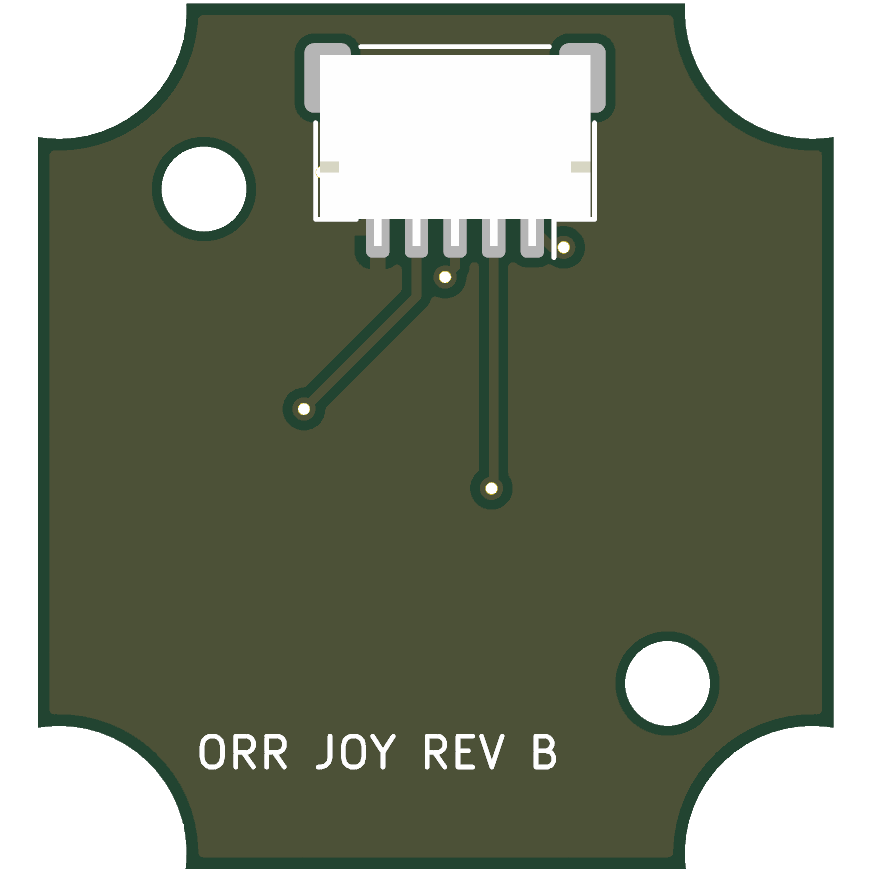

# Joystick Board, Rev B (V0.26)

**Superseded by [rev C](../joystick-pcb-rev-c/README.md) (V0.27).** With rev B, the V0.26 housing cannot close onto the board in a straight line: the lower cover bosses hit its upper notches and its upper screw ([path check](../../docs/assembly-video-v0.26-checks.md)). Do not order it.

Rev B of the [joystick board](../joystick-pcb/README.md) for the no-solder V0.26 remote ([spec](../../docs/superpowers/specs/2026-10-14-no-solder-assembly-design.md)). The outline, the four C&K KSC221JLFS switches and the two standoff holes are those of rev A. The changes:

- The 5 V input protection (PTC fuse and TVS) moves to the [control board](../control-pcb/README.md).
- The wire pads become one JST SH-compatible 5-pin side-entry socket (J1, LCSC C2906271) on the rear, below the stick axis, opening up the facet toward the control board; the plug lies over the rear face.

| J1 pin | Signal |
|---|---|
| 1 | UP |
| 2 | DOWN |
| 3 | LEFT |
| 4 | RIGHT |
| 5 | GND |

J1 has the same order as J4 on the control board, so a straight double-ended 5-pin JST SH cable (pin 1 to pin 1) joins them. Check that the bought cable is straight and not reversed before fitting it.

## Regenerating and checks

`design.py` reuses the rev A outline from `../joystick-pcb/design.py` and holds the placement and nets. `gen_pcb.py` and `gen_sch.py` are shared with the control board: run `gen_pcb.py` with KiCad's Python, then the ERC, DRC and export commands in the [control board README](../control-pcb/README.md#regenerating), with `joystick` in place of `control`.

On 2026-10-14: ERC 0 errors; DRC with schematic parity 0 errors and 0 unconnected pads (the remaining warnings say only that kicad-cli has no library tables). The board needs double-sided assembly: switches on the front, the socket on the rear.
