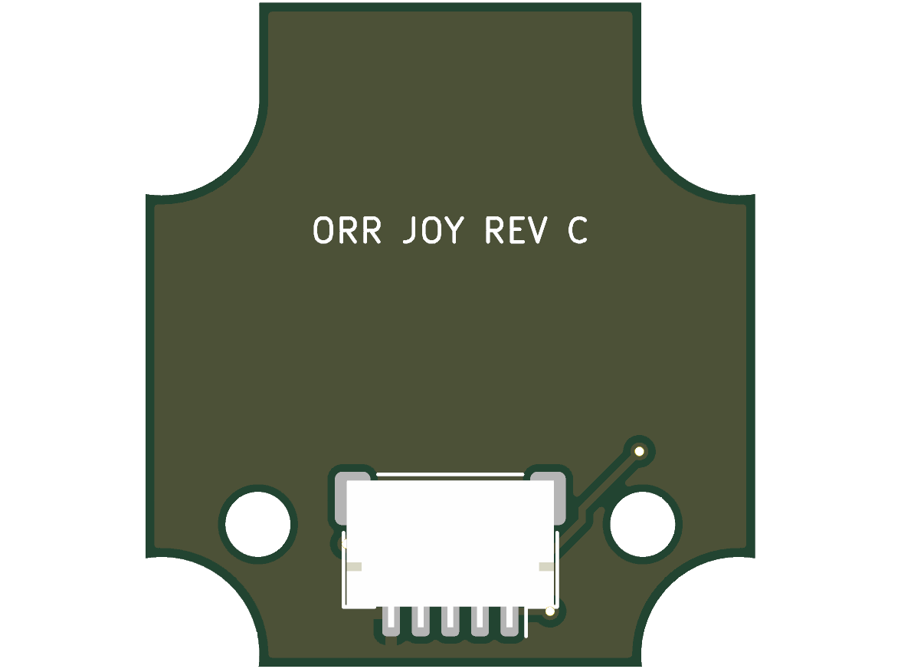

# Joystick Board, Rev C (V0.27)

Rev C of the joystick board, for V0.27. It is [rev B](../joystick-pcb-rev-b/README.md) with three changes, so the housing can close onto the stack, and the cover come off, in a straight line along the remote's X axis ([V0.27 changes from V0.26](../../docs/mechanical-concept.md#v027-changes-from-v026-still-current)):

- The two notches toward the fold (board y = −11.0) become slots running 3.0 mm down the facet (`SLOT` in `design.py`, `joy_pcb_slot` in the CAD). The lower cover bosses slide that way, 0.34 mm per millimetre, as the housing moves along X.
- The two standoff holes move to the lower half, at (±6.5, 6.4) in board coordinates. The upper half has no room for a screw between the switches and the slots.
- J1 moves from (1.0, 7.4) to (0.0, 7.4), to pass between the two screw heads.

The switches, the nets and the J1 pinout are those of rev B:

| J1 pin | Signal |
|---|---|
| 1 | UP |
| 2 | DOWN |
| 3 | LEFT |
| 4 | RIGHT |
| 5 | GND |

J1 has the same order as J4 on the control board, so a straight double-ended 5-pin JST SH cable (pin 1 to pin 1) joins them. Check that the bought cable is straight and not reversed before fitting it.

## Clearances

Board coordinates, mm, from `design.py` and the KiCad footprints:

| Between | Clearance |
|---|---|
| Slot edge and the nearest switch pad | 0.67 |
| Standoff (Ø3.6) and the nearest switch pad | 0.82 |
| Standoff and the nearest switch body | 1.35 |
| Standoff courtyard (R1.9) and the side-switch and J1 courtyards | 0.2 |
| Screw head (Ø3.5) and J1, each side | 0.35 |
| Standoff and the lower notch edge | 0.37 |

## Regenerating and checks

`design.py` builds the outline with the slots and holds the placement and nets. `gen_pcb.py` and `gen_sch.py` are shared with the control board: run `gen_pcb.py` with KiCad's Python, then the ERC, DRC and export commands in the [control board README](../control-pcb/README.md#regenerating), with `joystick` in place of `control`. The rear render is `kicad-cli pcb render --side bottom --width 1200 --height 900 -o fab/render-back.png joystick.kicad_pcb`.

On 2026-10-14: ERC 0 errors (the 9 warnings say only that kicad-cli has no library tables); DRC with schematic parity 0 errors and 0 unconnected pads (one library-table warning). Placing the standoffs at (±6.8, 6.0) first gave two courtyard overlaps with the side switches; (±6.5, 6.4) clears them. The board needs double-sided assembly: switches on the front, the socket on the rear. Check the parts' rotations in JLCPCB's placement preview.
