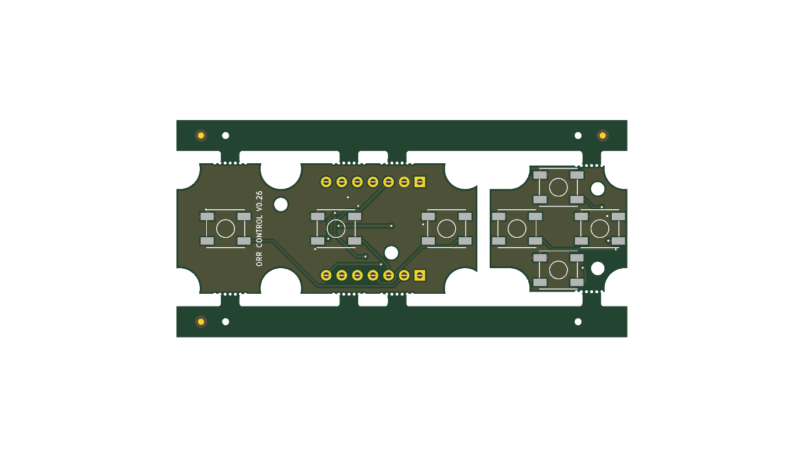
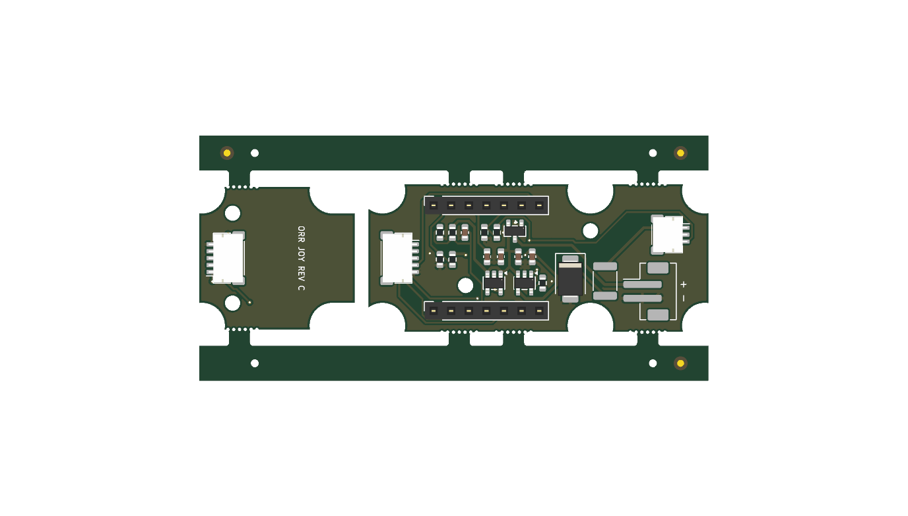

# Panel: Control Board and Joystick Board Rev C (V0.31)

One JLCPCB order for the [control board](../control-pcb/README.md) and the [joystick board rev C](../joystick-pcb-rev-c/README.md). Both are 1.6 mm and carry parts on both sides, so each needs JLCPCB's Standard (double-sided) assembly. Ordered apart, each pays its own setup and stencil (about 51 + 16 USD each on 2026-10-15); in one panel they pay one, plus a panel fee of about 8 USD and an unverified fee for a second design. The [USB-C board rev B](../usbc-pcb-rev-b/README.md) is 1.2 mm (the GCT USB4736 asks for 1.20 ± 0.10 mm) and single-sided, so it is ordered on its own.





## Layout

- 73.5 × 35.5 mm: the control board turned 90°, the joystick board turned 90° beside it, 2 mm apart.
- 5 mm rails top and bottom, 2 mm from the boards, with three fiducials (Ø1 mm copper, Ø2 mm opening) and four Ø1.152 mm tooling holes.
- Mouse-bite tabs to the rails only (Ø0.5 mm holes every 0.8 mm, centred on the board edge). No tab joins the two boards: it would sit at the control board's J4.
- Control board: 3 mm tabs where its edge runs straight, at least 1 mm from any part's courtyard; three per long edge.
- Joystick board: turned so its J1 edge faces the panel's open side. One 2.4 mm tab on each side edge, between the side switch and the notch; the boss slots get no tab.
- The joystick board's references move to the 100s (J1 → J101, SW1 → SW101) so they do not clash with the control board's.

To separate the boards, bend each tab off by hand or with pliers and file the edge smooth. Nothing needs soldering.

## Regenerating

KiKit 1.8 runs in a venv on KiCad's Python, so it can import `pcbnew`:

```
/Applications/KiCad/KiCad.app/Contents/Frameworks/Python.framework/Versions/Current/bin/python3 -m venv --system-site-packages ~/.arduino-orr/kikit-venv
~/.arduino-orr/kikit-venv/bin/pip install kikit
~/.arduino-orr/kikit-venv/bin/python gen_panel.py    # panel.kicad_pcb from the two boards
~/.arduino-orr/kikit-venv/bin/python gen_fab.py      # fab/: Gerber zip, BOM, CPL
```

Regenerate the panel whenever either board changes. The BOM comes from the footprints' LCSC fields (the panel has no schematic), one row per LCSC part; the CPL rotations come from `kicad-cli`, as for the single boards.

## Checks

On 2026-10-15, `kicad-cli pcb drc` on the panel: 0 unconnected items. Left, by design: two "NPTH inside courtyard" on the joystick board, where one mouse-bite hole per tab lies inside SW103's and SW104's courtyards, about 0.5 mm from the switch body; the rest are library-table notices. Check every part's rotation in JLCPCB's placement preview before ordering.
