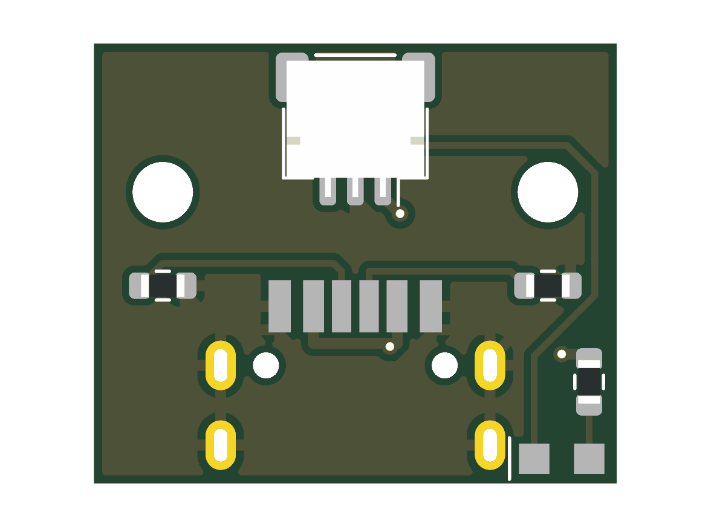

# USB-C Charging Board, Rev B (V0.26)

Rev B of the [USB-C charging board](../usbc-pcb/README.md) for the no-solder V0.26 remote ([spec](../../docs/superpowers/specs/2026-10-14-no-solder-assembly-design.md)). The GCT USB4736 receptacle, the two 5.1 kΩ CC pull-downs and the side-looking charge LED stay at their rev A positions against the rear wall. The changes:

- The wire pads become one JST SH-compatible 3-pin side-entry socket (J2, LCSC C2906269) behind the receptacle, opening into the remote toward the control board.
- The board is 16.0 mm deep instead of 13.6 mm, and the two M2 holes move from x = ±5.4 to ±7.0 mm, to make room for the socket. The CC resistors move beside the receptacle. `usbc_pcb` and `usbc_pcb_holes` in `mechanical/cad/complete-remote-v0.26.scad` follow.
- **Charge LED.** D1's anode goes to VBUS through R3 (1 kΩ); its cathode goes to J2 pin 3 and on to the charger's STAT pin on the control board. STAT is low only while the cell charges, so the LED lights only then, powered from the charger, not the cell. About 3 mA at 5 V. The firmware no longer drives it.

| J2 pin | Signal |
|---|---|
| 1 | VBUS |
| 2 | GND |
| 3 | LED cathode (to the charger's STAT) |

J2 has the same order as J3 on the control board, for a straight double-ended 3-pin JST SH cable. Check that the bought cable is straight.

The receptacle is in the JLCPCB library only through global sourcing (C9900206672), with no JLCPCB stock on 2026-10-14. GCT fits the USBTJ-06 gasket after the receptacle is soldered.

## Receptacle footprint

`orr:GCT_USB4736` was drawn by hand from GCT's drawing USB4736, revision A, 9 April 2025, sheet 1, "Recommended PCB Layout". Checked against that drawing on 2026-10-14:

| Feature | Drawing | Footprint |
|---|---|---|
| Signal pads: width; centres across | 0.80 (B12, A12), 0.76 (B9, A9), 0.70 (A5, B5); ±2.75, ±1.52, ±0.50 | Same |
| Signal pads: length; distance from the PCB edge | 1.90; 5.50–7.40 (1.40 + 2.90 + 3.10) | Same. Until this check, the pads sat at 5.40–7.30 mm, 0.10 mm toward the edge |
| Shell slots: centres; drill; pad | ±4.895 (9.79 apart), 1.40 and 4.30 from the edge; 0.50 × 1.20; 1.10 × 1.80 | Same |
| Locating holes | Ø0.95, ±3.25 (6.50 apart), 4.30 from the edge | Same |
| Pin order, seen from the top | B12, B9, A5, B5, A9, A12, left to right | Same |
| Nose past the PCB edge | 1.70 (3.10 from the nose to the first shell slot, less 1.40) | 1.70 |

The terminal feet (bottom view: 2.20 to 2.60 mm behind the locating posts, so 6.50–6.90 mm from the edge) sit inside the pads either way. Check again against the footprint JLCPCB uses for the global-sourcing part (C9900206672) when ordering.

## Regenerating and checks

`gen_pcb.py` and `gen_sch.py` are shared with the control board: run `gen_pcb.py` with KiCad's Python, then the ERC, DRC and export commands in the [control board README](../control-pcb/README.md#regenerating), with `usbc` in place of `control`.

On 2026-10-14, again after the footprint fix: ERC 0 errors; DRC with schematic parity 0 errors and 0 unconnected pads (the remaining warnings say only that kicad-cli has no library tables).
