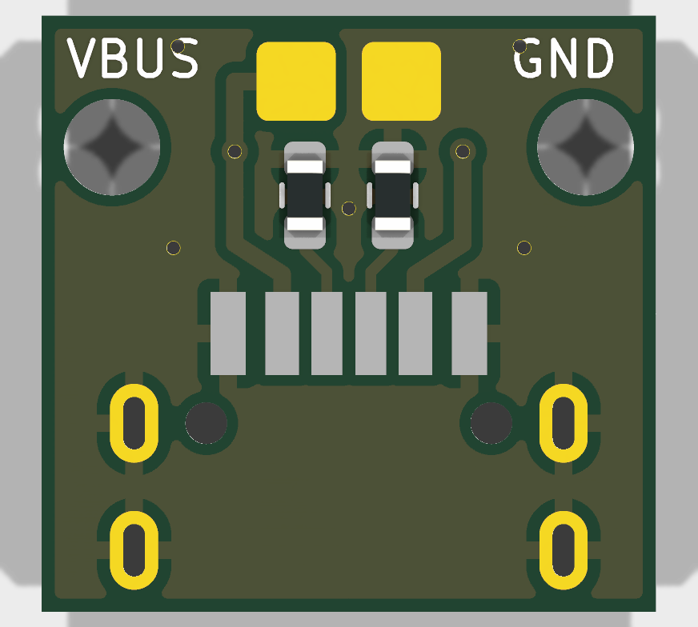
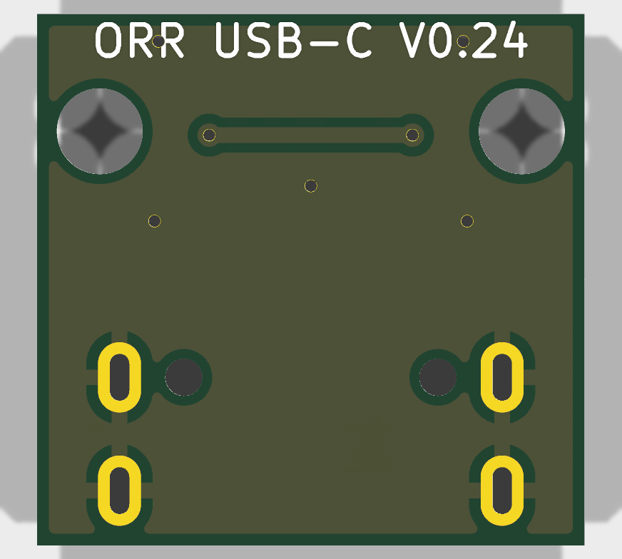
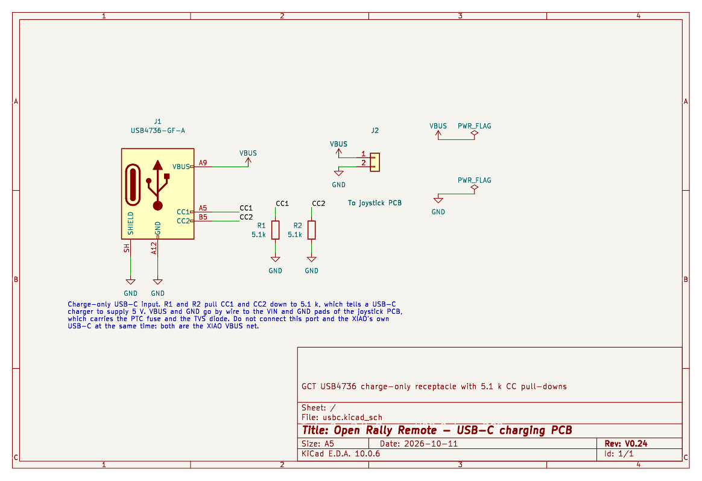

# USB-C Charging PCB — V0.24

The USB-C charging PCB carries the sealed receptacle that charges the V0.24 remote off the bike ([CAD](../../mechanical/cad/complete-remote-v0.24.scad), [notes](../../docs/mechanical-concept.md), [battery study](../../docs/battery-study.md)). It sits inside the remote's rear wall, above the dovetail groove, where the base covers the port on the bike.







Status: designed and checked in KiCad (ERC, DRC and schematic parity clean, apart from the library-table warnings described under [Regenerating](#regenerating)). Not yet built.

## Board

- Two layers, **1.2 mm** FR-4, 1 oz copper. GCT recommends a 1.20 ± 0.10 mm board for the USB4736: its shell stakes are sized for it. Ground pour on both sides.
- Outline 14.0 × 13.6 mm. The receptacle sits on the front edge; its nose overhangs the edge by 1.70 mm.
- Rules as on the joystick PCB: 0.2 mm clearance, 0.25 mm signal tracks, 0.4 mm VBUS tracks, 0.6/0.3 mm vias, 0.3 mm copper to edge.
- Two Ø2.2 mm holes for M2 × 4 thread-forming screws (button head, at most Ø3.5 × 1.1 mm) into a rib in the housing. They hold the board so the receptacle squeezes its gasket against the wall.
- The footprint (`orr:GCT_USB4736`) follows GCT's recommended PCB layout (drawing USB4736, revision A, 9 April 2025): six SMD pads, four plated oval slots (0.50 × 1.20 mm drill) for the shell stakes, and two Ø0.95 mm locating holes.

Board coordinates are seen from the top (component side): x runs along the bar, y = 0 is the front edge and −y runs into the remote.

## Circuit

| Net | Pins | To |
|---|---|---|
| VBUS | A9, B9 | Wire pad VBUS, to the VIN pad of the joystick PCB |
| GND | A12, B12, shell | Wire pad GND, to the GND pad of the joystick PCB |
| CC1, CC2 | A5, B5 | R1, R2, 5.1 kΩ to GND |

- **CC pull-downs.** A USB-C charger only turns VBUS on when the device pulls CC down through 5.1 kΩ. With R1 and R2, any USB-C charger supplies 5 V; USB-A to C cables supply it anyway.
- **Protection.** The joystick PCB carries the PTC fuse and the TVS diode on its VIN input; this board has none.
- **Two USB-C ports.** This port and the XIAO's own USB-C are the same VBUS net (see the [joystick PCB notes](../joystick-pcb/README.md#circuit)). Never connect both at once.
- This port only charges. The XIAO's USB-C stays for programming, with the cover off.

## Placement against the enclosure

The CAD (`usbc_*` values) places the board flat, components up, with its front edge 2.23 mm behind the remote's rear face. It checks it against the housing, the XIAO and its slide-in path, the pouch, the buttons, the joystick and the USB-C plug, with no overlap:
- **Panel.** The wall is thinned to GCT's 1.80 mm panel, with a 9.14 × 3.36 mm slot and an 11.00 × 5.90 × 0.60 mm gasket pocket. The receptacle's nose sits 0.53 mm back from the rear face.
- **Gasket.** The USBTJ-06 gasket (0.90 mm) is squeezed to about 0.53 mm, 41 %; GCT asks for 35–45 %, at least 0.315 mm.
- **Support.** The board rests on a rib that spans the cavity and takes the two screws.

## Parts

| Ref | Part | Source |
|---|---|---|
| J1 | GCT USB4736-GF-A-KIT: receptacle with USBTJ-06 gasket | DigiKey, Mouser, Farnell, TME (not on LCSC or Amazon) |
| R1, R2 | 5.1 kΩ 1 % 0603, UNI-ROYAL 0603WAF5101T5E | LCSC C23186 (JLCPCB basic part) |
| J2 | Wire pads (no part) | — |

The LCSC number was checked against the LCSC and JLCPCB listings on 2026-10-11; stock and prices change.

GCT fits the gasket after the receptacle is soldered. The cheapest route is to order the board with R1 and R2 assembled and to hand-solder J1: its pads are 0.70–0.80 mm wide at 1.0–1.23 mm pitch, and the four shell stakes go through plated slots.

## Fabrication files

`fab/` holds the outputs for the current board:
- `usbc-gerbers.zip` and `gerbers/`: copper, mask, paste, silkscreen, outline, and separate plated (with the oval slots) and non-plated Excellon drill files. Order the board at 1.2 mm.
- `usbc-bom.csv`: grouped BOM with MPN and LCSC numbers.
- `usbc-pos.csv`: placement file (KiCad format, mm). Check the rotations in the assembler's preview.
- `usbc-schematic.pdf`.

## Regenerating

The board and schematic are generated by script, as for the joystick PCB. Edit `design.py` (placement, nets, routing), then run from this directory:

```
/Applications/KiCad/KiCad.app/Contents/Frameworks/Python.framework/Versions/Current/bin/python3 gen_pcb.py
```

`gen_pcb.py` writes `usbc.kicad_pcb` and calls `gen_sch.py` for `usbc.kicad_sch`; `gen_sch.py` reuses the joystick PCB's schematic writer. Then check and export:

```
K=/Applications/KiCad/KiCad.app/Contents/MacOS/kicad-cli
$K sch erc --severity-all usbc.kicad_sch
$K pcb drc --schematic-parity --severity-all usbc.kicad_pcb
$K pcb export gerbers --layers F.Cu,B.Cu,F.Paste,B.Paste,F.SilkS,B.SilkS,F.Mask,B.Mask,Edge.Cuts --subtract-soldermask -o fab/gerbers/ usbc.kicad_pcb
$K pcb export drill --format excellon --excellon-separate-th --generate-map --map-format gerberx2 -o fab/gerbers/ usbc.kicad_pcb
$K pcb export pos --format csv --units mm --side both --exclude-dnp -o fab/usbc-pos.csv usbc.kicad_pcb
$K sch export bom --fields 'Reference,Value,Footprint,Manufacturer,MPN,LCSC,${QUANTITY}' --labels 'Reference,Value,Footprint,Manufacturer,MPN,LCSC,Qty' --group-by 'Value,Footprint' --exclude-dnp -o fab/usbc-bom.csv usbc.kicad_sch
$K sch export pdf -o fab/usbc-schematic.pdf usbc.kicad_sch
```

Tested with KiCad 10.0.6 on macOS. Without a configured KiCad (no global library tables), ERC and DRC report that the stock `Connector`, `Device`, `power`, `Resistor_SMD` and `MountingHole` libraries are not configured; those warnings go away once KiCad has been opened once.

The joystick PCB's local `orr` footprints are not shared: this board has its own `orr.pretty` with the USB4736 footprint and a copy of the two-pad wire footprint.

## Open points

- Check the footprint against the real part, or against GCT's footprint files, before ordering: it was drawn by hand from the PDF drawing.
- Find a source for the USB4736 that sells to individuals in small quantities, for builders.
- The thread-forming screw pilot (Ø1.6 mm, `usbc_pilot_d`) needs checking against the chosen screw.
